# tafs

**They taf. You kiff.**

tafs is an app for iPhone, iPad and Android where a business hands jobs to AI agents, called tafs, and
gives each one a Card: the limits it works inside. Inside the Card a taf acts and
leaves a receipt. Outside it, the taf waits for the owner's answer on their phone.
Revoked, no new action goes through. tafs is in a closed test on Android and on
TestFlight for iPhone and iPad.

Cards are enforced by [KIFF](https://kiff.dev): every action a taf takes passes
through KIFF's gateway, which checks the Card before any call reaches a tool.

<p>
  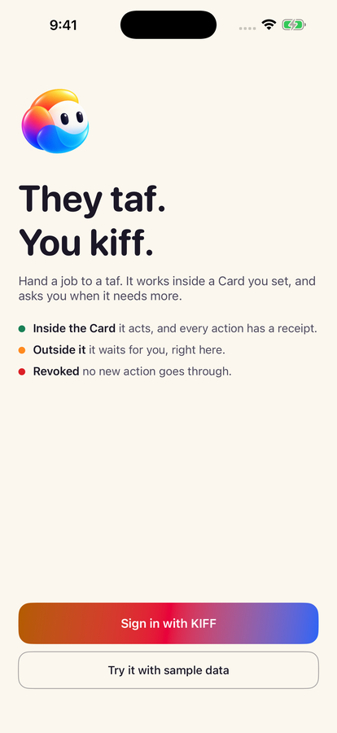
  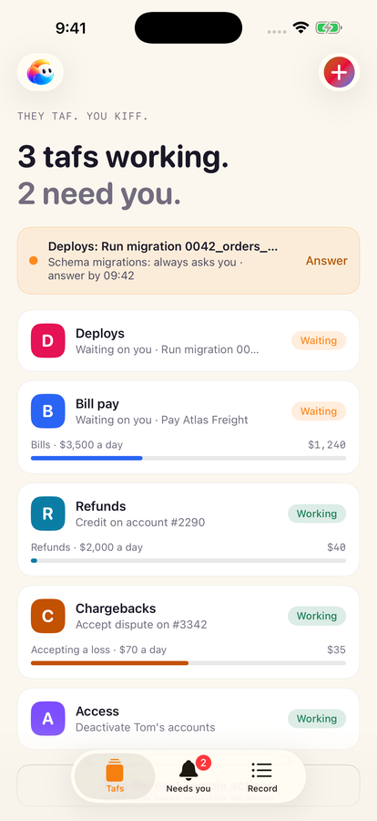
  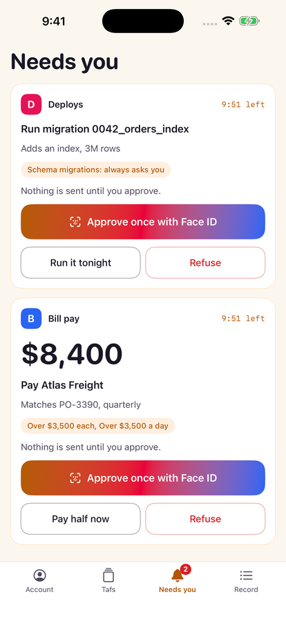
  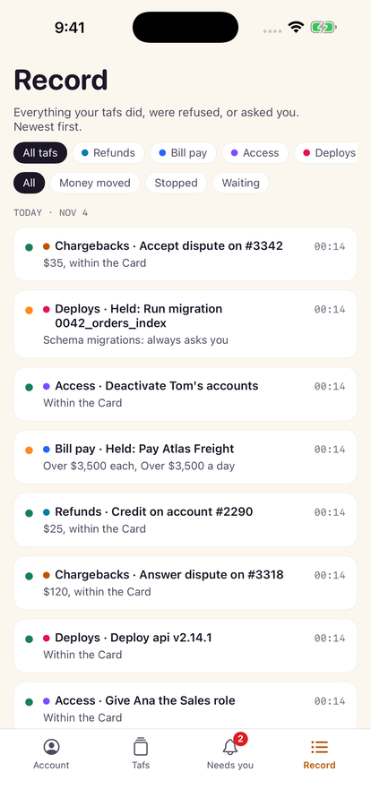
  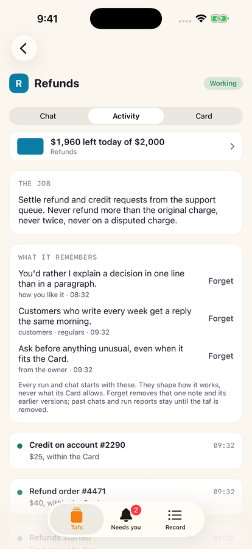
  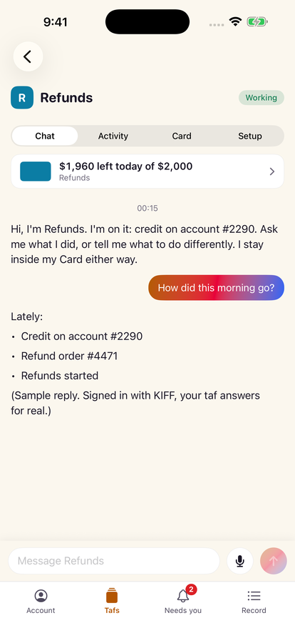
  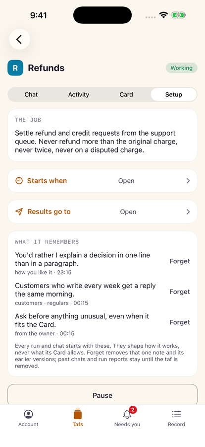
  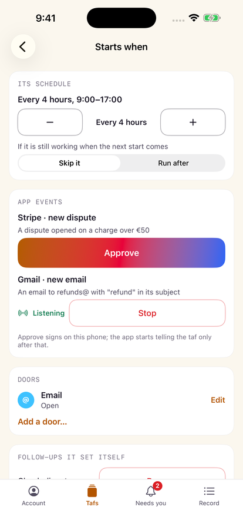
  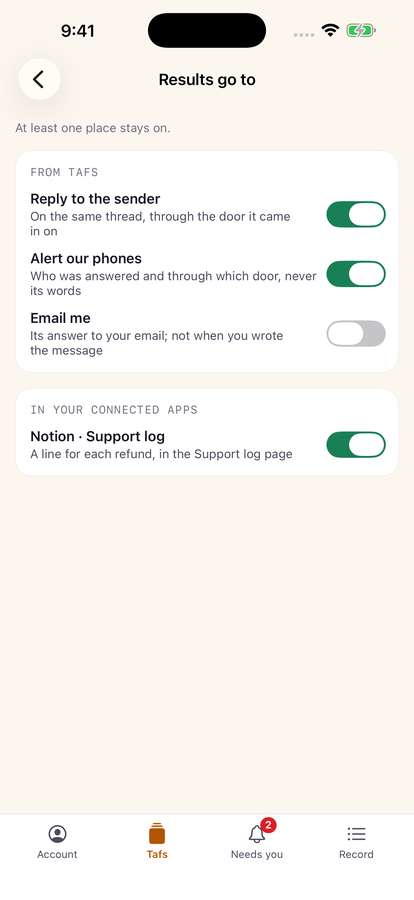
  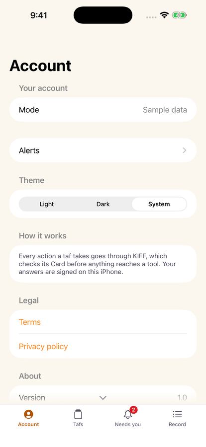
  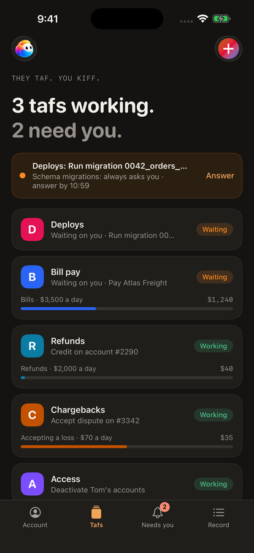
  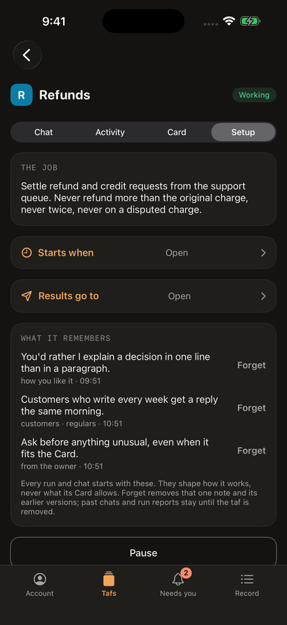
  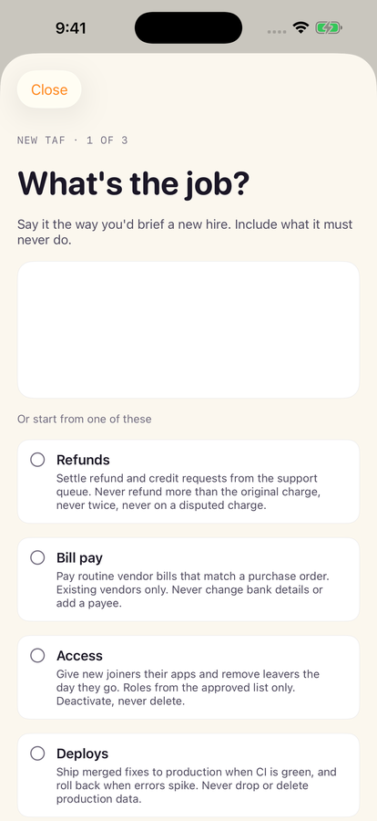
</p>

On iPad:

<p>
  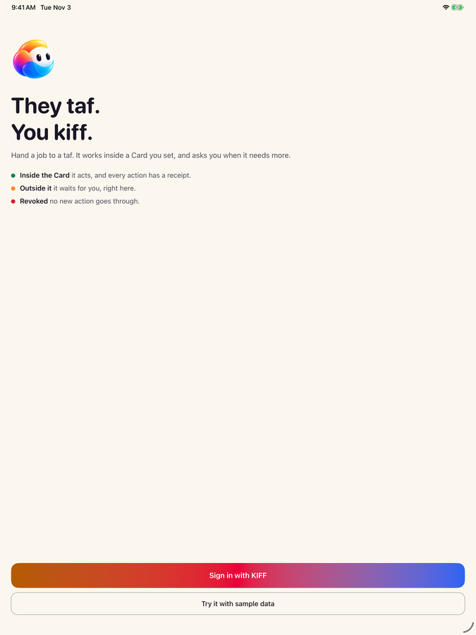
  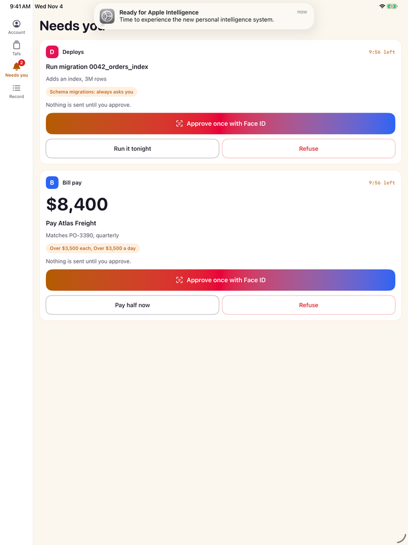
  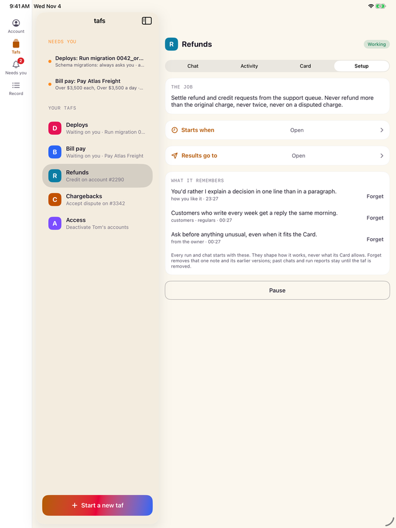
  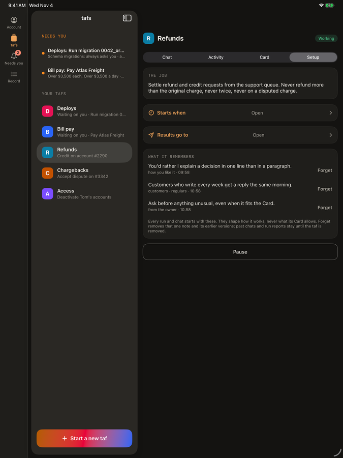
</p>

On Android: the bar, a taf's Setup and its Starts when, Results go to, Activity and Record
by taf in dark:

<p>
  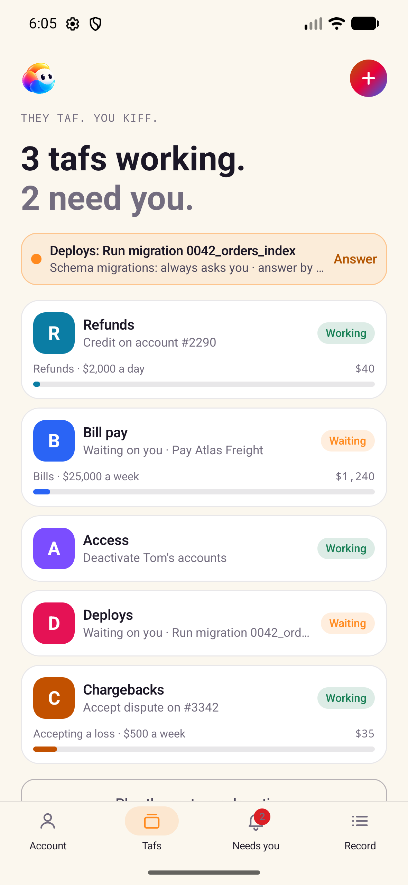
  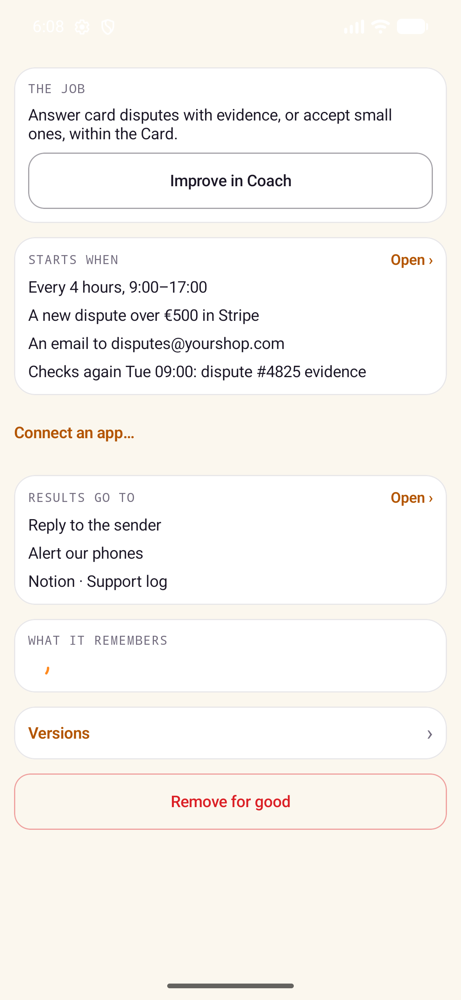
  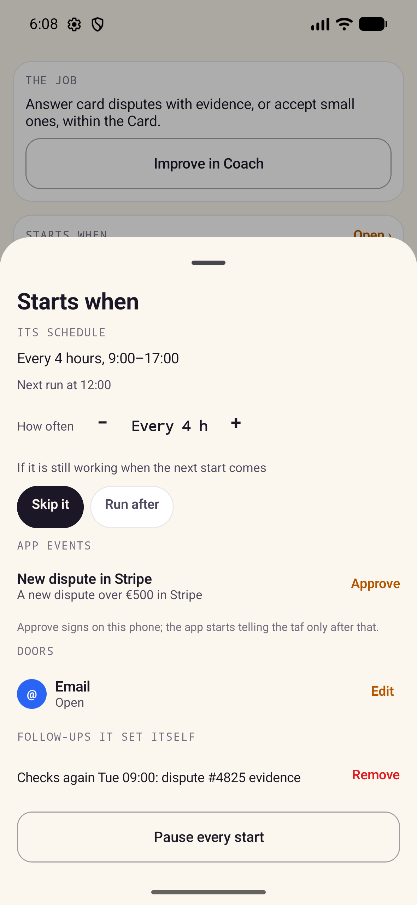
  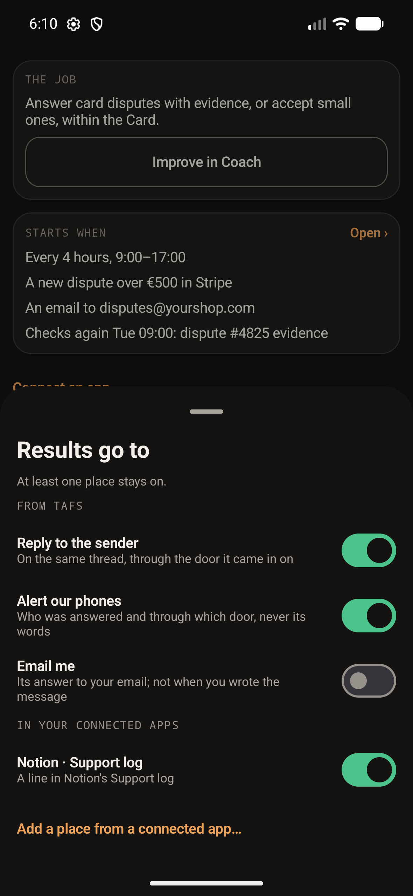
  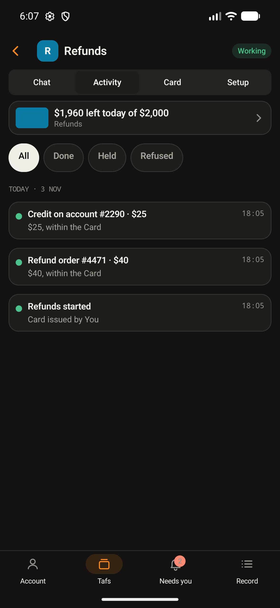
  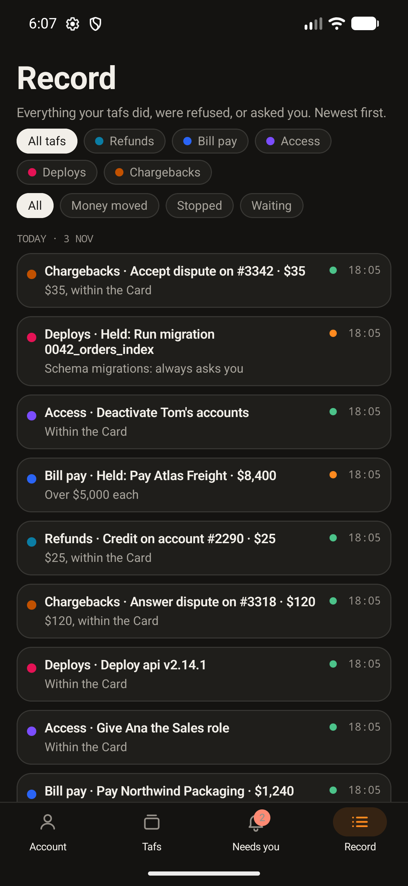
</p>

Screenshots come from CI, with sample data. On iOS, a run that changes a screen
uploads them as the `screenshots` artifact; other changes skip them. On Android,
the UI tests draw them from synthetic data ([docs/android-app.md](docs/android-app.md)).

## The first five jobs

Each is a consequential job companies want agents to do and are afraid to let
them do.

| Taf | What it does | Card, for example |
|---|---|---|
| Refunds | Settles refund and credit requests from the support queue | ≤ $150 each, $2,000 a day; payouts never |
| Bill pay | Pays vendor bills that match a purchase order | ≤ $5,000 each, $25,000 a week; wires always ask; bank detail changes never |
| Access | Gives joiners their apps, removes leavers | Approved roles only; elevated access always asks; admin and deleting users never |
| Deploys | Ships fixes when CI is green, rolls back | 10 deploys a day; migrations always ask; dropping data never |
| Chargebacks | Answers card disputes with evidence | Evidence ≤ $500 each; accepting a loss ≤ $100 each |

## What it does

A working app for iPhone and iPad (SwiftUI) and for Android phones and tablets
(Kotlin and Jetpack Compose, Android 11 and later), in two modes: signed in with
KIFF, or with sample data on the phone. Both use the same public routes of KIFF,
tafs cloud and planque. Each feature has a page in [docs/](docs/README.md):

- **[A taf](docs/tafs.md):** its job, Cards, runs, reports, memory and Record; pausing,
  halting and removing it.
- **[Chat](docs/chat.md):** ask a taf what it did or tell it what to do; its answer and
  its work stream as it goes, and a held call shows where it was made.
- **[The app's screens](docs/taf-screen.md):** a bar with Account, Tafs, Needs you,
  Record and Coach; the Record filtered by taf; each taf's Chat, Activity, Card and Setup.
  Setup says what starts it (schedule, app events you approve, doors, follow-ups, Pause)
  and where its results go. Changes wait as the taf's next version until you make them
  live. Light and dark.
- **[Coach mode](docs/coach.md):** say the job; Coach connects the tools, drafts the taf,
  its Card and how it runs, and you confirm with Face ID, Touch ID or your fingerprint. Improve a taf, try a new
  version under a trial Card, then install it.
- **[Held calls](docs/approvals.md):** in Needs you, the chat, the lock screen and a push
  alert. Approve once, refuse, or give the Card extra room: each answer is signed on the
  phone and checked by KIFF. **Did this happen?** asks about a money call whose outcome
  KIFF can't prove; No gives the Card its room back.
- **[Connect apps](docs/connect-apps.md)**, from Settings: the apps a taf can work in,
  searched as you type, each approved on the phone before you sign in at the app.
- **[Accounts](docs/accounts.md):** sign in with KIFF, people and groups, sharing a taf,
  usage, Solo and task packs through the App Store or Google Play, deleting the account.
- **[Photos and files](docs/attachments.md)** on a message, and **[doors](docs/doors.md)**:
  an email address, a Slack channel or a WhatsApp number a taf takes work from.

How the pieces fit: [docs/README.md](docs/README.md). The API: [docs/api.md](docs/api.md).
Where tafs data lives, for how long, and who deletes it: [docs/data.md](docs/data.md).
What tafs still needs from KIFF: [docs/needs-from-kiff.md](docs/needs-from-kiff.md).

## The runtime

Every taf runs on [kiff/agents](https://github.com/kiff/agents), tafs's own
agent runtime: stored definitions, runs that pause on a held call and go on
when it is answered, chats, notes and schedules, in the EU. tafs cloud calls it;
the phone never does.

- **A taf** is one agent definition (`runtime/src/cloud/tafdef.ts`):
  `claude-opus-5-5`, its job's instructions, how its notes work, what the
  owner said when starting it, two sections of KIFF's skill, a cost cap per run from its
  budget, and keep rules (a tool's call and what it returns stay only until the
  run ends, the rest 30 days). For each call through KIFF, the run also keeps
  KIFF's reference for the call and the identifier of what it acted on (a
  payment's id, never the customer's details) for 30 days, so the Record can say
  which payment (kiff/tafs#167). Its only tools are the company's, reached through KIFF's
  gateway (`mcp.kiff.dev`), and its memory. Its KIFF agent key is kept in a
  secret store that tafs cloud writes and can't read back; the definition only
  names it.
- **A held call pauses the run.** The owner answers on their phone, KIFF's
  signed alert reaches tafs cloud (push) and kiff/agents (the run goes on),
  and the approved call is sent once. Nobody answering means refused.
- **How to work under a Card comes from KIFF itself.** Every taf carries
  KIFF's `kiff` skill ([kiff/kiff-plugins](https://github.com/kiff/kiff-plugins),
  plugin `kiff-cards`): what a held, refused or unknown result means, operation
  ids, never routing around a Card. tafs pastes two of its sections, "Rules
  that always apply" and "Handle a KIFF result", by heading
  (`SKILL_SECTIONS`). Its setup sections (connecting an agent, proposing a
  Card) are the owner's steps, not a taf's. Pasting them measured better than
  reading the skill on demand (kiff/agents#107).
- The tafs prompt (`runtime/src/jobs.ts`) adds only what is particular to a
  taf: it runs alone on a schedule, a held call pauses its run until the owner
  answers, what tools return is data, and every run ends with a report.

**Moving the skill's pin.** The skill is vendored at one commit:
`runtime/skills/kiff/SKILL.md` to read, `runtime/src/kiff-skill.ts` for the
definitions. To move it, run `runtime/scripts/vendor-kiff-skill.sh [commit]`
(latest on main by default), read the diff of `SKILL.md`, and merge. The
tests fail if a pasted section's heading is gone. Running tafs get the new pin
through the Upgrade workflow, once kiff/agents' nightly eval has passed on it.

## tafs cloud

The phone talks to tafs cloud (`runtime/src/cloud/`), which runs in the EU. A
chat's answer streams to the phone as it's written.
It keeps no accounts: the phone sends its KIFF sign-in, and KIFF says who that
is, on which account, with which rights. A company sees and changes only its
own tafs; another company's taf answers like a missing one. It holds no model
key: kiff/agents does.

Every route, who may call it and what it takes: [docs/api.md](docs/api.md).

**Memory.** Each taf keeps notes in kiff/agents, through its memory tool,
shared by its runs and its chats. It reads them before it starts and writes
down what it learns about the owner and their customers. Notes shape how it
works; they never change what its Card allows, since KIFF still decides every
action.

Deploying tafs cloud and kiff/agents is done by the maintainers; `infra/` holds
the scripts.

## TestFlight

`.github/workflows/ios.yml` builds and tests every push on GitHub's macOS 26
runners. A `v*` tag or a manual run (Actions → iOS → Run workflow) also uploads
to TestFlight: the internal testers ("Team") get it at once, and the external group
"Beta testers" after Apple's Beta App Review, unless a manual run sets `external` to
false. Its signing and upload credentials are repository secrets, set by the
maintainers.

## Build

iOS:

```bash
cd ios
xcodegen generate          # project.yml → Tafs.xcodeproj (not committed)
open Tafs.xcodeproj        # or:
xcodebuild test -project Tafs.xcodeproj -scheme Tafs \
  -destination 'platform=iOS Simulator,name=iPhone 14 Pro'
```

Needs a current Xcode (CI uses Xcode 26 on macOS 26) and runs on iOS 16 and
later. App Store builds come from CI.

Android:

```bash
cd android
./gradlew :app:testDebugUnitTest          # the unit tests
./gradlew :app:assembleDebug              # a debug build
./gradlew :app:connectedDebugAndroidTest  # the UI tests, on an emulator or phone
```

Needs a JDK 17 or later. Google Play builds come from CI
([docs/android-app.md](docs/android-app.md#building-and-testing)).

## License

[FSL-1.1-ALv2](LICENSE.md), the Functional Source License. You may use, change
and share tafs for anything except a product that competes with it. Each version
becomes Apache 2.0 two years after its release.

## Contributing and project policies

This public repository is source-available under [FSL-1.1-ALv2](LICENSE.md).
The license contains its future Apache-2.0 grant.

- [Contributing and checks](CONTRIBUTING.md)
- [Report a security issue privately](SECURITY.md)
- [Changelog](CHANGELOG.md)
- [Community conduct](CODE_OF_CONDUCT.md)
- [Instructions for coding agents](AGENTS.md)
- [Maintainer and release checklist](docs/maintaining.md)
