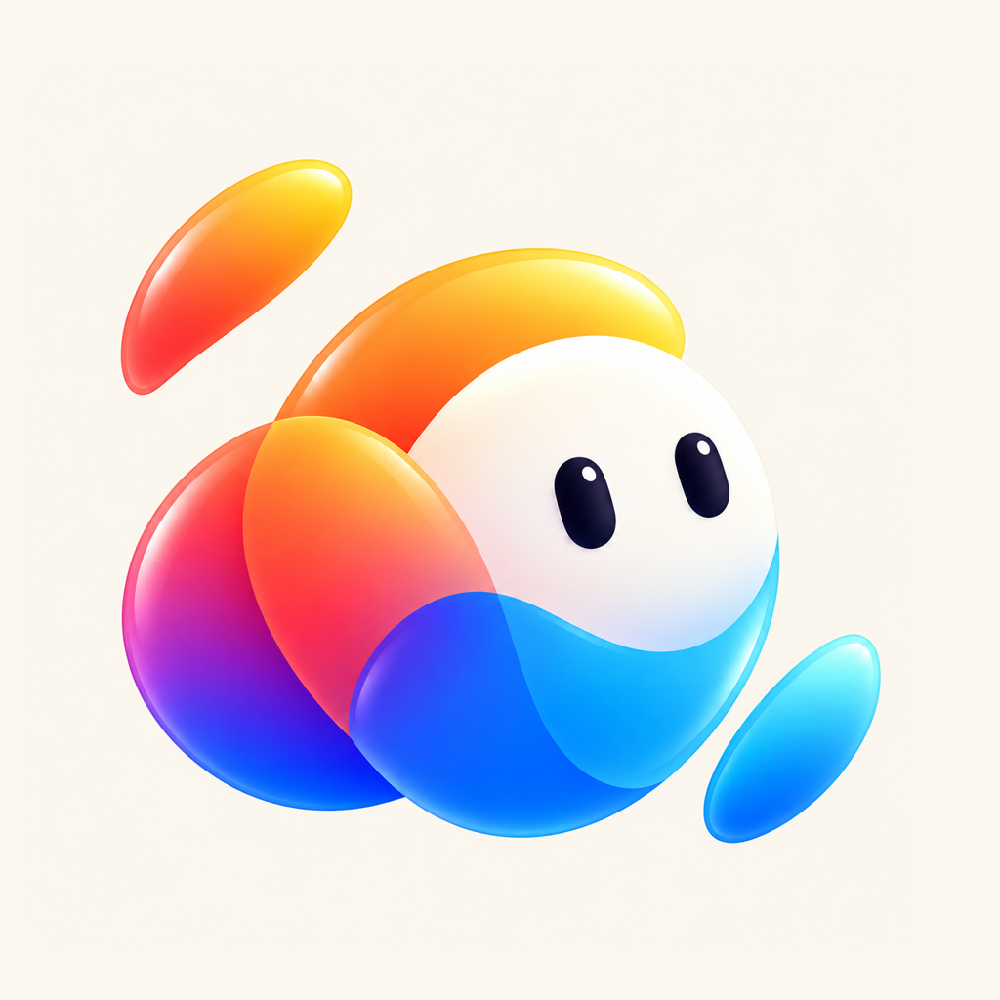
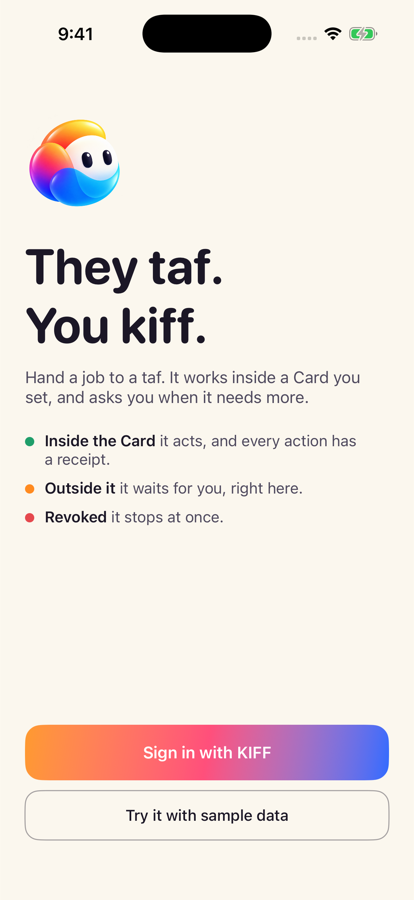
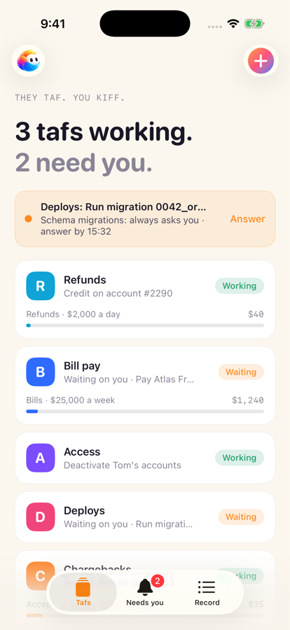
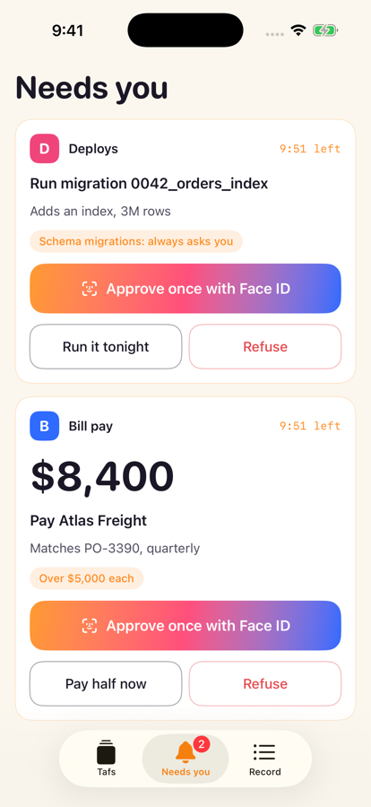
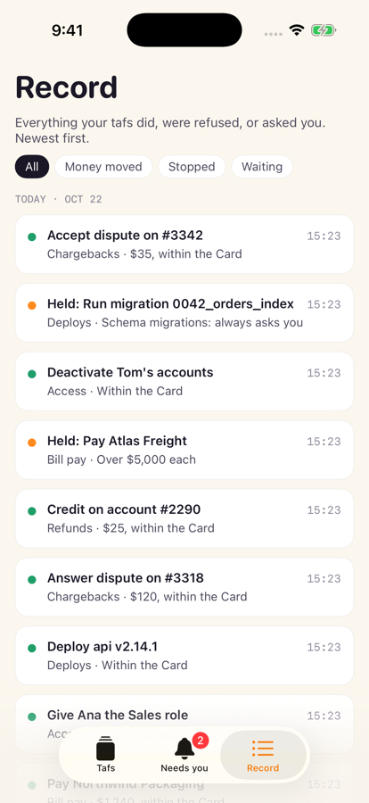
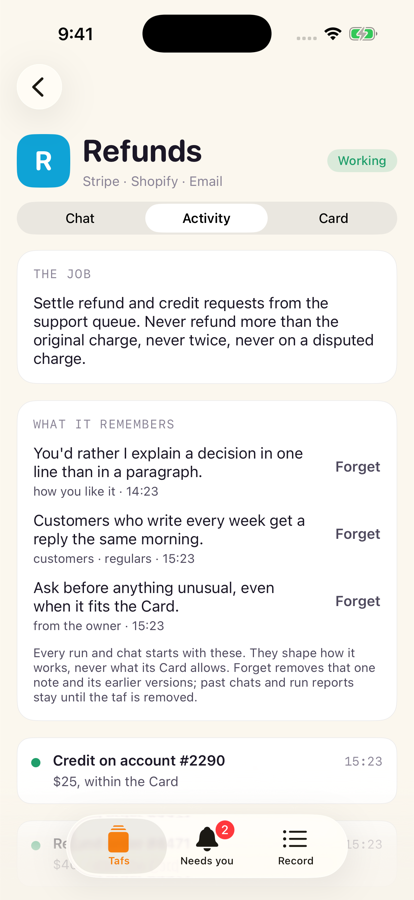
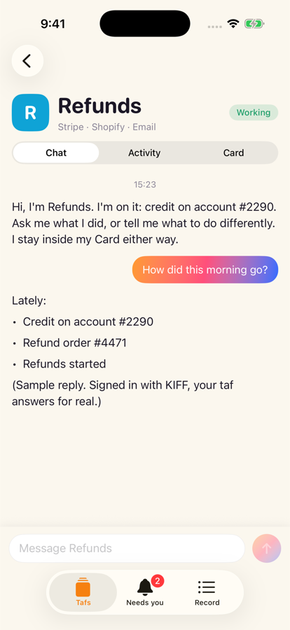
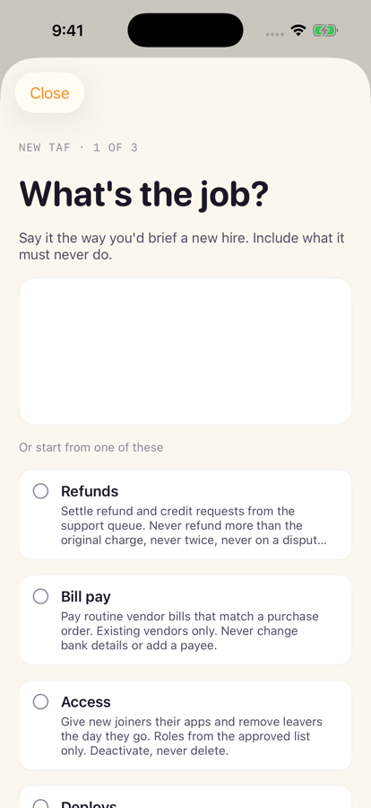
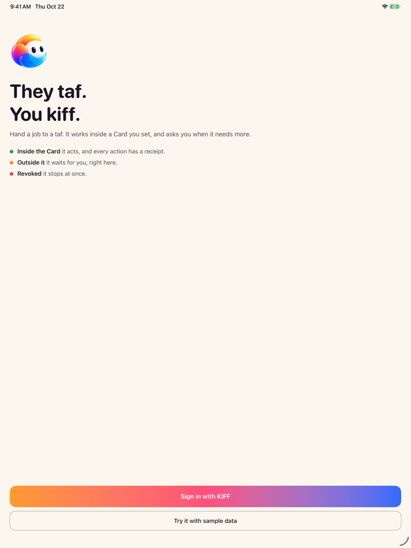
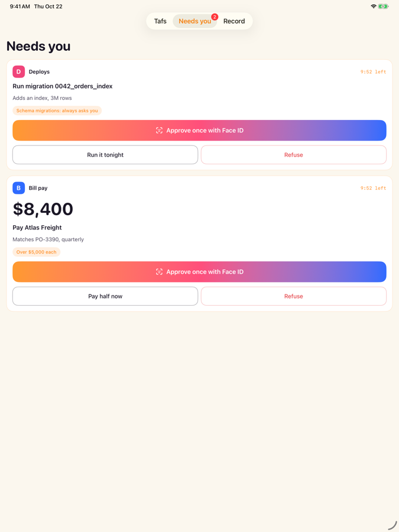

# tafs

**They taf. You kiff.**

tafs is an iPhone app where a business hands jobs to AI agents, called tafs, and
gives each one a Card: the limits it works inside. Inside the Card a taf acts and
leaves a receipt. Outside it, the taf waits for the owner's answer on their phone.
Revoked, it stops at once.

Cards are enforced by [KIFF](https://kiff.dev): every action a taf takes passes
through KIFF's gateway, which checks the Card before any call reaches a tool.

<p>
  
  
  
  
  
  
  
</p>

On iPad:

<p>
  
  
</p>

Screenshots come from CI: a run that changes a screen uploads them as the
`screenshots` artifact. Other changes skip them.

## The first five jobs

Each is a consequential job companies want agents to do and are afraid to let
them do.

| Taf | What it does | Card, for example |
|---|---|---|
| Refunds | Settles refund and credit requests from the support queue | ≤ $150 each, $2,000 a day; payouts never |
| Bill pay | Pays vendor bills that match a purchase order | ≤ $5,000 each, $25,000 a week; wires always ask; bank detail changes never |
| Access | Gives joiners their apps, removes leavers | Approved roles only; elevated access always asks; admin and deleting users never |
| Deploys | Ships fixes when CI is green, rolls back | 10 deploys a day; migrations always ask; dropping data never |
| Chargebacks | Answers card disputes with evidence | Evidence ≤ $500 each; accepting a loss ≤ $100 each |

## Status

Version 0.1. A working iPhone app with two modes.

**Signed in with KIFF**
- Sign in with KIFF's device flow: the phone shows a code and sends its signing
  key; you approve it in your browser, which shows the key's fingerprint.
- Start a taf: pick the job and its tools' limits, confirm with Face ID. The
  phone submits one signed KIFF agent draft holding the taf's Cards; tafs cloud
  claims the agent's key from the confirmed draft and runs the taf, so the key
  never reaches the phone. An editor's draft waits for an admin to confirm it
  in KIFF. A start that fails partway resumes on the next try. When tafs cloud
  refuses it, the app takes the draft's Cards back; if KIFF doesn't confirm
  every revocation, the app says so and the owner revokes the rest in KIFF.
- Your tafs are the agents holding your KIFF Cards (`/v1/me/mandates`), and the
  ones running on tafs cloud: run them now, read their latest report, chat with
  them, and see or remove what they remember.
- Held calls come from KIFF (`/v1/me/card-exceptions`), with amounts in the unit
  KIFF declares. Approve once or refuse them on the phone: each answer is signed
  with KIFF's `kiff.answer.v1` message, and KIFF accepts it only with that
  signature (kiff/kiff-cloud#1218). Revoke a Card from its taf.

**Sample data**
- Five sample tafs (the jobs above) and a morning of work, saved on the phone.
- Start a new taf: say the job, review the drafted Card, issue it with Face ID.
- The Card is checked on the phone in this mode, and chat replies and memory
  are samples, not a model.

**Both**
- Every answer is signed on the phone (Secure Enclave and Face ID on a device).
- The first held call counts down as a Live Activity on the lock screen and in
  the Dynamic Island; each new one posts a notification. For now the app finds
  held calls when it is open. Push alerts while it is closed are next: KIFF's
  side is done (kiff/kiff-cloud#1234), tafs cloud's receiver and Apple push are
  not built yet.
- The Record shows everything, newest first.

What tafs still needs from KIFF is in [docs/needs-from-kiff.md](docs/needs-from-kiff.md).
Where tafs data lives, for how long, and who deletes it: [docs/data.md](docs/data.md).

**Where it's going.** Today tafs has five fixed jobs. Next, a builder agent
designs each taf by conversation, each taf is its own agent holding one or more
Cards, and only its critical tool goes through KIFF. First comes an eval suite
that measures how good a taf is, so every step after it has to keep the score
([#26](https://github.com/kiff/tafs/issues/26)).

## The runtime

Every taf runs on [kiff/agents](https://github.com/kiff/agents), tafs's own
agent runtime: stored definitions, runs that pause on a held call and go on
when it is answered, chats, notes and schedules, in an EU region (eu-west-1).
tafs cloud calls it with its AWS role; the phone never does.

- **A taf** is one agent definition (`runtime/src/cloud/tafdef.ts`):
  `claude-opus-5-5`, its job's instructions, how its notes work, what the
  owner said when starting it, two sections of KIFF's skill, a cost cap per run from its
  budget, and keep rules (a tool's call and what it returns stay only until the
  run ends, the rest 30 days). For each call through KIFF, the run also keeps
  KIFF's reference for the call and the identifier of what it acted on (a
  payment's id, never the customer's details) for 30 days, so the Record can say
  which payment (kiff/tafs#167). Its only tools are the company's, reached through KIFF's
  gateway (`mcp.kiff.dev`), and its memory. Its KIFF agent key is in Secrets
  Manager, which tafs cloud writes and can't read back; the definition only
  names it.
- **A held call pauses the run.** The owner answers on their phone, KIFF's
  signed alert reaches tafs cloud (push) and kiff/agents (the run goes on),
  and the approved call is sent once. Nobody answering means refused.
- **How to work under a Card comes from KIFF itself.** Every taf carries
  KIFF's `kiff` skill ([kiff/kiff-plugins](https://github.com/kiff/kiff-plugins),
  plugin `kiff-cards`): what a held, refused or unknown result means, operation
  ids, never routing around a Card. tafs pastes two of its sections, "Rules
  that always apply" and "Handle a KIFF result", by heading
  (`SKILL_SECTIONS`). Its setup sections (connecting an agent, proposing a
  Card) are the owner's steps, not a taf's. Pasting them measured better than
  reading the skill on demand (kiff/agents#107).
- The tafs prompt (`runtime/src/jobs.ts`) adds only what is particular to a
  taf: it runs alone on a schedule, a held call pauses its run until the owner
  answers, what tools return is data, and every run ends with a report.

**Moving the skill's pin.** The skill is vendored at one commit:
`runtime/skills/kiff/SKILL.md` to read, `runtime/src/kiff-skill.ts` for the
definitions. To move it, run `runtime/scripts/vendor-kiff-skill.sh [commit]`
(latest on main by default), read the diff of `SKILL.md`, and merge. The
tests fail if a pasted section's heading is gone. Running tafs get the new pin
through the Upgrade workflow, once kiff/agents' nightly eval has passed on it.

## tafs cloud

The phone talks to tafs cloud (`runtime/src/cloud/`), an AWS Lambda behind a
function URL, at `https://qvjurway3eczrk7pqorfuy7z5y0vuztq.lambda-url.us-east-1.on.aws`.
It keeps no accounts: the phone sends its KIFF sign-in, and KIFF says who that
is, on which account, with which rights. A company sees and changes only its
own tafs; another company's taf answers like a missing one. It holds no model
key: kiff/agents does.

| Route | Who | What |
|---|---|---|
| `GET /v1/jobs` | anyone | the five jobs |
| `GET /v1/tafs` | a person signed in with KIFF | the account's tafs, and removals not finished |
| `POST /v1/tafs` | `cards.manage` | start a taf: `{name, job, draft_id + claim_secret, cron?, timezone?, budget_cents?, notes?}`. tafs cloud claims the agent's key from the confirmed KIFF draft once the name is held, so the key never reaches the phone, and keeps it in Secrets Manager. A claim works once, so the draft is kept on record (the taf it is starting, never the key): a retry with the same draft, secret and name resumes from there. A draft whose key was claimed but never kept answers 410; the app then tries to take its Cards back and says which ones the owner must revoke in KIFF if it can't. `agent_key` instead of a draft is still accepted. `notes` (at most 2000 characters) go into the taf's instructions. The key must be an agent's key on the same KIFF account. At most every 15 minutes, at most $10 a run. It runs once at once |
| `POST /v1/tafs/{id}/pause`, `resume`, `run` | `cards.manage` | its schedule off or on; run now |
| `GET /v1/tafs/{id}/runs`, `runs/{session}` | a person | recent runs, and a run's report (a run waiting on the owner is still running) |
| `GET /v1/tafs/{id}/conversation` | a person | the taf's thread: its last 5 runs and last 5 chats, oldest first, at most 100 messages `{at, from: owner\|taf, kind: kickoff\|message, text, session}` |
| `POST /v1/tafs/{id}/messages` | `cards.manage` | `{text}`, 1 to 2000 characters: a run in the latest chat if it was active in the last 30 minutes, else in a new chat. `{session, new_session}`. At most 10 a taf in 10 minutes |
| `GET /v1/tafs/{id}/memory` | a person | what the taf remembers, newest first: `{notes: [{id, path, content, updated_at}]}` (a note's name is its id) |
| `DELETE /v1/tafs/{id}/memory/{note}` | `cards.manage` | forget one note |
| `DELETE /v1/tafs/{id}` | `cards.manage` | remove it for good: kiff/agents withdraws its held calls and deletes its schedule, runs, chats and notes, then its key and its name go. Nothing else is deleted unless the first step worked; a second remove finishes what the first left. Answers `{done, removed, failed}`. The phone revokes its Cards in KIFF before calling this. Receipts stay in KIFF |
| `POST /v1/push`, `DELETE /v1/push/{token}` | a person | this phone gets the account's held-call alerts, or stops |
| `POST /v1/kiff/alerts` | KIFF, signed | a held call or its answer: pushed to the phones, then handed to kiff/agents as KIFF signed it |

**Memory.** Each taf keeps notes in kiff/agents, through its memory tool,
shared by its runs and its chats. It reads them before it starts and writes
down what it learns about the owner and their customers. Notes shape how it
works; they never change what its Card allows, since KIFF still decides every
action.

Setting it up, once, with AWS credentials for the account. kiff/agents comes
before tafs cloud, whose script reads its URLs. The model key comes first of
all: `tafs/anthropic-api-key` (us-east-1), replicated to eu-west-1, where
kiff/agents reads the replica; tafs cloud never reads it.

```sh
cd runtime && npm ci && npm run bundle && cd ..
# The model key, without it on a command line (the clipboard holds it):
pbpaste | tr -d '[:space:]' | aws --region us-east-1 secretsmanager create-secret \
  --name tafs/anthropic-api-key --tags Key=project,Value=tafs --secret-string file:///dev/stdin
aws --region us-east-1 secretsmanager replicate-secret-to-regions \
  --secret-id tafs/anthropic-api-key --add-replica-regions Region=eu-west-1
# kiff/agents, reading that replica (its own infra/aws.sh):
AGENTS_MODEL_KEY_SECRET=tafs/anthropic-api-key ../agents/infra/aws.sh
APNS_KEY_ID=… APNS_TEAM_ID=… infra/aws.sh runtime/lambda.zip   # the function, its role, the table, the deploy role
gh variable set TAFS_CLOUD --repo kiff/tafs --body on            # main then deploys on every merge
```

To rotate the key, `put-secret-value` on `tafs/anthropic-api-key` (the same
pipe); the replica follows.

## TestFlight

`.github/workflows/ios.yml` builds and tests every push on GitHub's macOS 26
runners. A `v*` tag or a manual run (Actions → iOS → Run workflow) also uploads
to TestFlight for internal testers. It needs four repository secrets:
`ASC_KEY_ID`, `ASC_ISSUER_ID`, `ASC_KEY_P8` (an App Store Connect API key with
the Admin role) and `APPLE_TEAM_ID`.

## Build

```bash
cd ios
xcodegen generate          # project.yml → Tafs.xcodeproj (not committed)
open Tafs.xcodeproj        # or:
xcodebuild test -project Tafs.xcodeproj -scheme Tafs \
  -destination 'platform=iOS Simulator,name=iPhone 14 Pro'
```

Needs a current Xcode (CI uses Xcode 26 on macOS 26) and runs on iOS 16 and
later. App Store builds come from CI.

## License

[FSL-1.1-ALv2](LICENSE.md), the Functional Source License. You may use, change
and share tafs for anything except a product that competes with it. Each version
becomes Apache 2.0 two years after its release.

## Contributing and project policies

This public repository is source-available under [FSL-1.1-ALv2](LICENSE.md).
The license contains its future Apache-2.0 grant.

- [Contributing and checks](CONTRIBUTING.md)
- [Report a security issue privately](SECURITY.md)
- [Changelog](CHANGELOG.md)
- [Community conduct](CODE_OF_CONDUCT.md)
- [Instructions for coding agents](AGENTS.md)
- [Maintainer and release checklist](docs/maintaining.md)
