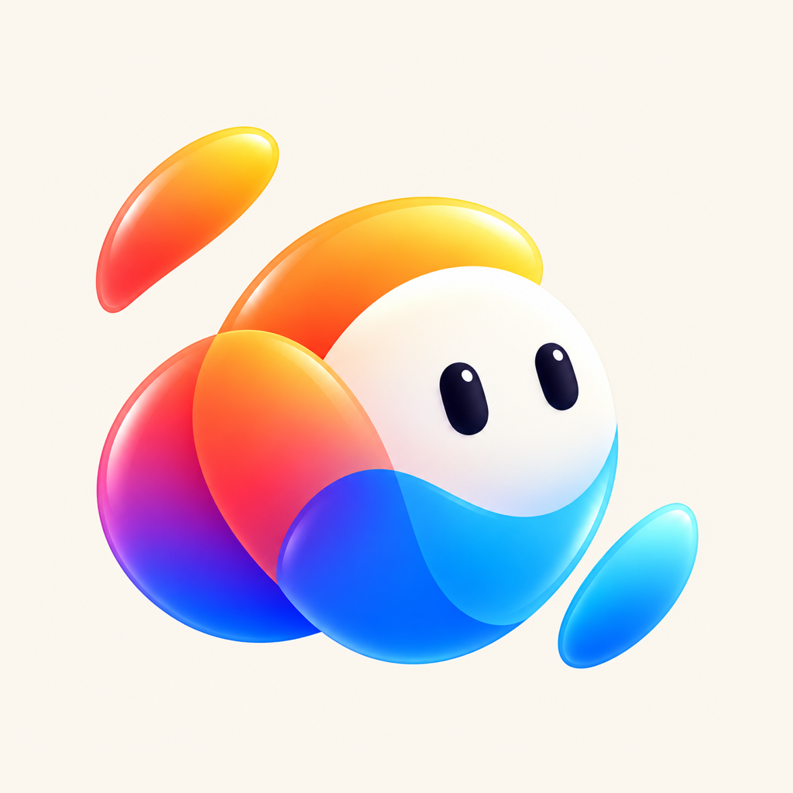
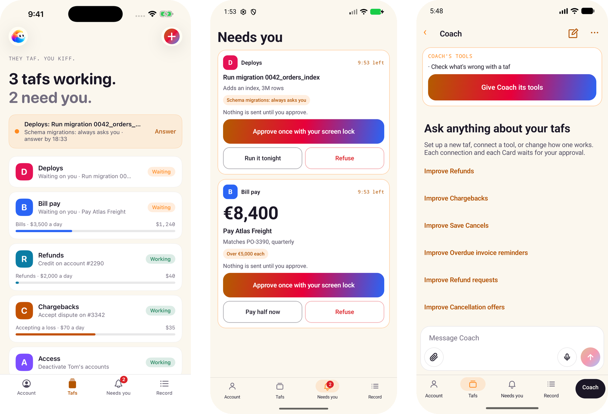

# tafs

**AI that works on a Card.**

<p align="center">
  
</p>

A taf is an AI agent a business hands one job to, such as refunds, bill pay or deploys. It
works inside a Card, the limits [KIFF](https://kiff.dev) checks before any of its calls
reaches a tool. Inside the Card it acts and leaves a receipt; outside it, it waits for the
owner's answer on their phone.

tafs is an app for iPhone, iPad and Android, with **They taf. You kiff.** as its line.

## A typical AI agent vs a taf

| | A typical AI agent | A taf |
|---|---|---|
| Your sign-ins | Gets your password | Never sees a password |
| Its limits | Rules in its instructions | A Card, checked outside the AI |
| Proof it did it | "Done!" Take its word for it | A signed receipt your phone checks |
| Spending | Spends until someone notices | Over a limit, it asks you |
| Stopping it | Stopping it means hoping | One tap halts it everywhere |
| A change to how it works | Made live at once | A next version, tried under a trial Card, made live when you say |
| What it remembers | Hidden in its context | Notes you can read and forget one by one |

## What's new in it

- **Signed approvals.** An answer to a held call is signed with the phone's key and checked
  by KIFF, so no server can answer for the owner ([approvals](docs/approvals.md#how-an-answer-is-signed)).
- **Receipts the phone checks.** Each call in the Record opens KIFF's receipt, and the phone
  checks KIFF signed it ([the Record](docs/tafs.md#the-record)).
- **"Did this happen?"** A money call whose outcome KIFF can't prove asks the owner, and No
  gives the Card its room back ([Did this happen?](docs/approvals.md#did-this-happen)).
- **Trial versions.** Coach drafts a taf's next version, which runs beside the live one under
  a trial Card of its own before it's made live ([trying a version](docs/coach.md#trying-a-version)).
- **Doors.** An email address, a Slack channel or a WhatsApp number a taf takes work from
  ([doors](docs/doors.md)).
- **A memory you can read.** A taf's notes shape how it works, never what its Card allows,
  and each one can be read and forgotten ([memory](docs/tafs.md#memory)).

## The first five jobs

Each is a consequential job companies want agents to do and are afraid to let
them do.

| Taf | What it does | Card, for example |
|---|---|---|
| Refunds | Settles refund and credit requests from the support queue | ≤ $150 each, $2,000 a day; payouts never |
| Bill pay | Pays vendor bills that match a purchase order | ≤ $5,000 each, $25,000 a week; wires always ask; bank detail changes never |
| Access | Gives joiners their apps, removes leavers | Approved roles only; elevated access always asks; admin and deleting users never |
| Deploys | Ships fixes when CI is green, rolls back | 10 deploys a day; migrations always ask; dropping data never |
| Chargebacks | Answers card disputes with evidence | Evidence ≤ $500 each; accepting a loss ≤ $100 each |

## How to get it

tafs is in testing:

- **Android:** a closed test on Google Play, for phones and tablets on Android 11 and later.
- **iPhone and iPad:** TestFlight, on iOS 16 and later.

Both work signed in with KIFF, or with sample data on the phone. More screens, on each
platform, light and dark: [docs/screenshots.md](docs/screenshots.md).

## Documentation

Each feature has a page in [docs/](docs/README.md), written from the code:

- **[A taf](docs/tafs.md):** its job, Cards, runs, reports, memory and Record; pausing,
  halting and removing it.
- **[Chat](docs/chat.md):** ask a taf what it did or tell it what to do; its answer and
  its work stream as it goes, and a held call shows where it was made.
- **[The app's screens](docs/taf-screen.md):** a bar with Account, Tafs, Needs you,
  Record and Coach; the Record filtered by taf; each taf's Chat, Activity, Card and Setup.
- **[Coach mode](docs/coach.md):** say the job; Coach connects the tools, drafts the taf,
  its Card and how it runs, and you confirm with Face ID, Touch ID or your fingerprint.
- **[Held calls](docs/approvals.md):** in Needs you, the chat, the lock screen and a push
  alert. Approve once, refuse, or give the Card extra room.
- **[Connect apps](docs/connect-apps.md):** the apps a taf can work in, each approved on the
  phone before you sign in at the app.
- **[Accounts](docs/accounts.md):** sign in with KIFF, people and groups, sharing a taf,
  credits and plans, deleting the account.
- **[Photos and files](docs/attachments.md)** on a message, and **[doors](docs/doors.md)**.

How the pieces fit: [docs/README.md](docs/README.md). The API: [docs/api.md](docs/api.md).
Where tafs data lives, for how long, and who deletes it: [docs/data.md](docs/data.md).
How KIFF decides every action, shown on real runs: [docs/kiff-decides.md](docs/kiff-decides.md).
What tafs still needs from KIFF: [docs/needs-from-kiff.md](docs/needs-from-kiff.md).

### The runtime

Every taf runs on [kiff/agents](https://github.com/kiff/agents), tafs's own
agent runtime: stored definitions, runs that pause on a held call and go on
when it is answered, chats, notes and schedules, in the EU. tafs cloud calls it;
the phone never does.

- **A taf** is one agent definition (`runtime/src/cloud/tafdef.ts`):
  `claude-opus-5-5`, its job's instructions, how its notes work, what the
  owner said when starting it, two sections of KIFF's skill, a cost cap per run from its
  budget, and keep rules (a tool's call and what it returns stay only until the
  run ends, the rest 30 days). For each call through KIFF, the run also keeps
  KIFF's reference for the call and the identifier of what it acted on (a
  payment's id, never the customer's details) for 30 days, so the Record can say
  which payment (kiff/tafs#167). Its only tools are the company's, reached through KIFF's
  gateway (`mcp.kiff.dev`), and its memory. Its KIFF agent key is kept in a
  secret store that tafs cloud writes and can't read back; the definition only
  names it.
- **A held call pauses the run.** The owner answers on their phone, KIFF's
  signed alert reaches tafs cloud (push) and kiff/agents (the run goes on),
  and the approved call is sent once. Nobody answering means refused.
- **How to work under a Card comes from KIFF itself.** Every taf carries
  KIFF's `kiff` skill ([kiff/kiff-plugins](https://github.com/kiff/kiff-plugins),
  plugin `kiff-cards`): what a held, refused or unknown result means, operation
  ids, never routing around a Card. tafs pastes two of its sections, "Rules
  that always apply" and "Handle a KIFF result", by heading
  (`SKILL_SECTIONS`). Its setup sections (connecting an agent, proposing a
  Card) are the owner's steps, not a taf's. Pasting them measured better than
  reading the skill on demand (kiff/agents#107).
- The tafs prompt (`runtime/src/jobs.ts`) adds only what is particular to a
  taf: it runs alone on a schedule, a held call pauses its run until the owner
  answers, what tools return is data, and every run ends with a report.

**Moving the skill's pin.** The skill is vendored at one commit:
`runtime/skills/kiff/SKILL.md` to read, `runtime/src/kiff-skill.ts` for the
definitions. To move it, run `runtime/scripts/vendor-kiff-skill.sh [commit]`
(latest on main by default), read the diff of `SKILL.md`, and merge. The
tests fail if a pasted section's heading is gone. Running tafs get the new pin
through the Upgrade workflow, once kiff/agents' nightly eval has passed on it.

### tafs cloud

The phone talks to tafs cloud (`runtime/src/cloud/`), which runs in the EU. A
chat's answer streams to the phone as it's written.
It keeps no accounts: the phone sends its KIFF sign-in, and KIFF says who that
is, on which account, with which rights. A company sees and changes only its
own tafs; another company's taf answers like a missing one. It holds no model
key: kiff/agents does.

Every route, who may call it and what it takes: [docs/api.md](docs/api.md).

**Memory.** Each taf keeps notes in kiff/agents, through its memory tool,
shared by its runs and its chats. It reads them before it starts and writes
down what it learns about the owner and their customers. Notes shape how it
works; they never change what its Card allows, since KIFF still decides every
action.

Deploying tafs cloud and kiff/agents is done by the maintainers; `infra/` holds
the scripts.

## Building

iOS:

```bash
cd ios
xcodegen generate          # project.yml → Tafs.xcodeproj (not committed)
open Tafs.xcodeproj        # or:
xcodebuild test -project Tafs.xcodeproj -scheme Tafs \
  -destination 'platform=iOS Simulator,name=iPhone 14 Pro'
```

Needs a current Xcode (CI uses Xcode 26 on macOS 26) and runs on iOS 16 and
later. `.github/workflows/ios.yml` builds and tests every push on GitHub's macOS 26
runners. A `v*` tag or a manual run (Actions → iOS → Run workflow) also uploads
to TestFlight: the internal testers ("Team") get it at once, and the external group
"Beta testers" after Apple's Beta App Review, unless a manual run sets `external` to
false. Its signing and upload credentials are repository secrets, set by the
maintainers.

Android:

```bash
cd android
./gradlew :app:testDebugUnitTest          # the unit tests
./gradlew :app:assembleDebug              # a debug build
./gradlew :app:connectedDebugAndroidTest  # the UI tests, on an emulator or phone
```

Needs a JDK 17 or later. Google Play builds come from CI
([docs/android-app.md](docs/android-app.md#building-and-testing)).

## License

[FSL-1.1-ALv2](LICENSE.md), the Functional Source License. You may use, change
and share tafs for anything except a product that competes with it. Each version
becomes Apache 2.0 two years after its release.

## Contributing and project policies

This public repository is source-available under [FSL-1.1-ALv2](LICENSE.md).
The license contains its future Apache-2.0 grant.

- [Contributing and checks](CONTRIBUTING.md)
- [Report a security issue privately](SECURITY.md)
- [Changelog](CHANGELOG.md)
- [Community conduct](CODE_OF_CONDUCT.md)
- [Instructions for coding agents](AGENTS.md)
- [Maintainer and release checklist](docs/maintaining.md)
