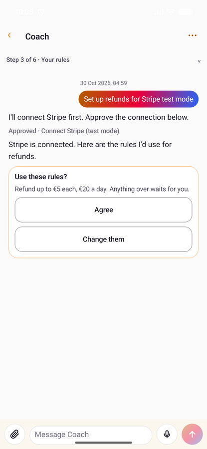
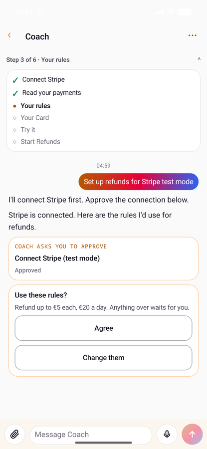
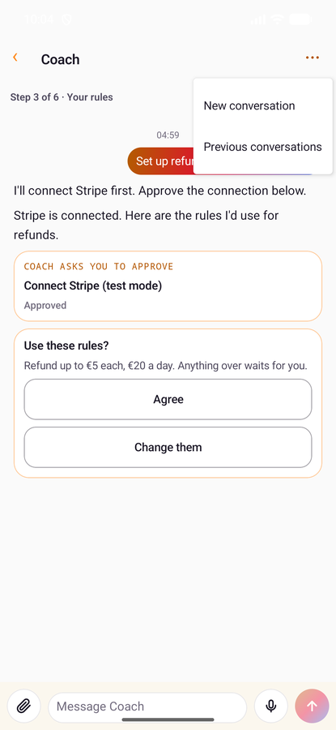
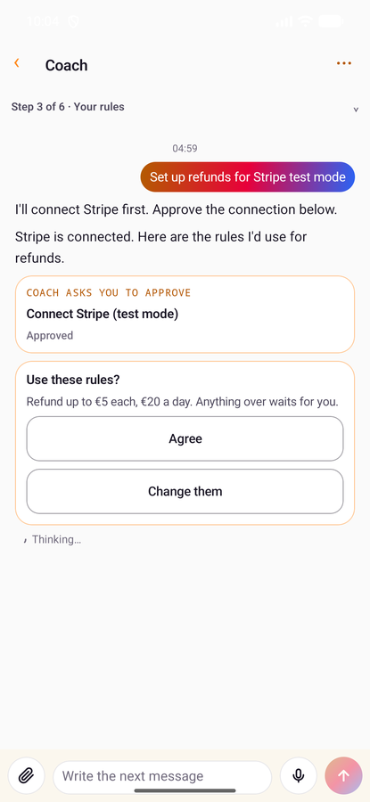
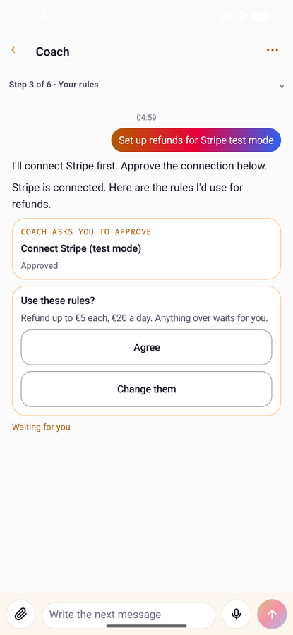
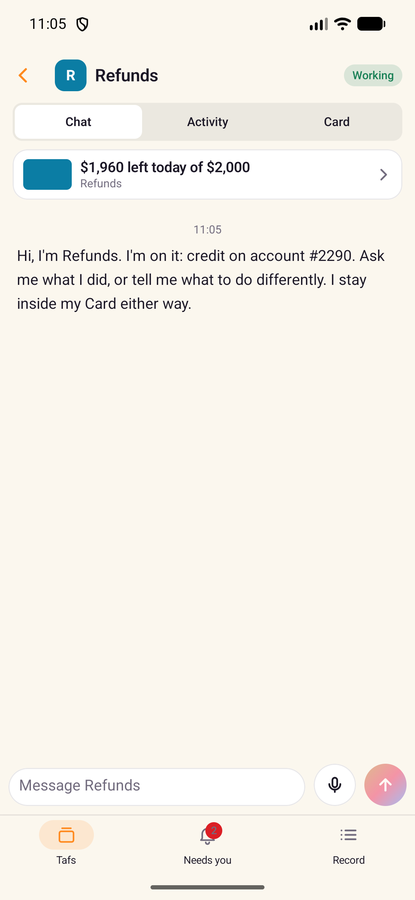
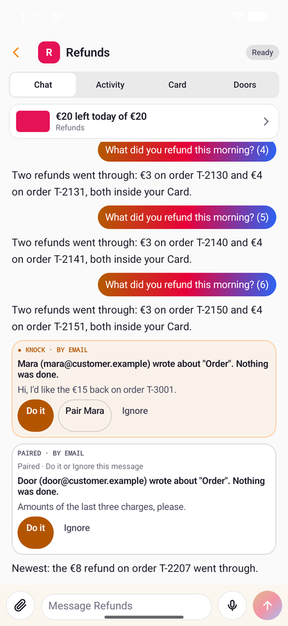
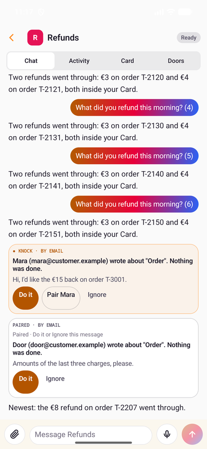

# The Android app's code

tafs for Android phones and tablets is Kotlin and Jetpack Compose, Android 11 (API 30) and
later. It uses KIFF, tafs cloud and planque exactly as the iPhone app does: the same public
routes, every answer signed on the phone, KIFF deciding every action. It is only the
screen: the backends give its names, words, limits and rules. This page is a map of the
code; what each feature does is on its own page ([README.md](README.md)), with a line
where Android differs.

It asks for the microphone only to dictate, at the first tap of the mic, and doesn't need
one to install (`uses-feature android.hardware.microphone required="false"`): a phone or
tablet without one installs tafs, and its mic says it can't dictate there.

## Coach's screen

Drawn by `CoachScreenTest` from synthetic data, at phone size: the compact header with the plan
in tafs cloud's one line, the plan opened, the conversations menu, and the live line thinking,
working and waiting for you ([coach.md](coach.md), [chat.md](chat.md#the-answer-as-it-comes)).

<p>
  
  
  
</p>
<p>
  
  
  
</p>

A taf's page, under its compact header: the sample's Refunds; a chat opening at its newest, with a
stranger's knock and a paired sender's message at their times; and the page folded as the chat
scrolls (the last two drawn by `TafPageScreenTest`, from synthetic data):

<p>
  
  
  
</p>

## Building and testing

```bash
cd android
./gradlew :app:testDebugUnitTest      # the unit tests, against fake KIFF, tafs cloud, planque and Google Play
./gradlew :app:assembleDebug           # a debug build
./gradlew :app:connectedDebugAndroidTest   # the UI tests, on a running emulator or phone
```

Gradle needs a JDK 17 or later; Android Studio's own (`jbr`) does. On Windows,
`gradlew.bat`. CI (`.github/workflows/android.yml`) runs the unit tests and the debug
builds on every pull request that touches `android/`, and the UI tests on an emulator.

The application id is `dev.kiff.tafs`; the Kotlin packages are `bot.tafs.app`.

**Alerts** need Firebase's settings, `android/app/google-services.json`, which is never
committed: CI writes it from the repository secret `GOOGLE_SERVICES_JSON`. A build without
it has alerts off and says so in Settings.

**Releases** are signed bundles for Google Play, built by `android.yml`'s release job on a
manual dispatch, in the `android-release` environment, which the owner approves each time.
The upload key is never in the repository or a session: `android/make-upload-key.sh` made
it once into the secrets store, and `android/release.sh` builds with it.

**Buying through Google Play** is built but off: `res/values/flags.xml`'s `play_billing`,
until KIFF names Google Play products for the account.

## The packages of `bot.tafs.app`

| Package | What's in it |
|---|---|
| (root) | `MainActivity` (the three tabs: Tafs, Needs you, Record; the list beside what's open on a tablet), `TafsApplication` (the clients, the keys, alerts, Google Play) |
| `app/` | `AppModel` (the one view model: state, and everything the screens ask of the backends), `SampleStore` |
| `kiff/` | The clients: `KiffClient` (KIFF's API), `TafsCloud`, `Planque`, `Transport`; `KiffMapping` (KIFF's records into the app's), `Stream` (a chat's streamed events), `ReceiptCheck` (receipts checked on the phone), `Jcs`, `SigningTime`, `SecretStore`, the wire types (`Wire`, `Usage`, `Coach`, `Doors`, `Versions`) |
| `model/` | The app's own types and words: `Models` (`Taf`, `Card`, `HeldCall`, `RecordEntry`…), `Chat`, `Attachments`, `CardCheck` (the sample only), and one `…Words` object per feature, for words the backends don't send yet |
| `signing/` | `KeystoreKeys` (the signing key and the approval key, in the Keystore), `DeviceSigner`, `BiometricAuthenticator` |
| `push/` | Alerts through Firebase Cloud Messaging: `TafsMessagingService`, `AndroidPush`, `Alerts` |
| `billing/` | `Purchases` and `PlayBillingStore`: Google Play, behind the flag |
| `files/` | `PhotoPrep`: a photo redrawn as a JPEG, with no metadata |
| `voice/` | `Dictation` and `DeviceSpeech`: dictation, recognised on the phone |
| `views/` | One file per screen or feature: `HomeView`, `TafDetailView`, `TafChatView`, `CoachViews`, `CoachChats`, `NeedsYouView`, `RecordView`, `ReceiptSheet`, `UsageViews`, `TaskRequestViews`, `SettingsView`, `PeopleViews`, `ShareViews`, `DevicesView`, `DoorViews`, `DoorDial`, `VersionViews`, `HaltViews`, `AttachViews`, `MicButton`… |
| `design/` | `Theme` (colours, the amber accent, type), `Components`, `MarkdownText` |

## Live updates

A silent push from tafs cloud names what changed on the account (`kind: background` with
`change` and `taf_id`, [approvals.md](approvals.md)), and the app reads that again with its own
session (`AppModel.changed`, `readChange`). Nothing is shown and nothing is taken from the push:
- `taf`: the home list, and that taf's thread where it's been read;
- `halted` and `resumed`: the home list;
- `knock`: that taf's doors, and its thread where it's been read.

Every refresh and every push also reads planque's grants again: tafs cloud never sees them, so
this is how a connection its vendor signed out reaches the list.

**A connection its vendor signed out** (`needs_reconnect`): its taf waits on the owner in the
home list, at the top with the held calls, its row reading planque's `status_words` ("Signed out
by Stripe · sign in again"; `AppState.signedOut`, `waitingOnOwner`). On the taf's Card tab its
connection says the same, with **Sign in again**: one approval, then the vendor's own page
(`AppModel.reconnect`), and "Connected" only once planque answers connected.

A change of a kind the app doesn't know is ignored; coming back to the app reads everything
again. Opening a chat no longer reads it on a timer: a run at work is followed on its stream, and
the timer is left only where nothing else tells the phone (a trial's chat, a run whose stream
can't open).

A door shows tafs cloud's words for itself (`words`: `state`, `tap`, `settings`) as they come; the
app's own lines stand in only where tafs cloud sends none.

## When something doesn't go through

The owner reads the app's own words for what happened and what, if anything, they can do
(`ErrorWords`): offline, try again online; signed out, sign in; not allowed by their
role; changed in the meantime; too many tries, wait a minute; down on our side, nothing to
do but try later; anything else, nothing to do on their side. A server's error text never
reaches the screen, and "try again" is said only where trying again can help. The app's own
failures (signing, signing in, a file that didn't upload) keep their words (`OwnWords`).
Coach still hears the server's reason for an approval that failed, as the card's answer,
so it can say what went wrong and ask again.

## Signing

Two keys in the Android Keystore, in StrongBox where the phone has it
([approvals.md](approvals.md#how-an-answer-is-signed)). The **signing key** signs what
reads or takes authority away. The **approval key** signs what grants it, once per
fingerprint, through the prompt; a new fingerprint turns it off, and the phone asks for a
new sign-in. A debug build on a phone with no screen lock signs without asking, as the iOS
Simulator does; a release never does.

## Tests

`app/src/test` holds the unit tests: each feature against `FakeTransport`, which answers
each route in turn with what the test queued and keeps every request, and
`FakeAuthenticator`, the person at the prompt. `app/src/androidTest` holds the UI tests.
