# The Android app's code

tafs for Android phones and tablets is Kotlin and Jetpack Compose, Android 11 (API 30) and
later. It uses KIFF, tafs cloud and planque exactly as the iPhone app does: the same public
routes, every answer signed on the phone, KIFF deciding every action. It is only the
screen: the backends give its names, words, limits and rules. This page is a map of the
code; what each feature does is on its own page ([README.md](README.md)), with a line
where Android differs.

It asks for the microphone only to dictate, at the first tap of the mic, and doesn't need
one to install (`uses-feature android.hardware.microphone required="false"`): a phone or
tablet without one installs tafs, and its mic says it can't dictate there.

## Coach's screen

Drawn by `CoachScreenTest` from synthetic data, at phone size: the compact header with the plan
in tafs cloud's one line, the plan opened, the conversations menu, and the live line thinking,
working and waiting for you ([coach.md](coach.md), [chat.md](chat.md#the-answer-as-it-comes)).

<p>
  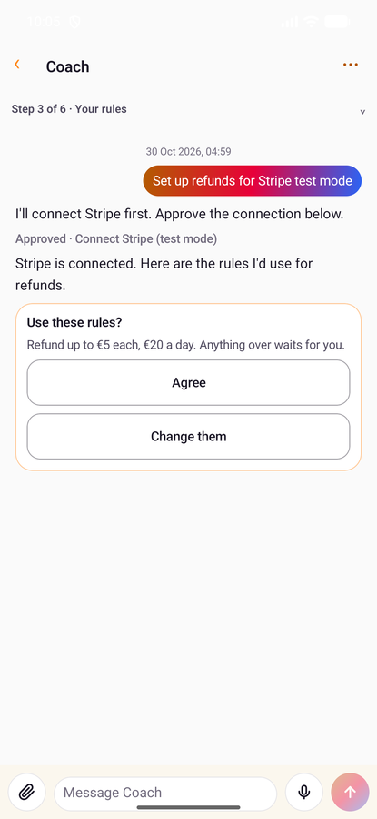
  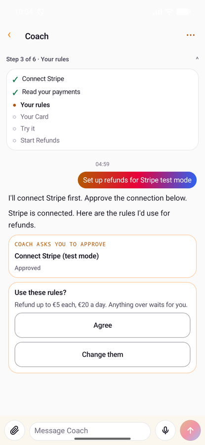
  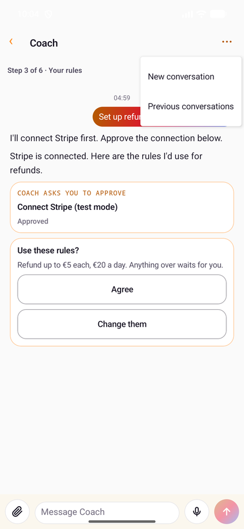
</p>
<p>
  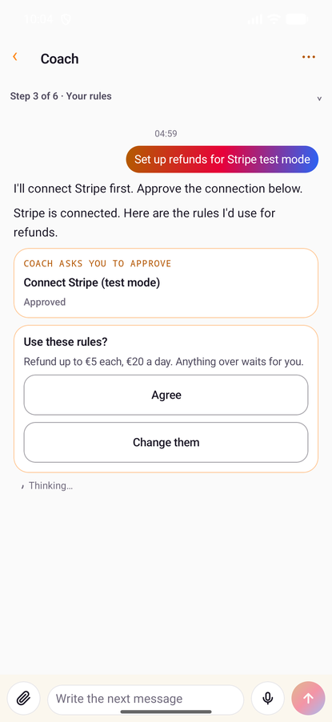
  
  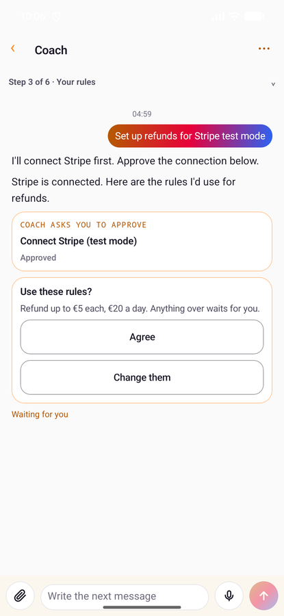
</p>

A taf's page, under its compact header: the sample's Refunds; a chat opening at its newest, with a
stranger's knock and a paired sender's message at their times; and the page folded as the chat
scrolls (the last two drawn by `TafPageScreenTest`, from synthetic data):

<p>
  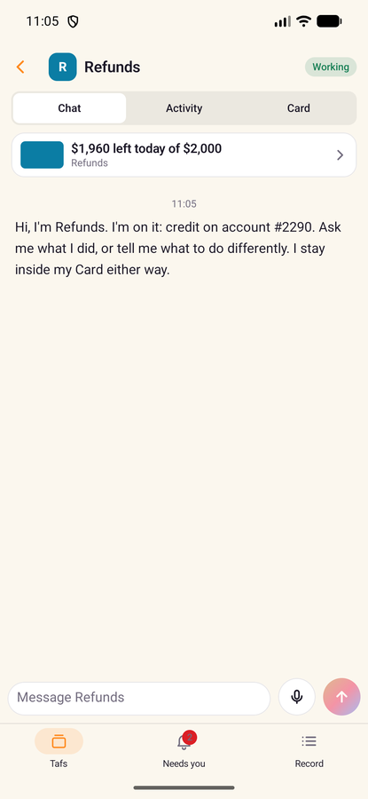
  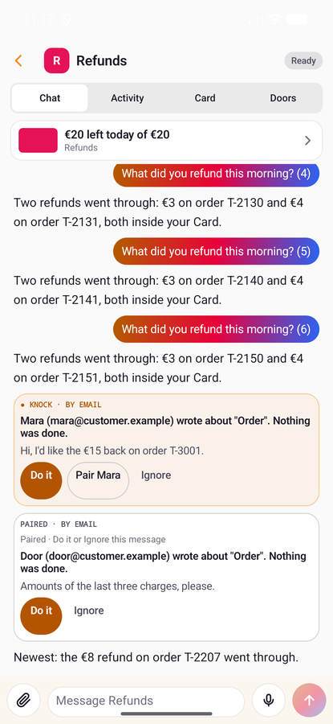
  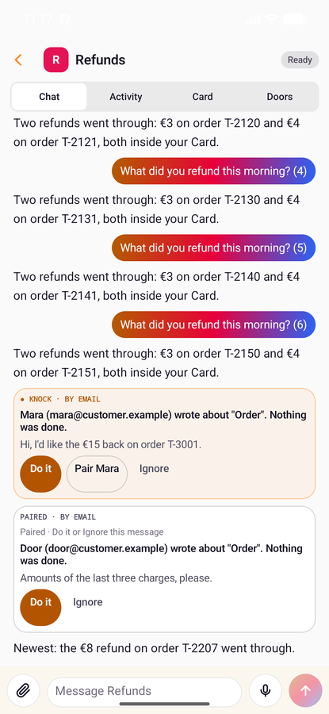
</p>

## Home with no taf

An account with no taf sees the jobs a taf can take on Home, where tafs cloud says so
(`GET /v1/recipes`, its `home`; [coach.md](coach.md)). Every word is tafs cloud's, in the
person's language.
- **The list** (`HomeRecipes`): `home.words` leads it, then a chip per category to narrow it
  (picked again, every recipe shows), then each recipe led by its `headline`, the problem it
  removes, with its `line` under it.
- **Only when `home.shown`** is true, which tafs cloud sets only with no taf, suggestions on, and
  someone who can set a taf up with Coach. Home then leads with the jobs, with no count above them
  ("0 tafs working", "Nothing needs you"), since a new account has nothing there yet. Otherwise Home shows `home.words` alone, its empty line.
  A tafs cloud from before `home` leaves Home's own "No tafs yet." as it was.
- **A recipe's sheet** (`RecipeSheet`): the headline, the line, `today` (what it costs today),
  then its Card in three zones titled by `labels` (`allows`, `holds`, `never`), a zone with
  nothing left out, and one button, `labels.hand`. The button opens a new Coach conversation
  with the recipe's `say` in the message box, to edit and send, as a recipe tap in Coach does
  (`AppModel.handRecipeToCoach`). Someone who can't use Coach gets no button.
- **When it's read:** the recipes are read with each refresh that finds no taf, as well as when
  Coach opens (`RecipesTest`, `HomeRecipesTest`).

**Every job, also once a taf runs** (`GET /v1/recipes/gallery`, read with each refresh;
[coach.md](coach.md#the-gallery)). tafs cloud decides what shows; the app draws it.
- **+ New** at the top of Tafs (Home no longer repeats the tagline: it is in Settings, About), in tafs cloud's `words.title` (the app's "New taf"
  while it sends none), opens the gallery (`GallerySheet`): its title, "Say it in your own words"
  (`own_words`), which opens Coach on a new, empty conversation (`AppModel.openCoachEmpty`), then
  `words.all`, a chip per category, and every job. Only for someone who may use Coach. A tafs cloud
  without the route shows no + New.
- **Explore jobs**, a row under the headline (`words.explore`), opens the same gallery to browse:
  every job to read, with nothing created. It shows with or without a taf, and for someone who
  can't use Coach too, but only when tafs cloud sends `words.explore`: it leaves them out while
  Home already lists every job, and the app draws no row of its own words (as on iPhone and
  iPad). While browsing, the gallery is titled Explore jobs and offers no "own words".
- **The strip** under the tafs list (`JobStrip`) draws `strip.ids` in their order, under
  `strip.title`, while `strip.shown`. An id the gallery doesn't list is left out. When the gallery
  holds more jobs than the strip shows, a last row, **See all jobs** (`words.see_all`), opens it
  to browse, as Explore jobs does. The strip offers jobs to hand to Coach, so it shows only to
  someone who may use Coach; someone who can't has Explore jobs, which opens the same gallery.
- **A job** (`JobRow`, also on Home with no taf) leads with its headline, then its line, then its
  apps, each with its logo. Its category's colour is its edge, and its chip's; the colour is tafs
  cloud's token for the theme on screen (`CategoryColor`), and without one the app's own colours
  show. A tap opens the same sheet as on Home, with the gallery's `labels`.
- **A job's sheet** (`RecipeSheet`) creates nothing. It shows the headline, the line, what it
  costs today, where it was proved (`proved`, "Proved on a test help desk."), its apps with
  their logos, its Card as does / asks / never, and what it reported after that proof run
  (`sample`, under `words.sample`). A job with no proof run has neither. Its one action hands
  it to Coach: "Try it with Coach" (`words.try`) when opened while browsing, else `labels.hand`,
  and only for someone who may use Coach.
- **The words** are tafs cloud's; the app's own (`HomeWords`) stand in only while it sends none.
- **Logos** (`LogoStore`, `AppWithLogo`) load only tafs cloud's own `/v1/logos/{key}` paths, with no
  session: any other value, a URL included, draws the name alone, so no request ever leaves for a
  third party. They're kept in memory and on disk for a week, as tafs cloud's `max-age` says.
  Connect apps shows an app's logo in place of its initial when tafs cloud sends one
  (`GalleryTest`, `GalleryScreenTest`).

## Building and testing

```bash
cd android
./gradlew :app:testDebugUnitTest      # the unit tests, against fake KIFF, tafs cloud, planque and Google Play
./gradlew :app:assembleDebug           # a debug build
./gradlew :app:connectedDebugAndroidTest   # the UI tests, on a running emulator or phone
```

Gradle needs a JDK 17 or later; Android Studio's own (`jbr`) does. The build uses the
Android Gradle plugin 9.1 on Gradle 9.3.1, which the wrapper fetches and checks against its
checksum; Android Studio needs to support that plugin version to open the project. On Windows,
`gradlew.bat`. CI (`.github/workflows/android.yml`) runs the unit tests and the debug
builds on every pull request that touches `android/`, and the UI tests on an emulator. The UI
tests run in a debug-only `TestHostActivity` (`createStableComposeRule`), which takes configuration
changes in place: on a just-booted emulator the system settles after the first test starts, and an
ordinary activity recreated then would drop the test's screen ("No compose hierarchies found").

The application id is `dev.kiff.tafs`; the Kotlin packages are `bot.tafs.app`.

**Alerts** need Firebase's settings, `android/app/google-services.json`, which is never
committed: CI writes it from the repository secret `GOOGLE_SERVICES_JSON`. A build without
it has alerts off and says so in Settings.

**Versions** (`android/app/build.gradle.kts`): `versionCode` goes up by one with every build,
and `versionName` is what the store shows: `1.x` for a release with new features, `1.x.y` for
one with fixes only. Every Android batch pull request says its `versionName`. The app went public
at 1.0 (versionCode 40), and 1.1 (43) is its first feature release since.

**Releases** are signed bundles for Google Play, built by `android.yml`'s release job by hand,
or on a merge to main that raises `versionCode` (the `version` job compares it with the commit
before), once `test` and `ui` passed, in the `android-release` environment, which the owner
approves each time.

**To Play's internal track, with no upload by hand.** Once the repository variable
`PLAY_UPLOAD` is `on`, the release job sends the signed bundle to Play's **internal** track
(`android/play/play_internal.py`): one edit, the bundle, the internal track's release
(`completed`, this bundle alone, with its notes), committed. It never touches production,
closed or open testing, or a rollout: the track is fixed in the script, and its tests check
it. It signs in with Google's workload identity federation (`google-github-actions/auth`,
`PLAY_WIF_PROVIDER` and `PLAY_SERVICE_ACCOUNT`), a token for the Play Developer API that lasts
the run: no key file, and no secret holds a key. A bundle Play reads as another `versionCode`
than the build's commits nothing.
- **Release notes** live in the repository, one folder per `versionCode`:
  `android/play/release-notes/<versionCode>/<locale>.txt`, for en-US, de-DE, fr-FR, es-ES,
  it-IT, pt-PT, nl-NL and pl-PL, each at most 500 characters. A pull request that raises
  `versionCode` adds that folder; `test` checks it (`play_internal.py --check`), and the upload
  refuses a version with none.
The upload key is never in the repository or a session: `android/make-upload-key.sh` made
it once into the secrets store, and `android/release.sh` builds with it. The app has no native
code of its own. Its only native libraries are two small ones that AndroidX ships already
stripped (`libandroidx.graphics.path.so` for Compose, `libdatastore_shared_counter.so` for
DataStore), with no symbol table or debug sections, so there are no native symbols to put in the
bundle. `ndk.debugSymbolLevel` stays set, so any native code added later sends its symbols. Play's
"no debug symbols" notice is about those two libraries, and it can't be cleared from this build.

**Plan & usage** (`UsageViews`) opens on tafs cloud's balance (`GET /v1/usage/balance`,
[accounts.md](accounts.md)), every line in its words: the balance and its second line, a bar at
`meter_pct`, the warning, and **Raise the limit** where `raise` is set (`BalancePanel`). Then buying,
who bills the plan, asking an admin, and the Credits panel, which is left out where the balance's
`credits_panel` is false (no plan and no run lately; a tafs cloud without the flag shows it). Settings' Plan card shows `plan_line` in
`plan_tone`'s colour, and Home shows `home_line` when it's set (`planColor`); both are read with each
refresh (`AppModel.refreshPlan`). A 404 from a tafs cloud from before the balance shows none, and a
failed read shows tafs cloud's `words` above what was read before.
- **Raise the limit** (`AppModel.raiseLimit`) asks once, then the device key signs KIFF's
  `PUT /v1/me/usage/limit` with `{"raise": true, "from_cents"}` (`KiffClient.raiseLimit`, a
  setup-signed path). The button stays busy until the balance is read again; a read that fails
  says "Your tafs can go on. This period's credits couldn't be read since." with **Read it again**,
  which signs nothing, and no raise until it's read. A `limit_changed` refusal reads the balance
  again and offers the raise from the new limit, and says so; `limit_ceiling` shows KIFF's words, or
  that KIFF raises it further. An admin's open request for a raise has Raise the limit on it too.
- **A chat or Run now refused for credits** (409 `credits_used_up`, `limit_reached` or `no_plan`)
  shows tafs cloud's words as they are (`AppModel.creditsRefusal`). A chat's words go back in the box,
  with no Not sent row and no Retry, as with `held_full`: sending again changes nothing until the tafs
  go on, and the words say how.
- **Asking an admin** (`TaskRequests`): on Company for a raise (`kind: "raise"`), on Solo for a pack.
  Someone who manages billing (`billing.manage`) sees the open requests: a raise is answered by Raise
  the limit, a pack by buying it, and either can be declined, signed. The request's lines are the
  ones the doc gives both apps (`UsageWords.asked`, `lastAnswer`).
- **A taf's Usage row,** on its Card tab, opens its own credits this period: its runs, each opening
  its request (`CreditsRunsSheet`).
- **The sample** shows a balance and credits (`SampleCredits`), the same as iPhone's.

**Buying through Google Play** is on (`res/values/flags.xml`'s `play_billing`). Plan & usage offers
Solo and packs of credits, which never expire, at Play's prices, where the balance's `buy` offers
them to this person, and only once KIFF's usage names their Play products and the account's token.
KIFF records each purchase before Play is told it's done, and Restore purchases sends again what
wasn't. The panel's title is **Choose a plan** while Solo is offered (`buy.solo`), and **Add
credits** once it runs. Under Solo's terms, the balance's `buy.coach` says what Coach's help
includes, tafs cloud's sentence as kiff.dev says it; none sent, no line.
- **Restore purchases** shows only while Play knows a purchase not finished yet, or couldn't say, or
  after one KIFF didn't record (`AppState.restoreShown`, read with Play's offers). Launch and sign-in
  already send what's unfinished, so an account that bought nothing has no Restore. A restore that
  finds nothing says "Nothing to restore.", never "Purchases restored." (`PurchaseOutcome.NothingToRestore`).
- **The First month pack** (`bot.tafs.credits.firstmonth`, KIFF's pack with `"once": true`) shows
  first among the packs, where the balance's `buy.first_month` is set and `ready`, its price its
  button (`UsageStore.firstMonthPack`, `repeatPacks`). Not ready, it isn't shown: never alone or
  greyed. tafs cloud offers it only once Solo runs, and KIFF leaves it out once the account has
  bought it (`PlayOffersTest`).
- **Play's offers are read again** each time Usage shows, after every purchase and restore, and
  just before Play's sheet opens (`Purchases.load`, `PlayBillingStore.purchase`), never kept
  from an earlier read. Solo has no free trial; the trial's words show only if Play ever lists a
  free-trial offer for the Google account, and the words follow Play: "Free for {trial}, then
  {price} a month", or "{price} a month". When Play can't be reached for that read (no network, its service down), the
  purchase says "Couldn't reach Google Play. Try again.", never that Play doesn't sell it
  (`PlayBillingStore.unreachable`).
- **When Play lists none of what's offered,** the panel says why above Restore purchases, rather
  than standing empty (`Purchases.buyNote`): "Couldn't reach Google Play. Try again." when Play
  couldn't be read, else "Google Play can't sell on this phone, so nothing can be bought here."
  That's Play billing off for this app on this phone (`BILLING_UNAVAILABLE`, such as a build Play
  didn't install), or nothing listed for this Google account. Nothing is said before Play is asked,
  or once it lists one of them.
- **How a purchase or restore went** shows under what was tapped (Start Solo, the pack, Restore
  purchases), read out by TalkBack (`PurchaseNote`). A purchase KIFF hasn't recorded yet offers
  Restore purchases right there.

**Needs you's count** (Home's line and the tab's badge) is tafs cloud's (`needs_you`: its count and
words, covering held calls, "Did this happen?" calls, currency requests and tafs with a knock). When
tafs cloud leaves it out (it couldn't read all of it), the app counts what it has (`needsYouCount`).
Android shows each alert on the lock screen as it comes, with no count of its own there. An app's
sheet with no saved workflow says so once, under a Workflow line of its own (`workflow_words`).

**A held call's card** (`HeldCallCard`) has KIFF's face: the amount in its declared unit, the
action as KIFF titles it, and the Card rule it crossed in KIFF's words (`reason_text`). Under it,
when KIFF kept the taf's words with the call, **The taf says** (`needs_you.taf_says`) shows them
under their own heading:
- `taf_about`, what the call is on, as a business reference ("Order 1042");
- `taf_reason`, the customer's reason ("Arrived broken, photo attached").

These come from text a customer wrote, so they're drawn as plain text, one paragraph each, with
control characters and line breaks made spaces, and format characters (bidi overrides, zero-width
marks) dropped so nothing can reorder or hide words (`KiffMapping.tafSays`). They're capped at what
KIFF keeps, 120 and 280 code points, so an emoji is never cut in half. A link or markup shows only as words. They never stand in for KIFF's amount,
rule or action. The gateway's own arguments (`kiff_operation_id`, `kiff_about`, `kiff_reason`)
aren't repeated under Details, where the call's ids stay. A KIFF that keeps neither shows the card
as before.

**A Card asked to take another currency** (KIFF's `card_unit` exception, as tafs cloud draws it in
`card_unit_exceptions`): one panel (`CardUnitExceptionPanel`) with tafs cloud's title, words and
history, in Needs you (and its count), at the top of the taf's Setup, and above its Activity, where
the Activity page's rows win over Home's. It is never a held call and never offers Approve once.
Its Coach button opens a new conversation on the taf with tafs cloud's proposal written in, not
sent (`discussCardUnit`); Dismiss reads KIFF's exception again and, only while it's still that
taf's open request, signs KIFF's ordinary refusal against its current version (`dismissCardUnit`). A
dismissed one leaves at once, from Home, Setup and Activity's cached pages, and a page or Setup read
already on its way doesn't bring it back, whether it lands as a page, a 304, a failure or a cancel
(`dismissedCardUnits`). Activity draws the newest page's requests, and its notice when KIFF's
couldn't be read (`card_unit_exceptions_notice`).

**Alerts after signing out.** Signing out turns this phone's alerts off and remembers whether
they were on for that account (`ALERTS_WERE_ON`). Signing in to the same account again registers
this phone again, with no new confirmation, while the account's alerts still reach tafs cloud;
otherwise the app says once that they're off, with **Turn on**. Another account doesn't get them.

**Halt and Resume say what happened on the Halt screen** (`haltError`): a halt or resume that
didn't go through says why there, and the screen never calls a connection by its service's name.
Its button says what's under way, "Halting…" or "Resuming…", even once the screen has turned to
the other button.
While it halts, the screen reads the halt again after half a second, a second, then every 2
seconds, for about two minutes (`HALT_POLLS_MS`), and the home list is read beside it rather than
before it, so Halted shows as soon as tafs cloud says so.
Home's row for halting every taf shows with tafs to halt, or whenever the account isn't running
(`showsAccountHalt`). With no taf, the home list carries no account halt, so each refresh reads
`GET /v1/halt` on its own: an account halted with no taf left can still be resumed from Home.
**A message refused for a halt** (`code: "halted"`, with tafs cloud's `halted`: `account` or
`taf`) keeps that on its Not sent row (`Unsent.halted`), and the halt is read at once. While it
holds, the row offers **Resume** behind the fingerprint, the halt row's own resume, in place of a
Retry that can't work. A resume that didn't go says why under it. Resumed, Retry is back
(`AppState.unsentWaitsOnHalt`).

**Run now that finds nothing new is no failure** (`runNowQuiet`): a taf that checks first answers
`session: null` with `outcome: "quiet"` and tafs cloud's `words`, shown as they are under Run now until
the next one. The app writes no line of its own, and an older tafs cloud's bare `null` shows nothing.

**Tafs tapped again goes back to the list** (`tappedAgainGoesToStart`): from a taf's screen, the
trial, the calendar or Coach, the bar's Tafs closes it, as a phone's tab bar does. Another tab is
a place of its own.
Resume's confirmation is bounded: unanswered after 10 seconds, the fingerprint check is
cancelled, the prompt with it, so a late answer sends nothing, and the screen says "The fingerprint
check timed out. Try again." (`RESUME_CONFIRM_MS`). Android can't tell whether its prompt is on
screen, so the wait itself is what's bounded, and only for Resume.

**One account per phone, and signing out asks first.** Account ends with **Sign out**: another
account is signing out, then signing in with it. Sign out, and Sign in again on the line shown
when the phone can't approve, each open a confirmation (`ConfirmSignOut`), so one stray tap
never ends the session. Account › About › Version names the build, e.g. "1.0 (26)"
(`versionWords`).

The status and navigation bars follow the app's own Light/Dark/System choice from the first
frame (`enableEdgeToEdge` with the saved choice in `MainActivity`), and `TafsTheme` keeps their
icons dark on the light ground and light on the dark one when the choice changes.

## The packages of `bot.tafs.app`

| Package | What's in it |
|---|---|
| (root) | `MainActivity` (the bar: Account, Tafs, Needs you, Record, Coach, or a rail on a tablet; the list beside what's open on a tablet), `TafsApplication` (the clients, the keys, alerts, Google Play) |
| `app/` | `AppModel` (the one view model: state, and everything the screens ask of the backends), `SampleStore` |
| `kiff/` | The clients: `KiffClient` (KIFF's API), `TafsCloud`, `Planque`, `Transport`; `KiffMapping` (KIFF's records into the app's), `Stream` (a chat's streamed events), `ReceiptCheck` (receipts checked on the phone), `Jcs`, `SigningTime`, `SecretStore`, the wire types (`Wire`, `Usage`, `Coach`, `Doors`, `Versions`) |
| `model/` | The app's own types and words: `Models` (`Taf`, `Card`, `HeldCall`, `RecordEntry`…), `Chat`, `Attachments`, `CardCheck` (the sample only), and one `…Words` object per feature, for words the backends don't send yet |
| `signing/` | `KeystoreKeys` (the signing key and the approval key, in the Keystore), `DeviceSigner`, `BiometricAuthenticator` |
| `push/` | Alerts through Firebase Cloud Messaging: `TafsMessagingService`, `AndroidPush`, `Alerts` |
| `billing/` | `Purchases` and `PlayBillingStore`: Google Play, behind the flag |
| `files/` | `PhotoPrep`: a photo redrawn as a JPEG, with no metadata |
| `voice/` | `Dictation` and `DeviceSpeech`: dictation, recognised on the phone |
| `views/` | One file per screen or feature: `HomeView`, `TafDetailView`, `TafChatView`, `CoachViews`, `CoachChats`, `NeedsYouView`, `RecordView`, `ReceiptSheet`, `UsageViews`, `TaskRequestViews`, `SettingsView`, `PeopleViews`, `ShareViews`, `DevicesView`, `DoorViews`, `SetupViews`, `EventApproval`, `VersionViews`, `HaltViews`, `AttachViews`, `MicButton`… |
| `design/` | `Theme` (colours, the amber accent, type), `Components`, `MarkdownText` |

## The Record

The Record tab lists every call the person's tafs made, by day (`RecordView`). Signed in, it also
searches across their tafs, opens one case, and exports receipts
([api.md](api.md): `GET /v1/record`, `/v1/record/cases/{about}`, `/v1/record/receipts`;
`RecordSearchViews.kt`, `AppModel.searchRecord`):

- **Search:** the box's placeholder is tafs cloud's `hint` ("Search by order, invoice, amount or
  action"), read once when the tab opens; the app's own line stands in until it comes. It searches as
  the person types, 400 ms after the last key (`RECORD_SEARCH_PAUSE_MS`), and at once on the
  keyboard's Search; only the answer for what's in the box is shown. The results take the list's place: tafs cloud's `groups`, each call drawn as
  its taf's Activity draws it (`SourceActivityRow`, with its receipt and its own next step) under
  its taf's name, and **More** for `next_cursor`. A cursor tafs cloud refuses (409, a call made
  since) searches again. Nothing found shows `none_words`. Clearing the box shows the Record as
  before. Never by a customer's name: KIFF keeps none.
- **One case:** a call with an `about` ("Order 1042 ›") opens a sheet with every call about the
  same thing, oldest first. The step that didn't go through is named first, in tafs cloud's words
  (`failed.words`), and its own next step on its row is the only retry, through the taf under its
  Card. The Record never sends anything again itself.
- **Export receipts,** for someone who oversees or manages every taf (`AppState.seesEveryTaf`;
  tafs cloud's 403 still decides): Last 7, 30 or 90 days, inside tafs cloud's 92, counted in the
  account's zone as tafs cloud counts them, not the phone's. Two files go to
  the share sheet (`shareReceipts`): tafs cloud's answer byte for byte as JSON, so KIFF's receipts
  are exactly as issued, never re-encoded, and its CSV. They live only in the app's cache and are
  replaced at each export. `missing` shows as a line ("2 calls have no receipt yet.").

## Words and languages

**Account › Language** shows the lines' language named in itself ("Français", `AppLanguage.name`) and **Change
language**, which opens the phone's own setting: Android 13+'s per-app language for tafs, which offers the 8 because the
manifest declares the generated `locales_config` (`android:localeConfig`), else the phone's languages on Android 11 and
12. There's no picker of the app's own.

**Numbers and money** follow the app's language too (`Res.locale`, from the lines' `words_language`), never the phone's
region: an English app on a German phone writes "€2,000", a French one "2 000 €". An amount keeps its own currency and
symbol, and is never converted (`Money.figure`, `MoneyFormatTest`). Amounts in KIFF's or tafs cloud's own words are
shown as they come.

Every line the app writes itself is in the shared `app/strings/en/`, one file per feature, by key
(`needs_you.approve_once` is in `en/needs_you.json`), the same files iPhone and iPad read; the servers' own lines stay theirs. `app/strings/android.py` writes, from it,
`res/values/strings.xml` (counts as `<plurals>`), `res/xml/locales_config.xml` and `model/Words.kt`, a typed accessor per
key (`Words.NeedsYou.approveOnce`, `Words.Taf.worksUnderCards(count = n)`), so a missing key or a wrong value doesn't
compile. Nobody edits those three files by hand: change the JSON and run the generator, and `--check` fails CI when they
differ. Code reads a line only through `Words`, which asks `Res`: the app's resources in the language Android resolved for
tafs, set in `TafsApplication` and again by each screen as it's created (`AndroidWords.of`), from the screen's own
configuration. A screen's configuration carries the language picked for tafs alone (Settings › Apps › tafs › Language,
from `locales_config`), which can differ from the phone's; the application's context can keep the one the process
started with. Before 1.1.2, a German app once showed Home's count in English, and a language picked while tafs waited in
the background didn't reach its own words (`AppLanguageTest`). Errors that are objects (`KiffError`, `PlanqueError`) read their words when shown, so they
follow the language. Unit tests run on the JVM without Android's resources: there `Res` reads the generated English
`strings.xml` itself (`XmlWords`, named by a test service file), so every test still checks the exact English words.

What stays in code, never in a language: JSON keys, codes and states compared with a server's, tool names, file names,
what's sent to a server as data, and every signed message (`tafs.connect.v1|…`, `tafs.cards.v1|…`, an answer's wire name).
The one signature over words, a people change (`tafs.people.v1|…`), is a fingerprint check on the phone whose result isn't
sent. Lines only Coach reads (the screen's description in a drive) stay English. The terms and the voice for each language
are in [languages.md](languages.md).

No English is left in the app's code outside that list: `app/strings/android_literals.py` scans the Kotlin literal by
literal, as `ios_literals.py` does for iOS, so words beside a comparison or a `when` branch are still caught. What stays is
kept by a rule there or by name in `app/strings/android_kept.json`, with the reason, and the strings tests fail on anything
else. The Strings workflow runs on every change to `android/app/src/main/kotlin`.

A line that names the device says what it is (`{device}`): "phone", or "tablet" where the screen's smallest width is 600 dp
or more, as Android's `sw600dp` does (`ThisDevice`, set in `TafsApplication`). Both words are lines of their own
(`device.phone`, `device.tablet`), so each language says them. The device name KIFF lists for the phone's key reads "tafs
on Android phone" (`settings.devices.this_device_name`).

The Terms and Privacy policy links (Settings, Sign-in, Plan & usage) open kiff.dev's page in the lines' language:
`/terms#tafs` in English, `/de/terms#tafs` in German, and so on (`Legal`).

The chat shows the owner's own answer line as it is by a flag on the line (`RecordEntry.byYou`, set where the phone
records the answer and kept when KIFF's outcome matches), never by matching its words, so it holds in every language.
KIFF's line for a held call reads "approved by you, done" only when KIFF says the reader answered it (`answer.you`), and
"approved, done" otherwise.

## Live updates

A silent push from tafs cloud names what changed on the account (`kind: background` with
`change` and `taf_id`, [approvals.md](approvals.md)), and the app reads that again with its own
session (`AppModel.changed`, `readChange`). Nothing is shown and nothing is taken from the push:
- `taf`: the home list, and that taf's thread where it's been read;
- `halted` and `resumed`: the home list;
- `knock`: that taf's doors, and its thread where it's been read.

Every refresh and every push also reads planque's grants again: tafs cloud never sees them, so
this is how a connection its vendor signed out reaches the list.

**A refresh runs to the end, whoever asked for it** (`AppModel.refresh`): a screen that goes away
meanwhile never cancels it, and neither does a sign-in's screen, which leaves as soon as the phone
is signed in (`finishSignIn` loads the account the same way: the list, the approval key, alerts and
purchases). Before 1.1.1, a cancelled first refresh left Home on "Loading your tafs…" until a pull,
and could leave a new phone without its approval key or alerts (`SignInTest`, `RefreshTest`). A
sign-out or another sign-in on the way is told by the account's generation, as before.

**A connection its vendor signed out** (`needs_reconnect`): its taf waits on the owner in the
home list, at the top with the held calls, its row reading planque's `status_words` ("Signed out
by Stripe · sign in again"; `AppState.signedOut`, `waitingOnOwner`). On the taf's Card tab its
connection says the same, with **Sign in again**: one approval, then the vendor's own page
(`AppModel.reconnect`), and "Connected" only once planque answers connected.

A change of a kind the app doesn't know is ignored; coming back to the app reads everything
again. Opening a chat no longer reads it on a timer: a run at work is followed on its stream, and
the timer is left only where nothing else tells the phone (a trial's chat, a run whose stream
can't open or dropped, and a run that goes on after its stream ended at a pause: Coach's, once
tafs cloud answers its result, which the timer follows until Coach's closing words show).

A door shows tafs cloud's words for itself (`words`: `state`, `tap`, `settings`) as they come; the
app's own lines stand in only where tafs cloud sends none.

**What a run did, counted from the record.** A taf's message may carry tafs cloud's `counted`
("From the record: 5 done · 1 waiting for you · 2 refused"), on a run's last message. Android
draws it under the taf's words, small and as written (`ChatMessage.counted`); a blank one is none.
The phone counts nothing itself, and with no `counted` no line is drawn. A message with both draws
`delivered` above the words and `counted` under them.

**A connection that was refused.** A taf's message may carry tafs cloud's `refused` ([chat.md](chat.md)):
the failed step's words ("Coach couldn't connect Shippo yet"), the server's reason ("Why: …") and what to
do next. Android draws them under the taf's words, never folded into its steps, the first in the failure
colour (`ChatMessage.refused`, `RefusedLines`). A blank line is left out, and with none sent nothing is
drawn: the phone decides nothing about the connection.

## A taf's work

**Its row's line** is tafs cloud's: the next run as `next_run_words` ("Next run Mon 08:00", with its day when it isn't
today; the app's own format only where an older tafs cloud sends none, and after a pause or resume until Home is read
again), and, when its work's summary has `attention` (a failed check, an unhealthy taf, a run stopped at a cap or failed),
that summary's `line` in place of "Working" (`KiffMapping.taf`). The same words are its next run in Setup's schedule and
in Activity's runs panel (`RunsPanel`). Its Cards keep tafs cloud's order, which puts first the
one that has used the most of its limit; the app sorts none (`Taf.shownCards`). **Its runs** show the first page's
`skipped` firings in their place by time (`Chat.runRows`), so a Run now whose check couldn't read shows there.

The Activity tab of a taf on tafs cloud (`TafActivityList`) shows, for whoever manages it, its
doors' knocks first (`KnocksPanel`: strangers' knocks with Do it, Pair them and Ignore, then paired
senders), so a knock Needs you counts is on the taf's page too. Then come its held calls, then where its
work stands, then its runs (the same order on iOS: what needs the owner first), from `GET /v1/tafs/{id}/work` ([reliability.md](reliability.md#the-tafs-view);
`WorkPanel`, `AppModel.loadWork`): tafs cloud's
summary line, then its recent requests and skipped firings, newest first, each in tafs cloud's
words (`Chat.workRows`). A request that needs the owner is amber, a failed one red; a skipped
firing ("Skipped the 9:00 run: the last one was still working", `skipped[]`) isn't a failure, so
it's dim. A delivery given up on after its tries shows **Send again** to whoever manages the taf
(`AppModel.sendAgain`), by its own place (`WorkDelivery.sendPlace`): a door reply sends once more;
a place of the taf's own (an app's action, another taf) goes by its `key`, retried as the taf's
task. It signs nothing, and the work is read again after. One still not delivered offers **Ask
Coach** (`open_coach`): a new conversation about the taf with tafs cloud's `coach_words` in the
message box, sent only by the owner (`askCoachAbout`). The request sheet's **Try the reply now**
is the door reply's alone. A `taf` live update reads it again where the page has.

**Its health** ([reliability.md](reliability.md#its-health); `HealthLines`, `TafWork.health`)
shows under the summary line. An idle taf's summary line is its first reason, and health's first
line is that reason followed by what to do, so the summary line is left out when it begins health's
first line (`TafHealth.repeats`, as on iOS). Health shows: each of tafs cloud's `health.lines`, amber when `at_risk` and red
when `failing`. Skipped work is never healthy, so a check that found work too big for one run,
or a time that waited for credits, shows here and among the skipped firings (`why: too_large`,
`credits`, in tafs cloud's words). Under a line with a fix (`health.fixes[].line`), its button
shows in tafs cloud's `words`:
- `coach` opens a new Coach conversation about the taf with `say` in the message box, sent only
  by the owner (`askCoachAbout`). It isn't shown to someone who can't use Coach.
- `credits` opens Plan & usage. The words say "Add credits", or "Ask an admin for credits" for
  someone without `billing.manage`.

A kind the app doesn't know draws no button, and its line still shows. The app works out no
level and no fix. A healthy taf with no lines shows nothing. On Home, tafs cloud orders what a
taf's row says: its work's `line` carries health's first reason only while `work.status` is
`idle`, since halted, needs you, retrying, working, waiting on an app and paused come first. While
idle and at risk or failing, the row shows that line amber or red (`HomeTaf.health`,
`Taf.nowHealth`). Otherwise it reads as before, untinted.

**Its oldest waiting case** ([reliability.md](reliability.md#its-oldest-waiting-case);
`TafWork.oldestWaiting`) shows under its health, in tafs cloud's `words` ("Oldest case waiting
5 h, past the 4 h you set"): amber once it's `late`, soft otherwise, and nothing while no case
waits. For whoever manages the taf, **Answer within** (`PromiseRow`) shows its `promise` as tafs
cloud keeps it, or Not set. Its menu offers Not set, 1, 2, 4 or 8 hours, or 1, 2 or 7 days (whole days read as
days, `promiseWords`; they're still 24, 48 and 168 hours), and sends
`PUT /v1/tafs/{id}/promise {hours | null}` (`AppModel.setPromise`), then reads the work again.
tafs cloud checks the range, and a refusal says why on the panel. tafs cloud sends the late alert,
which opens the taf. The app keeps no copy of the promise and works out nothing from it.

**What a run used.** Under a run's line, in the work panel and in Its runs, the run's
`credits.words`, as tafs cloud reads them from KIFF's usage record ("34 credits", or why it used
none), drawn as sent (`WorkRequest.credits`). A run KIFF hasn't counted yet has no `credits`, and no
line: the phone counts nothing.

## When something doesn't go through

The owner reads the app's own words for what happened and what, if anything, they can do
(`ErrorWords`): offline, try again online; signed out, sign in; not allowed by their
role; changed in the meantime; too many tries, wait a minute; down on our side, nothing to
do but try later; anything else, nothing to do on their side. KIFF's and planque's error text
never reaches the screen: every KIFF and planque refusal says one of these lines by its status, and its
raw reason stays in the error for the code that acts on it (including an approval window's refusal,
whose `detail` or `error` is the app's own line now). tafs cloud writes its `words`, else its `error`,
for the person, so those are shown as sent; one that isn't is fixed in tafs cloud. The one planque line
shown as planque says it is a vendor refusing planque's client (`vendor_refused_client`), since it says
whose it is. iPhone and iPad do the same. "Try again" is said only where trying again can help. The app's own
failures (signing, signing in, a file that didn't upload) keep their words (`OwnWords`).
Coach still hears the server's reason for an approval that failed, as the card's answer,
so it can say what went wrong and ask again.

## The bar

Five places under every screen: **Account** · **Tafs** · **Needs you** · **Record** · **Coach**.
Account opens Settings and Coach opens Coach; the three between are tabs, and Needs you keeps
its count. Coach is a filled button (ink, with the ground's colour as its label), shown only to
someone KIFF lets use Coach, so the bar has four places otherwise. The one exception is the store's
screenshots: a debug build opened with `adb shell am start -n dev.kiff.tafs/bot.tafs.app.MainActivity --ez screenshots true`
shows Coach in the sample, and it opens on what Coach is, as a new account first sees it (`AppState.screenshots`). A real
sample session never offers it. In landscape and on tablets
the same places are a rail on the left, with Coach at its foot (`TabBar`, `TabRail` in
`MainActivity`). Home's header keeps the account's name; Settings and Coach are no longer there.
A new taf starts in Coach, signed in. The sample has no form for one: under its list it says
"Sample data. The Card is checked on this phone. Signed in with KIFF, KIFF decides, and a new taf
starts in Coach." (`HomeWords.SAMPLE_FOOT`). Coach from a taf's page is that taf's conversation: the one
already open about it, else a new one about it; from anywhere else, the conversation open as
it was (`AppModel.openCoachOn`). Leaving a conversation stops following it on this phone (work it
accepted goes on at tafs cloud), and a read of it that lands later doesn't replace the one shown.

**Record** filters by taf too: All tafs, then a chip per taf with its colour, combined with the
kind filter. Each entry starts with its taf's colour and name, and each day says what its money
moved came to, by unit (`spentOn`).

## The taf's screen

Four tabs, each with one job (`TafDetailView`). It opens on Chat, except from a door's knock alert
(tafs cloud's `knock`, `AlertPayload.opensActivity`), which opens it on Activity, where knocks are
answered:
- **Chat:** talking to it.
- **Activity:** what it did and what waits for you. Its holds and its doors' knocks first (Do it,
  Pair them, Ignore), then its runs, where its work stands (each request opens step by step) and
  its last run, then its Record by day: All, Done, Held, Refused (`ActivityRecord`).
- **Card:** only what's on its Card: the Card, its limits and how they're counted, its usage,
  Halt and Revoke.

Who it's shared with (`PeopleWords.sharedWith`) leaves out the person reading: the one KIFF marks
`you` in its people list, or the one whose email is the account read's, as on iOS. Their own share is
never named, and a taf shared with no one else reads "Not shared".
- **Setup** (`SetupTab`): how it runs, in sections.
  - **The job**, with Improve in Coach.
  - **Starts when**, one line per start in tafs cloud's words, opening its sheet
    (`StartsWhenSheet`): its schedule (the line, "Next run at 13:00 · Europe/Paris", − and + from
    its `size`, each choice's `setting` sent as it is), and **If it is still working when the next
    start comes: Skip it / Run after** (`busy`, sent in the knob's `setting`); its app events, each
    with its filter in words, **Approve** while it waits for the owner (the signed approval, below)
    and Listening once approved; its doors, each with **Edit** (the door's own screen) then **Add
    a door…**; the follow-ups it set itself, each with **Remove**; and **Pause every start** (off
    when `can_pause` is false; a 502 says "Not every start could be paused. Try again.").
  - **Connected apps**, read from planque: each connection, **Choose actions** for one signed in
    with none chosen yet (Coach), then **Connect an app…**.
  - **Results go to**, the places on, opening its sheet (`ResultsSheet`): tafs' own places (Reply
    to the sender, Alert our phones, Email me), each a switch sent through `PUT …/results`; each
    place in a connected app by its name, a switch from its own on/off choice; **Add a place from
    a connected app…** (Coach). The last place on can't be turned off. A delivery given up on shows
    under **Not sent**, with the place's name for one of the taf's own, and **Send again** by its place.
  - **What it remembers**, **Versions**, Pause (in the sample) and **Remove for good**.

A change to the dial's setting (a size, Skip it / Run after, a place in an app) makes the taf's
next version: "DRAFT · Vn · NOT LIVE" and **Make N changes live** show in the sheet while it waits
(tafs cloud's `pending`), the usual version switch.

**An app's event** (`kind: app_event`) waits for the owner while its `approval` is `needed`:
Approve opens its filters, as tafs cloud gives them, and **Approve with your fingerprint**
approves exactly those (`AppModel.approveKnobEvent`, `EventApprovalSheet`). The live dial is read
again first, and anything changed (version, connection, event or filters, compared in their
canonical form) stops it there. The owner confirms with the approval key over
`tafs.event.v1|tenant|taf|version|trigger|grant|event|sha256(filters)`. planque subscribes the
event with `{account, slug, config}`, signed by this device (`PlanqueClient.subscribeEvent`), and
tafs cloud records planque's id for that version (`POST …/knob/subscriptions {trigger,
subscription, version}`). Whether it's approved is only tafs cloud's answer. A subscription made
but not recorded is kept for this account, so approving again records it, with no second
confirmation or subscription. A refusal is said in planque's or tafs cloud's words.

Every word on Setup's rows is tafs cloud's (each start's `words`, each place's `name`), except
the section titles and tafs' own three places, which are the app's (`SetupWords`).

**A request, step by step** (`RequestSheet`): a request's row in Activity opens it
(`GET /v1/tafs/{id}/requests/{run}`). It shows the request's line, where it came from, and what
happened, each step marked done, failed, not made, waiting or next, every line and time as tafs
cloud wrote it. A run waiting for an app's event (the slow-tools design) says what it waits for in
the connection's words, tafs cloud's `waiting_for`; the step tafs cloud marks `waits_on: "app"` is
drawn as not needing the owner, never in the amber of a hold (`RequestWords.waitsOnApp`). On the
home list, a taf whose work is `waiting_on_app` reads as its work's line, not "Waiting for you" nor
its next run, and a home state the app doesn't know reads as that line too (`KiffMapping`).
**Try the reply now** sends a reply given up on again, for whoever manages the
taf, and **Ask Coach** opens a conversation about the taf.

<p>
  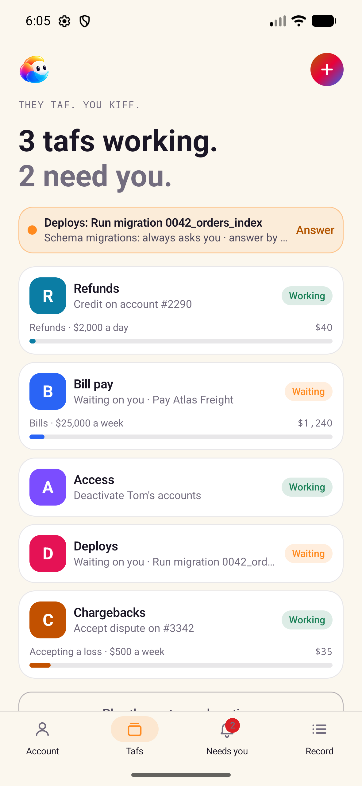
  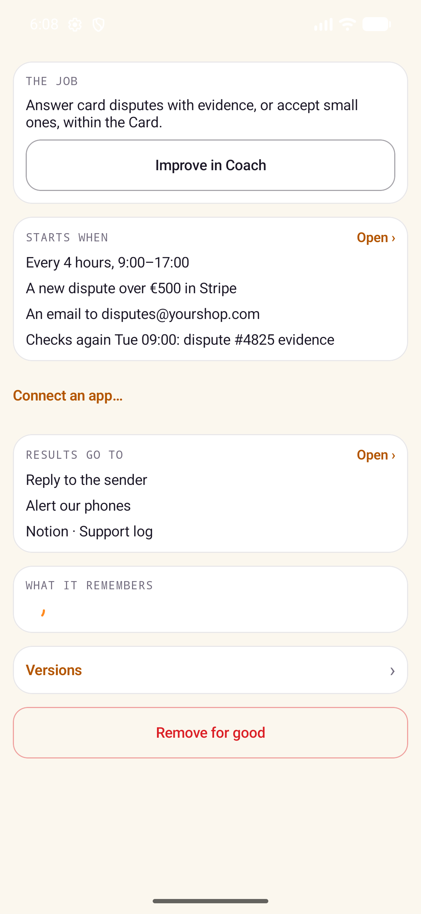
  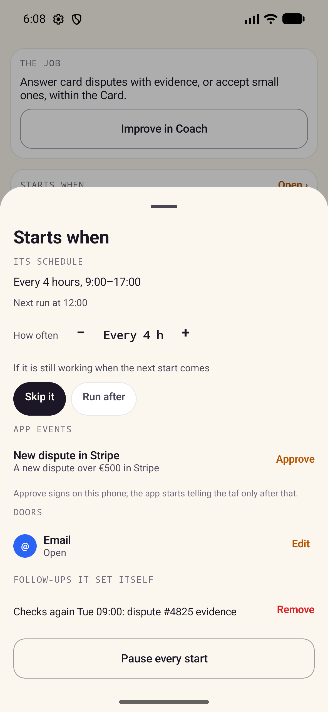
  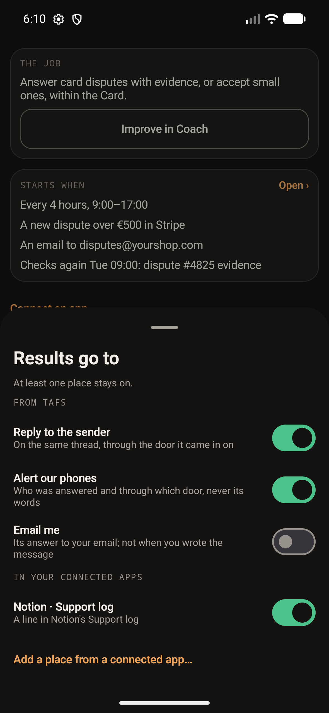
  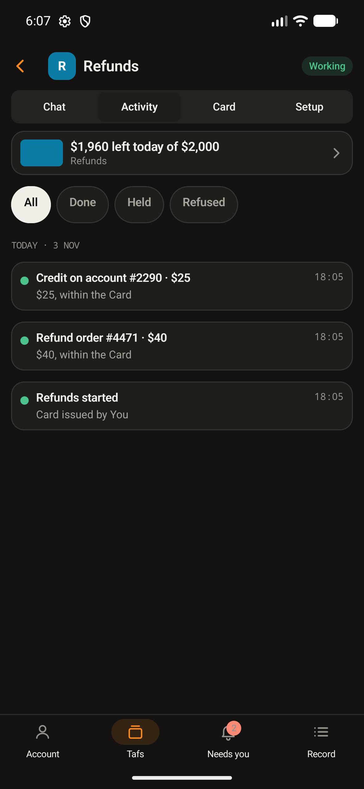
  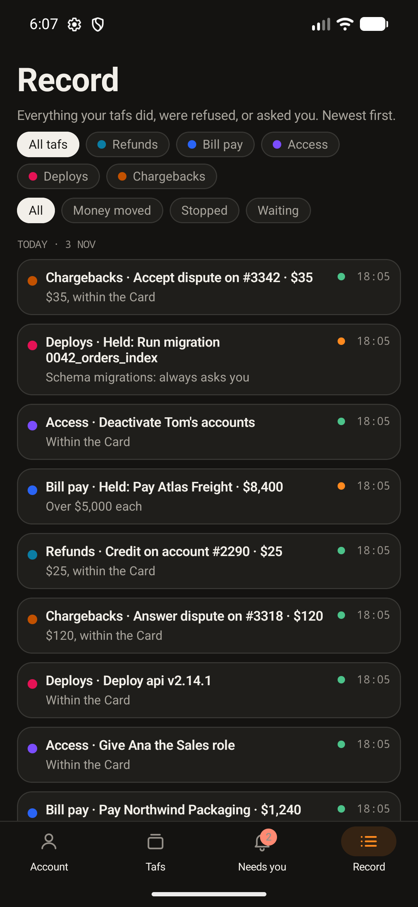
</p>

## Allow this from now on

A held call's third answer ([allow-from-now-on.md](allow-from-now-on.md)): change the Card so calls
like this one go on their own.

- **The button** shows only once KIFF's `GET /v1/me` lists the `holds.allow` capability, which it
  sends once its `allow-draft` answers (`AppState.allowLive`; never assumed when missing). Then
  it follows the app's own rule, from the held call KIFF sent, with no request
  (`AppState.offersAllow`, `HoldAllow.allowable`): someone who manages Cards, on a hold that isn't a
  currency mismatch (`card_unit`) or Coach's install, whose every breach is `per_action_exceeded`,
  `limit_reached` or `resource_not_on_card`.
- **Coach's install** (`KiffMapping.install`, a held `version_install` of Coach's own agent) keeps KIFF's title
  ("Install a version") but isn't drawn as a call: no Details (its `n` and `taf` arguments) and no reason badge,
  since installing is asked every time by design, never something outside the Card. Its Install button says the rest.
- **A tap** opens the sheet (`AllowSheet`) and posts tafs cloud's `…/holds/{exception}/allow`,
  which makes the draft. A `none` shows tafs cloud's words, with nothing to sign.
- **The sheet** shows tafs cloud's change, before and after, and KIFF's own lines for each Card that
  changes, read from KIFF's draft by the phone. Under them: what it would have done, the held
  call's switch (on by default; off, the Card changes and the call still waits), and **Round up to
  {amount}** only when the offer names `round` (the app never rounds).
- **The device signs what the person saw** (`HoldAllow.matches`): the draft is the held call's
  agent's (and, when KIFF names `from_hold`, made from this held call), retires no Card and adds
  none. Each Card it changes is one the offer names and reads exactly as that Card in force with the
  offered limit moved from `before` to `after` in the offer's unit: a per-call cap on the held
  call's action (`per_action`), or a total or count in its own window, the offer's `window` when it
  names one (`total`, `count`). A `resource` change is the held action's scope on the offer's
  `parameter` with exactly its `value` added. Every other term is the same, compared as KIFF compares
  two Cards:
  - each action, its caps, the `entity_states` and `resources` it's limited to, and its `next_steps`;
  - each total, its window (none named is `calendar_day`), its `measure` (none named is `attempts`
    for a count, `effects` for a sum), and its `per`;
  - `on_exceed`, and `valid_from` and `valid_until`, compared as instants;
  - the Card's holders (`subjects`; none named on a revision keeps the Card's, unless `subject`
    names another first holder), its `domain` and `environment` as written (without case), its
    `location` and `hold_expiry` (none, or `keep`, keeps the Card's; a duration it can't read never
    matches). A Card with `revoked_at`, in the draft or in force, never matches.

  KIFF's lines and a grant's title are words, not terms. A Card marked unchanged must read as in
  force too. Anything else, or a kind the contract doesn't name: "This change isn't what was
  offered", and no sign button. A draft that couldn't be read shows the error alone.
- **Round up** asks tafs cloud for the rounded draft and keeps the person's switch. An answer that
  comes back after its sheet closed changes nothing.
- **One signature:** the draft's confirm, behind the approval key, with the held call
  (`hold: {id, accounting_version}`) when the switch is on, so KIFF lets it go under the same
  signature. Then Needs you is read again.

## Connect again on the taf

When a connection's sign-in expired, tafs cloud puts the taf's own **Connect again** at the top of its
Setup page (`connect_again: {grant, app, title, words, done_words}`, [api.md](api.md); read leniently: a
shape this build doesn't know, or one with no connection or no button, is none). A panel
(`ConnectAgainPanel`, `views/TafPresentationViews.kt`) shows tafs cloud's `words`, and, for someone who
manages the taf, its `title` as the button. The tap signs that same connection in again
(`AppModel.connectAgain`, the path of Connect apps' Sign in again: planque's approve, the provider's
sign-in, planque's confirm), so the taf keeps its tools and its Card, with no list and no picking an app.
Once planque says it's connected, tafs cloud's `done_words` ("Gmail is connected again. Mail can use
it.") show on the taf, and its Setup page is read again. A sign-in that didn't go through says so under
the button, and Connect again stays. The app decides nothing about whether it's needed. iPhone and iPad
do the same.

## Coach waiting

A Coach chat paused on a card its person answers (an approval, a sign-in, questions) is in **Needs
you** ([api.md](api.md#coach-waiting)): Home's `coach_waiting`, after the steps, each a panel
(`CoachWaitingPanel`, `views/YourStepViews.kt`) with tafs cloud's line ("Coach is waiting for your
approval.") and its **Open Coach** button, which opens Coach on that chat (`AppModel.openWaitingCoach`),
where the card is answered; someone who can't use Coach reads the line alone. tafs cloud counts each in `needs_you`, so Home never says "Nothing needs
you." while Coach waits. The app decides nothing about it; a row with no chat or no line isn't drawn.

**Set aside** is "not now", never an approval, and only signed in (not the sample).
- **One chat:** a row whose `words.set_aside` tafs cloud sends can be swiped away either way, and has
  a button with the same words, so a swipe isn't the only way. Either one calls
  `POST /v1/home/coach-waiting/{session}/set-aside` (`AppModel.setAsideCoach`), with the signed read
  of this phone's connections, so tafs cloud can withdraw a connection that chat asked for.
- **Every chat:** with two or more rows and Home's `coach_waiting_clear`, its **Set all aside** sits
  above them. It asks once, in tafs cloud's words (the title names the count), then calls
  `POST /v1/home/coach-waiting/set-aside`.
- **After:** the row goes once tafs cloud answers, and Home is read again for its count. A refusal
  says why (`ErrorWords`) and keeps the rows. A row being set aside isn't drawn again by a Home read
  meanwhile.

iPhone and iPad follow.

## Your step

A step a taf may never take itself, such as approving a bank transfer, is handed to its owner
([api.md](api.md#your-step)). Signed in, Home's `your_steps` come first in **Needs you**, oldest
first, each a panel (`YourStepPanel`, `views/YourStepViews.kt`) in tafs cloud's words: its title and
the taf's name, what to do, and why. Needs you counts each once, as tafs cloud does.

- **Open in {vendor}** shows only for an https `link` whose own host is tafs cloud's `link_host`,
  with `words.open` (`YourStep.open`, as iOS's `openLink`). It opens the browser on that link, and
  the host shows under the button, so the line names where it really goes. A link with no host apart,
  another host, or plain http shows the words with no button, as does one tafs cloud left out.
- **Done** and **Skip it** are for those who answer holds (`canAnswerHolds`). Each reads the hand-off
  from KIFF (`GET /v1/me/handoffs/{id}`) for its version, signs KIFF's `kiff.handoff.v1` (tenant,
  hand-off, `done` or `skipped`, version, signed_at) with the **device key** (the signing key KIFF
  binds to the session), after the screen lock, as a refusal is signed. It's never the approval key
  and never needs a fingerprint, since answering grants nothing. It then sends it to KIFF
  (`POST /v1/me/handoffs/{id}/answer`, `AppModel.answerYourStep`). KIFF tells the taf's run. The
  prompt reads tafs cloud's words: "Done · {what}".
- **A step KIFF no longer waits on** (answered elsewhere, or past its week) isn't signed: the app
  says so and drops it. A refusal from KIFF keeps the step and says why.
- **Its alerts** open the taf. A step's alert is tagged by its hand-off, so its reminder replaces its
  first alert and no other, once tafs cloud passes `handoff` on to Android.
- **The vector:** `YourStepTest` pins KIFF's `kiff.handoff.v1` message and its sha256, and checks
  KIFF's vector signature verifies with the key derived from its seed, and for no other answer,
  hand-off, account or version.

## A newer version

When Play's track has a newer tafs, Home says so in one line under the account's name, with one button
(`push/AppUpdates.kt`, Play's flexible in-app update): **Update** opens Play's own confirmation and downloads it in the
background, the line says it's downloading, then **Restart** installs it and opens tafs again. Play is asked each
time the app comes to the front; it decides what's newer and installs it, and the app decides no version. A build Play
didn't install (a debug build, an emulator without Play) is never offered one. Test it on the internal track: install an
older build from the track, publish a newer one, open tafs.

## Alerts

In Account (Settings), **Alerts** shows how each kind looks on the lock screen (a hold, with
sound; an answer, silent), each marked **Example** so no one looks for that taf, then **Alerts on this phone**, **Sound** (for a hold or a halt only)
and the line under them. **What alerts you** is read only, at the levels `push/Alerts.kt` uses: a
taf needs you and every taf halted, with sound, always; a taf answered someone, silent, for the
tafs whose results include our phones (`Taf.results` has `app`; "N tafs ›" lists them); a reply
wasn't sent, silent.

## Haptics

The same rule as on iPhone and iPad (`design/Haptics.kt`):

- **A light tap on every button press,** from the shared buttons (`PrimaryButton`, `OutlineButton`), so every new button
  gets it.
- **A success tick** when a send goes through (`deliverChat`), a held call's answer goes through (`answer`), or tafs cloud
  approves Coach's approval card.
- **A warning tick** when one of those is refused or fails. Only the outcome of something the person did, never a background
  read.
- **A step tick** on a selector's stops: the theme picker and the jobs' category chips.
- **Settings › Haptics** turns all of it off, on this phone (`tafs.display`, `haptics`). It's on until turned off.

## Dark

The app follows the phone's dark setting (`TafsTheme`, `Theme.dark`): every colour in `Theme` has
its dark value, the owner-reviewed warm near-black (background `141311`, panels `1F1E1B` and
`2A2824`, ink `F2EFE9`) with brighter green, amber and red, each 4.5:1 or more on the dark
surfaces. Text on a status fill uses the panel's colour, so it stays readable either way; taf
colours and the Card keep white text.

**Edge to edge, without deprecated calls.** The app draws behind the status and navigation bars
on every Android version, and the bars' icons follow the app's own Light, Dark or System from the
first frame (`MainActivity`, then `TafsTheme`). It doesn't use androidx.activity's
`enableEdgeToEdge`, which calls the window's bar colours (`setStatusBarColor`,
`setNavigationBarColor`) and the short-edges cutout mode, all deprecated from Android 15 and
flagged by Google Play. Below Android 15, the theme makes the bars transparent and uses the cutout
area (`values/themes.xml`, `values-v31`). From Android 15, which draws edge to edge on its own,
the theme sets no bar colours (`values-v35`). `EdgeToEdgeSourceTest` fails if the app's code calls
any of them again; `EdgeToEdgeTest` checks that the app draws behind the bars, with the icons'
shade per theme.

<p>
  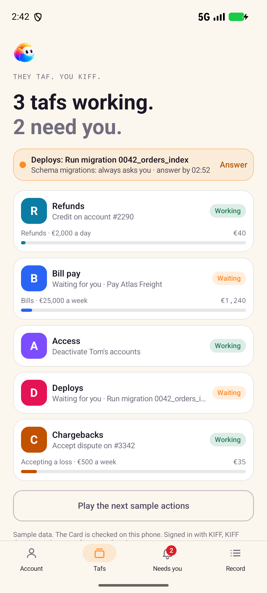
  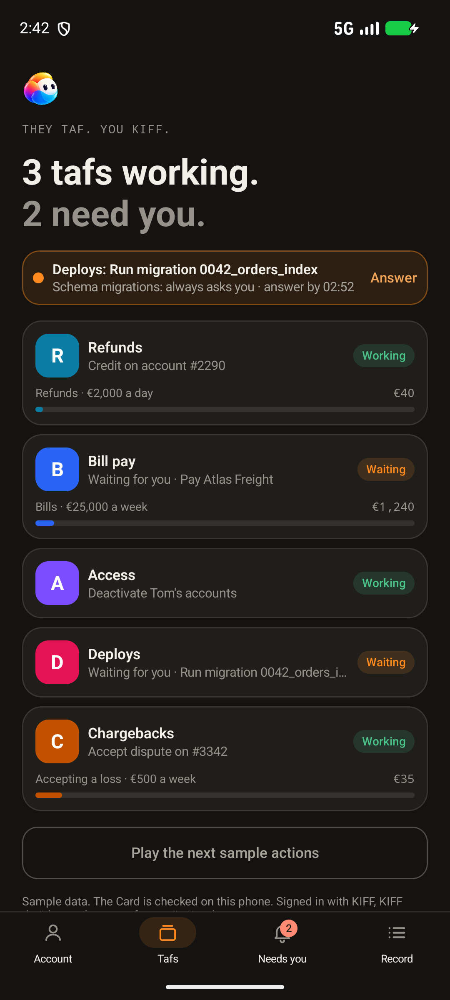
</p>

## Connect apps

Settings › **Connect apps** (`ConnectAppsSheet`), as [coach.md](coach.md#connect-apps) says.

**The list, as on iPhone and iPad** (Android 1.20.3):
- **Yours, then Discover.** The account's own apps (connected, signed in, or to sign in again) come first under **Yours**,
  with **Connected ✓**. The rest of the catalog follows under **Discover**. Within each list, tafs cloud's order is kept.
- **Each row has two lines:** the app's title, then tafs cloud's `line` as sent ("Sign in · Connected · Used by Refunds").
  - Without `line`, the same shared words are put together here: how it connects (`method`, else `how`: **Sign in** or
    **With a key**), `whose` as sent, where it stands (**Connected**, or **Sign in again**), and, for an app that's
    yours, **Used by** the tafs that use it, as a list in the app's language. iPhone and iPad put it together the same way.
  - "Used by" is tafs cloud's `used_by` when sent, else this phone's own read of its connections, by taf (`usedBy`).
- **The trailing button is compact:** **Connect**, **Sign in again**, or for one signed in, **Signed in · choose its actions**.
  A connected app opens its connections, each with Disconnect.

**An app's connections, as planque describes them** (Android 1.25.0, planque's `title`, `used_by`,
`health` and `actions` on each grant; `Grant.health`, `Grant.actions`, read leniently). A connected app
opens its connections, under each taf's name:
- **Each row** is planque's `title` ("Gmail · name@example.com"), then **Used by** its `used_by`, then its
  `health.words` ("Gmail's sign-in expired on 14 Nov"), amber when not `ok`. No id, and no button beside
  it (`DescribedConnectionRow`).
- **A tap opens its detail first:** its health, the tafs that depend on it, then only the `actions`
  planque sent, in its order: `approve` is Sign in again on itself (`reconnect`), `key` a new key, and
  `delete` the signed removal. An action whose `how` this build doesn't know isn't drawn, so a leftover
  shows only planque's **Remove unfinished connection**, never Sign in again.
- **A removal asks once more,** with planque's `stops` ("Unanswered customer emails will stop using
  Gmail."), and only then the fingerprint. Remove is never beside a row.
- Every request to planque says the person's time zone (`X-Time-Zone`), so the times in its words are
  theirs.
- A planque from before it sends no `actions`, and the row is the app's own, as below, until it does.
- **planque's refusals in its own words:** any refusal that carries planque's `words` (a sign-in again
  to another account than the connection's, say) shows those words as sent (`PlanqueError.Server.words`,
  `ErrorWords.of`), never a line of the app's over them. "It changed in the meantime" is kept for a
  409 with no words. planque's `error` stays the reason, for the code.

tafs cloud's list, searched as the owner types, and **Connect** opens the approval as a sheet
over the list (`ConnectApprovalSheet`). With several tafs, **Which taf is this for?** is asked
first, in a dialog over the list wherever Connect was tapped, as on iPhone and iPad. When a sign-in
comes back, what happened is said at once, over the list: "Notion is signed in for Refunds. Next,
Coach chooses its actions and you approve them.", with **Choose its actions**, which opens the
taf's Coach (or "… is connected" when it's done). A row tafs cloud sends as signed in
(`signed_in`, or `listed`) reads **Signed in · choose its actions** in place of Connect, and
opens the same Coach. A row is the app's title alone, never the provider's id
for it. Only the newest search's answer is shown: an earlier read that comes back late (the
first, unfiltered one) is dropped. An app that signs in at the vendor is approved, then
signed in. An app that takes an API key (`needs_key`) takes it on the same sheet, as on iPhone
and iPad: a password field, and **Give the key with your fingerprint**, which signs the same
confirmation as an approval and sends the key to planque once (`AppModel.giveKey`,
`PlanqueClient.giveKey`, the key in `Planque-Vendor-Key`, its SHA-256 in the signed body). The
key lives only in the open sheet's field, and nothing on the phone keeps it.
**Coach's approval card never takes a key** (`openCardKeySheet`): the chat isn't a place for a
secret. While the grant takes a key (planque's `api_key`) and isn't connected, the card has one
button, **Give the key on a secure sheet**, which opens this same key sheet full screen, outside the
chat. The sheet says where the key goes (`connect.key_goes_to`: this phone, then the connection
server, which sends it only to the vendor's host: `Grant.keyHost`, the server without its scheme or
path, never the vendor's name; and never Coach), and that the clipboard is
cleared after a paste: more than one character at once is a paste, and the clipboard is cleared
then. Given there (`AppModel.approveCoachWithKey`), the key goes as above, then the card is answered
as any approval: tafs cloud finds the app connected, and Coach goes on or asks for its Cards. A key
that didn't go answers nothing, and says why on the sheet.

**The secure connection sheet** ([secure-connection.md](secure-connection.md)). When the key
sheet opens, the phone reads tafs cloud's `GET /v1/connect/grants/{grant}/sheet` with its signed
grants read (`Planque-Device-Signature`), once per grant (`AppModel.loadSecureSheet`,
`TafsCloud.connectSheet`), and draws only its words (`SecureKeyContent`):
- the title, with the vendor's logo and a lock;
- the three plain lines. A `reads_only` line is checked against the grant this phone signs: at least
  one tool, and every one `read_only` (`SecureSheetWords.firstLineHolds`). Otherwise the mismatch
  line shows, with nothing to sign;
- **Paste the key**, a button, never a typing field, so no keyboard opens. The pasted key is
  trimmed, the clipboard is cleared at once, and only its last 4 show ("Key …ab12"), then tafs
  cloud's line for what to do next (`paste.next`, "Key pasted. Tap Connect"; none from a tafs
  cloud from before it);
- the legal line, its `{terms}` and `{privacy}` links opening in the browser (https only);
- the button, right under the pasted key and the legal line, which gives the key as above;
- **Details**, collapsed: the technical lines, then the connection server's own words and KIFF's
  words for the profile.

Once the key went, the sheet shows the receipt with the last 4 (from a key of 12 characters or
more, as on iOS) and **Remove access** (`AppState.keyReceipt`), until it closes; nothing keeps the last
4 after that. **Remove access** asks first, naming the taf it ends, in Connect apps' own words. Without
the sheet's words (an older tafs cloud, an error), the sheet stays as above. The sheet sits above
the keyboard and scrolls. An approval card that tafs cloud marks `connection: {done: true, words}`
draws only those words and Its Card, never the connection's text again.

**What a card's fingerprint signs** (`signs`, docs/secure-connection.md): Coach's thread is read with this
phone's planque read proof (the device's key, no prompt) and `?can=tools_and_cards,key_and_cards,signs`, so tafs
cloud marks each waiting approval card with `signs: {card, words?}` (read leniently: any other shape is no mark).
- `card: true`: Its Card, KIFF's own lines, stays on screen until the fingerprint, connected or not, and
  Approve waits until KIFF's draft is read.
- `card: false`: the Card's lines, dimmed, under tafs cloud's `words` ("Its Card: you approve it next"), never
  under its own title as if signed now; with no `words`, not drawn.
- No mark (a tafs cloud from before it): as before, Its Card once the grant is connected.
The approve flow asks with `signs` in `can` too, only from a card that carries the mark: a card read without
it (no read proof, or tafs cloud's read timed out) never says it draws what it signs. Once the ask is back, and before any signature, a step
that disagrees with the mark is never signed (`AppModel.stepMatchesMark`): `card: true` takes only
`cards`, `key_and_cards` or `tools_and_cards`, and `card: false` only another step. On a mismatch the card says
"What you're asked to approve changed since it was shown. Read it again, then approve." and the thread
is read again. No mark: any step.
iPhone and iPad draw it the same way.

**One fingerprint for a key and its Card** (`kiff.requests.v1`, docs/secure-connection.md). From
Coach's card with a Card's draft, on a phone with an approval key, the key sheet's button asks tafs
cloud for the step with `can: ["key_and_cards"]` (`AppModel.approveCoachWithKey`). When tafs cloud
answers `key_and_cards`:
- the phone checks the ask as for each step alone: the card's grant at the digest shown, its draft
  at the version shown, `scheme` `kiff.requests.v1`, and no message of tafs cloud's
  (`expectedApprovalMessage`);
- it builds both requests itself, with one `signed_at`: planque's key request
  (`PlanqueClient.keyMessage`) and KIFF's draft confirm (`KiffClient.confirmMessage`);
- it signs `kiff.requests.v1`, the account, the time and both messages' SHA-256 sorted, once, with
  the approval key, behind the fingerprint (`AppModel.keyAndCards`);
- it sends each request with that signature and the other's hash (`v3=…,with=sha256:…`): the key to
  planque, in its header alone, then, only once planque says `connected`, the confirm to KIFF;
- it reports what came of them, as for any step. A key that went in with a Card that didn't is said
  by tafs cloud, and Coach's next card asks for the Card alone.

Answered with the two steps instead (tafs cloud's step off, or a card it won't join), the phone signs
nothing for that answer and gives the key, then approves the Card, as before.

**One fingerprint for a connection's tools and its Card** (`tools_and_cards`, Android 1.22). The
same, for an app signed in to, not given a key: from Coach's card with a Card's draft, on a phone with
an approval key, Approve asks tafs cloud with `can: ["tools_and_cards"]`. When tafs cloud answers that
step (only while the connection waits for its added tools, behind `TAFS_TOOLS_AND_CARDS`), the phone
checks the ask as for `key_and_cards`, then builds planque's approve, with the body exactly as tafs
cloud built it (`PlanqueClient.approveMessage`), and KIFF's draft confirm with one `signed_at`, signs
both hashes once (`AppModel.toolsAndCards`) and sends the approve, then, only once planque says
`connected`, the confirm. Any other answer is the steps as before. The phone doesn't check the draft's
tools against the connection: a Card can span several of the agent's connections, and KIFF refuses a
draft over tools that aren't declared.

A browser connection's sheet (on a taf's Setup) offers tafs cloud's `site_sign_in` action, to
whoever manages the taf: its `title` ("Sign in to a site") and its line. A tap asks planque, signed
by the device's key with no fingerprint (it grants nothing), for the live sign-in view
(`AppModel.openSiteSignIn`, `PlanqueClient.siteSignIn`, `POST …/grants/{id}/sign-in`). The view
opens only when its URL is on planque's own https origin (scheme, host and port), in a full-screen web view
(`SiteSignInScreen`) under planque's `words`, with **Close** and nothing else. The web view runs the
page's scripts and follows no link off that origin, and closing it clears its cookies (it is the app's only web view). A refusal (a view already open, the connection
not connected) is said on the connection in planque's words. Closing leaves the view to lapse.

An app tafs cloud sends as `needs_setup` (kiff/planque#87) shows tafs cloud's `words` under its
title ("Needs setting up first. Ask tafs to enable it.") and has no Connect: nothing on its row
can be tapped. On a taf's Setup, a connection's sheet shows tafs cloud's `custody_words` under its
status line, the one line on who keeps its sign-in; with none sent, nothing shows. Above it,
`account_words` says which account the connection works in and in which mode ("Demo Shop ·
Live"), as tafs cloud sends it; with none sent, nothing shows.

A connected app opens its connections by taf (`byTaf`), as on iPhone and iPad
([ios-app.md](ios-app.md#connect-apps)): one section per taf, those that need the owner first,
the same rows with **Sign in again**, **Remove access** and **Cancel**, then **From removed tafs**
with **Clear these connections** on tafs cloud's `used_by` (`AppModel.clearRemovedConnections`),
one fingerprint for them all, and **Other connections** last.

**Ending access, in plain words** (`ConnectionWords.endButton`). A connected app's row says
**Remove access**, and asks first, naming the taf it ends. For a key, the confirmation says the key
is deleted from tafs once no taf uses it, since a key another taf's connection shares stays for that
taf; only a sign-in says it's revoked at the vendor. What never connected is
cancelled instead: a request not answered yet (`Grant.pendingRequest`: pending, holding no sign-in, and not connected by
this phone since) says **Cancel the request**,
and a sign-in that never came back says **Cancel**, each with its own question. Once access is
removed, Connect apps is read again at once (`AppModel.disconnect`), so it no longer says
Connected until it's reopened.


**What the phone signs.** Before it shows or signs a grant, the phone recomputes its digest from
what planque sent and refuses one that doesn't match (`PlanqueClient.digestCovers`,
`Grant.digestMatches`). Without `digest_v`, the digest covers the request alone (v1). With
`digest_v: 2`, it covers `{"lang", "request", "text"}`, so the words the person reads (`text`, in
their language) and that language are what's signed. An unknown version, or a v2 grant without its
words or its language, never matches. Every request to planque carries the person's language
(`Accept-Language`, as tafs cloud gets it), for the words planque writes. Nothing changes on screen
until planque issues v2 grants; iOS checks the same.

## Signing

Two keys in the Android Keystore, in StrongBox where the phone has it
([approvals.md](approvals.md#how-an-answer-is-signed)). The **signing key** signs what
reads or takes authority away. The **approval key** signs what grants it, once per
fingerprint, through the prompt; a new fingerprint turns it off, and the phone asks for a
new sign-in. Whether the phone can approve is read each time the app comes back
(`approvalReadiness`), and while it can't, each approval's button gives way to the state and what
to do ([approvals.md](approvals.md#set-up-approvals-on-this-device)). A debug build on a phone with no screen lock signs without asking, as the iOS
Simulator does; a release never does.

**What the prompt says** is the last thing read before signing. Connecting an app names the app and
the taf as the person knows them (`ConnectionWords.connectPrompt`, `giveKeyPrompt`): tafs cloud's
Connect apps title for that connection, else planque's vendor name, and the taf's name, else the
name planque keeps (`agent_name`). It never shows an agent id or a server's slug. With no name for
the taf, it names the app alone ("Connect Stripe").

## The calendar

As iOS's (`docs/ios-app.md`, "The calendar"): the tafs' scheduled work still to
come (kiff/tafs#534), opened from the calendar icon at the top right of the
Overview on a tablet and from the home's header on a phone.
`views/CalendarView.kt` draws Day, Week and Month, Week first; `model/Calendar.kt`
(`CalendarMath`, `CalendarLayout`, `CalendarState`) counts dates, groups and picks
the layout exactly as iOS's does, and the titles are the same words. Every
occurrence, with its `day`, `time` and `minute` in the account's zone, is tafs
cloud's (`TafsCloud.calendar`, `GET /v1/calendar`); the app converts no zone. What
it shows is kept in `AppState`, so a rotation keeps it, and a new account starts
afresh. A tap opens the taf. Read-only; no new dependency. Tests:
`CalendarTest.kt`.

## Tests

`app/src/test` holds the unit tests: each feature against `FakeTransport`, which answers
each route in turn with what the test queued and keeps every request, and
`FakeAuthenticator`, the person at the prompt. `app/src/androidTest` holds the UI tests.
Each one orders `AwakeDevice` before its compose rule: it wakes the device and dismisses the
keyguard, then waits until it is awake and unlocked, since a just-booted emulator may not be,
and an activity launched then never gets a window ("No compose hierarchies found"). It
also closes a system dialog left over from boot, and each test sets its screen with `setShown`,
which waits until there's a Compose hierarchy to read before reading it.

## The first run

A simpler first run (Android 1.20), drawn from tafs cloud's words ([coach.md](coach.md#starting-coach-once-per-account),
[api.md](api.md)):

- **No time-zone question for a new account.** `GET /v1/setup` carries this phone's zone as `X-Time-Zone`. When tafs cloud
  set a new account's zone from it, it answers `time_zone`; times show in it, and nothing is asked. For an account KIFF still
  has on UTC, on a phone that isn't, that read happens before the account first shows (Android 1.20.2, as on iPhone and
  iPad), so the question never comes up for it. A later mismatch is still asked, as before.
- **A taf made with no plan** says so on Coach's card, with **Choose a plan**, which opens Plan & usage.
- **When KIFF doesn't take this phone's approval key at Start,** Start says "KIFF didn't accept this device's approval key.
  Try again." (`approval.key_not_accepted`), and from the second time in a row the support line under it
  (`approval.key_not_accepted_support`). A phone with no fingerprint keeps "Setting up a taf needs approvals".
- **Coach's Start is one screen** (`StartScreen`): tafs cloud's line, Coach's Cards in KIFF's words, the tools folded under
  their details, what Start does, and its button. Start, or the first Send, signs it all under one fingerprint.
- **Home leads with "Say it in your own words"** (`GET /v1/recipes`'s `home.own_words`, `OwnWordsRow`): under tafs cloud's
  line and above the jobs, or under Home's empty line when no job is listed, so there's always a way to Coach. It opens Coach,
  empty, for someone who may use it. As on iPhone and iPad.
- **Fewer words** (1.20.x): the welcome is its title and one line, with no points under it. Home doesn't repeat the
  tagline (it's in Settings, About), and Coach's intro doesn't say that each approval waits, since the first approval card
  does. The shared lines are cut in `app/strings` for both apps.
- **A taf made with no plan says so** on Coach's "taf made" card, in tafs cloud's words (the result's
  `plan_needed.words`).
- **Alerts are offered once,** on Coach's "taf made" card, where alerts can be on and aren't: "Get an alert when a taf needs
  you", Turn on alerts (as in Settings, with Android's permission prompt) or Not now. Either answer is kept on this phone for
  the account (`AppModel.ALERTS_OFFERED_PREFIX`), so it isn't asked again. Settings keeps the switch.
- **A taf whose setup stopped partway** (Android 1.20.1; listed among the tafs from 1.20.2): tafs cloud lists it in
  `setting_up` ([tafs.md](tafs.md#the-home-list)), by the name Coach gave it, with no state. Home draws it among the tafs with
  no state pill. The person whose Coach chat it was gets `finish: {taf, session, words}`: the row shows `finish.words`
  ("Finish setting up") in amber, and a tap opens Coach on that chat (`AppModel.finishSetup`), only for Coach's own chat and
  someone who may use Coach, as on iPhone and iPad. Reading the chat makes the taf at tafs cloud. Anyone else sees the name
  alone. When `setting_up` is sent, `others` only repeats it for apps from before, so it isn't drawn; a tafs cloud from before
  `setting_up` still has its `others` drawn under "Other agents with Cards".
  - **Discard** (Android 1.21): for the person who started it, tafs cloud also sends `discard: {cards, words}`. Under the row,
    `words.button` asks `words.title` and `words.text`, with `words.yes` and `words.no`; with any word missing there's no button.
    On yes (`AppModel.discardSetup`): the fingerprint, under `words.title`, signs `POST /v1/home/setting-up/{kiff_agent}/discard`
    and its empty body; each of `cards` is revoked in KIFF, as before a removal; then the signed POST goes to tafs cloud, and
    Home is read again. A Card KIFF didn't revoke is said, with tafs cloud's refusal (`cards_in_force`) when it gives one, and
    Home is read again then too. The Cards that refusal names are kept and revoked on the next tap, with its own fingerprint
    (a signature is taken once, so there's no second ask). Once tafs cloud drops it, no Card is said left. The
    phone decides nothing: whether it's theirs to drop is tafs cloud's to prove. iPhone and iPad do the same.
- **When it shows:** after sign-in and at launch while it isn't given, and whenever tafs cloud refuses a model turn with
  `ai_consent_required`. `TafsCloud` reads that refusal once, for every route, plain or streamed, and the sheet shows the
  `consent` it carries.
- **Allow** sends the version on the screen. A 409 (the words changed) shows the newer words to read again.
- **Not now** sends nothing and closes the sheet for the session: reading it again for Account doesn't bring it back, only
  the next refused turn does. Reading Home, a taf and the Record goes on as before.
- **A refused message goes back in the box,** with its files. There's no Not sent row, since Retry would change nothing
  until it's allowed, and no error line: the screen says why. A refused card answer stays on the card, with no line either.
- **Account** shows the section under tafs cloud's title: "AI use: allowed" with Withdraw, or the lines with Allow.
- With no answer from tafs cloud (a build before the route), or words missing a title, a line, Allow or Not now, nothing
  shows: never a blank sheet.

## Account and paged taf presentation

Account names the KIFF account, its id and who's signed in. A personal account is named after its
owner's email (`Account.personal`), so it shows the email once, as the account's name, with no
"Signed in as" and no raw id; a named account shows all three. People & groups starts with the
count alone for a personal account, else "Acme · 3 people".

`ThemePreference` and `TafsTheme` apply the saved Light/Dark/System choice.
`SettingsSheet` exposes source-defined phone alerts and time zones. Alert
choices are saved for this device and account and sent on registration; Off
unregisters this phone. Time zone changes keep the existing signed KIFF flow; once KIFF
has the new zone, `AppModel.applyAccountTimeZone` asks tafs cloud to move the schedules
(`POST /v1/account/time-zone`), then drops the pages and Setups read in the old zone and reads
home and each dial again; a page, Setup, dial or work read begun in the old zone is dropped when
it lands. A 503 shows tafs cloud's words, and choosing again retries it. The Card tab names the
clock its times are in, in tafs cloud's words (`time_zone_words`), and, while a schedule still
runs in another zone, what to do about it (`schedule_time_zone_words`).
Its sheets open at full height, so the back key closes them. Signing in from the
sample, or switching account, closes what the last account had open (`accountShown`).

`TafPresentation.kt` decodes cloud presentation DTOs. `SourcePages` and
`AppModel` cache pages and first-page ETags per taf, filter and app selection.
The cloud defines outcomes, display names, limits, step mappings and counts.
`TafPresentationViews` draws the ring, app sheets, Workflow, memory summary,
Activity and recent runs. An app's sheet shows tafs cloud's words for its connection
(`statusWords`, "Connected"), and planque's state is read on its own. So the taf's Setup is read
again each time an app's sheet opens, and whenever planque's state for one of the taf's
connections changes (`ConnectionWords.setupKey`): a sign-out at the vendor, then a new sign-in,
each show without reopening anything. The Setup on screen stays while it's read. A list asks for its next page whenever it is at its end with a cursor
and no load running, including when it got there while its first page was refreshing. Under the
last page it shows tafs cloud's `end_words` ("Nothing older in this view").
`AvatarDoorRim` animates source metadata and respects
disabled system animations. Coach overlays the mounted taf so its tab survives.
The API contracts and recent-run history bound are in [api.md](api.md).

### A vendor sign-in left in its tab

The vendor's sign-in opens in a Custom Tab, and the app waits for planque to send the owner back (`tafs://planque/signed-in`). If the owner closes the tab without finishing, the app comes back to the front with no link. After a short grace (`VendorWait.RETURN_GRACE_MS`, for a link that arrives just after the resume), the wait ends as a closed sign-in, the card offers the sign-in again, and other approvals aren't held behind it. Only a resume after the tab took the screen counts: the fingerprint dialog before the tab opens doesn't.
Coming back to tafs before finishing also ends that sign-in, and a link the tab sends later is dropped, with nothing connected: start it again from the card. With tafs and the tab side by side, tafs may never pause, and the wait keeps its 15 minutes.
