# The Android app's code

tafs for Android phones and tablets is Kotlin and Jetpack Compose, Android 11 (API 30) and
later. It uses KIFF, tafs cloud and planque exactly as the iPhone app does: the same public
routes, every answer signed on the phone, KIFF deciding every action. It is only the
screen: the backends give its names, words, limits and rules. This page is a map of the
code; what each feature does is on its own page ([README.md](README.md)), with a line
where Android differs.

It asks for the microphone only to dictate, at the first tap of the mic, and doesn't need
one to install (`uses-feature android.hardware.microphone required="false"`): a phone or
tablet without one installs tafs, and its mic says it can't dictate there.

## Coach's screen

Drawn by `CoachScreenTest` from synthetic data, at phone size: the compact header with the plan
in tafs cloud's one line, the plan opened, the conversations menu, and the live line thinking,
working and waiting for you ([coach.md](coach.md), [chat.md](chat.md#the-answer-as-it-comes)).
Coach's bar is the iPad's (`CoachHeader`), from Coach's first screen: Back in a capsule at the start
(with ⤢ in a tablet's panel), "Coach" centred, and, once Coach has started, new conversation and ⋯
(the earlier conversations) in one capsule at the end, in Coach's own blue (`Theme.coach`, the
iPad's).
**A run that ended without an answer** (the thread's `failed: {run, code?, words}`: the model unreachable or out of funds,
`ai_unavailable`, or an uncoded `ERROR`) is the chat's last line, in tafs cloud's words, as Coach's or the taf's
(`AppState.chatFailed`, `RunFailedTest`). A later read with none clears it. A `failed` of another shape, or with no words, is no
line. Before it, a turn refused after an approval read as "Waiting for you", then as nothing. A new chat, with nothing in it yet,
shows none. One refused line per run: a run
followed live already ends with its own line, with Retry (`ChatEnd.Failed`, which keeps the stream's run), so the thread's line
for that same run isn't added; another run's still is. `contracts/conversation-failed.json`, tafs cloud's own answer, is read in
the same test. iOS draws it in a taf's chat by the same rules (`TafsCloud.RunFailed`, `AppModel.chatItems`); in Coach's, iOS follows.

<p>
  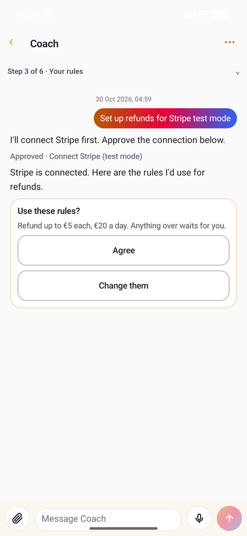
  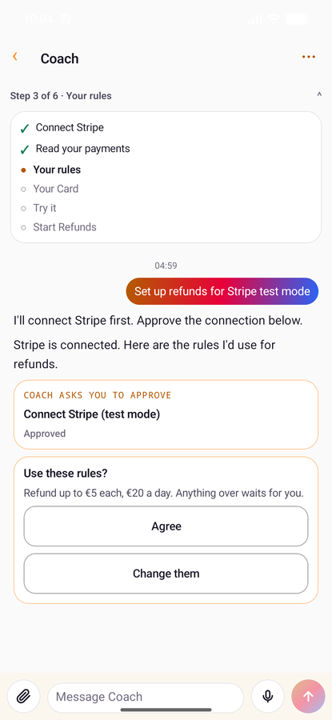
  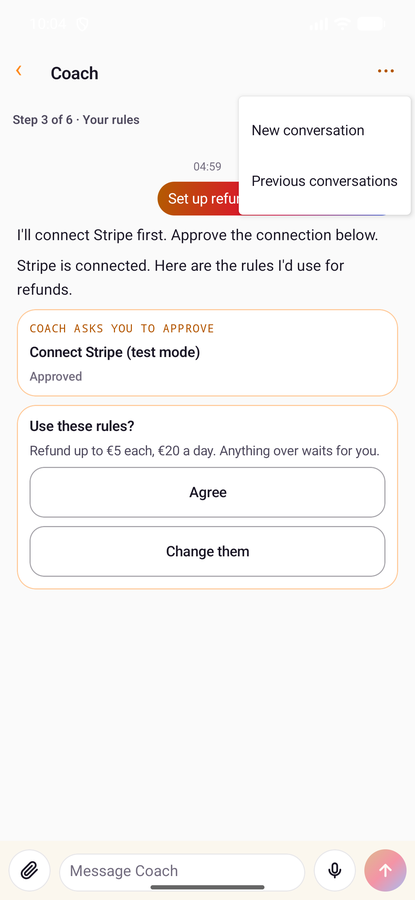
</p>
<p>
  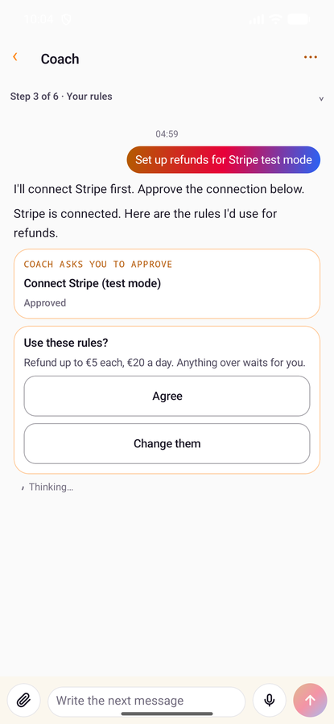
  
  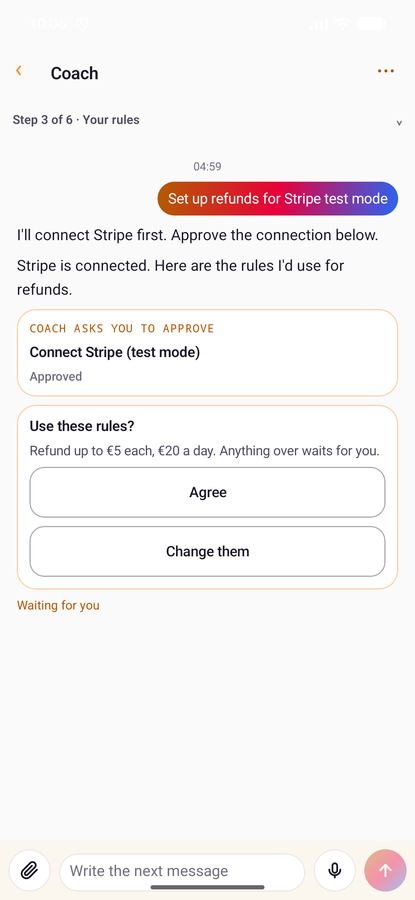
</p>

Where Coach's screen is 600 dp wide or more (a tablet, beside the sidebar or with it folded
away), Coach's conversation has "Taking shape" beside it, as on an iPad (`SetupShapePanel`, from `AppState.setupShape`): what Coach
has made so far, read only from what the app already holds. The taf's name once it's handed over,
else the plan's title; the plan's steps, each done, needing you, at work, to do, failed or skipped
(with no plan, what Coach asked of the person and where each stands); the tools its cards connect,
each connected (with what the taf calls through it), signed in, waiting for you, or not connected
in planque's words for its state (`status_words`), never planque's `reason`, which is English, for the log; and the Card KIFF drafted, dashed until it's confirmed. Before anything, one
line says what will show there. Nothing is fetched, signed or sent from it, and the cards to answer
stay in the conversation; beside it, the plan's line above the thread steps aside, since the panel
shows it (`SetupShapeTest`).

**Nothing on screen moves while you watch.** A chat screen keeps the order it has already drawn
(`Chat.steady`, one `Chat.Shown` per open chat): a turn that streams, a card that comes with it, and the thread read again
when the turn ends leave what's shown where it is. Something new goes after it, in the order it arrived; older than
everything shown (an earlier page), before it. Your message, once tafs cloud has it under its own id, takes the place of
the one you sent. Opened again, the thread is in its own order, a card after what Coach wrote with it
(`CoachWords.items`). Before, a card that came while Coach answered could show above your message, then jump twice as
Coach's words came in and the turn ended (`ChatSteadyTest`).

A taf's page, under its compact header: the sample's Refunds; a chat opening at its newest, with a
stranger's knock and a paired sender's message at their times; and the page folded as the chat
scrolls (the last two drawn by `TafPageScreenTest`, from synthetic data):

<p>
  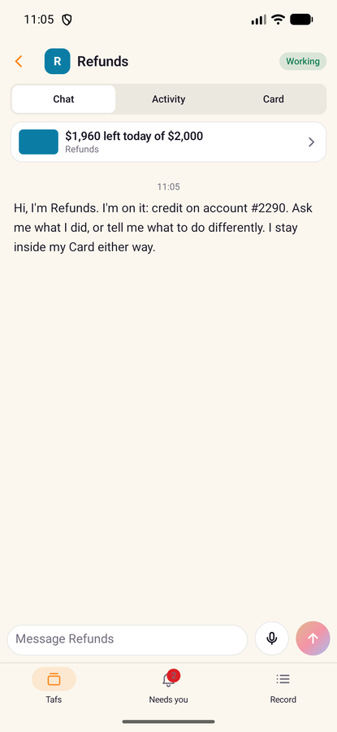
  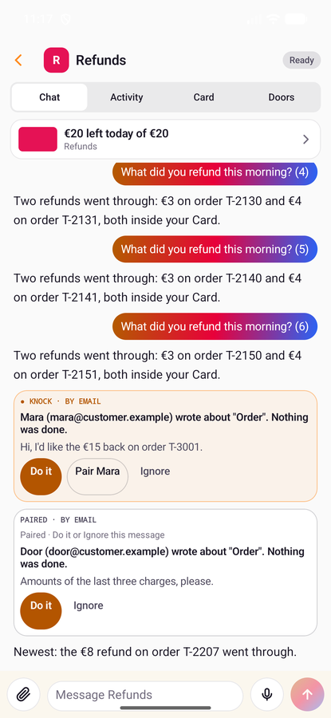
  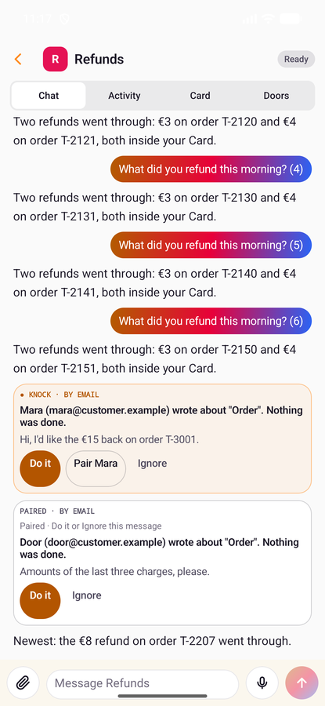
</p>

## Home with no taf

An account with no taf sees the jobs a taf can take on Home, where tafs cloud says so
(`GET /v1/recipes`, its `home`; [coach.md](coach.md)). Every word is tafs cloud's, in the
person's language.
- **The list** (`HomeRecipes`): `home.words` leads it, then a chip per category to narrow it
  (picked again, every recipe shows), then each recipe led by its `headline`, the problem it
  removes, with its `line` under it.
- **Only when `home.shown`** is true, which tafs cloud sets only with no taf, suggestions on, and
  someone who can set a taf up with Coach. Home then leads with the jobs, with no count above them
  ("0 tafs working", "Nothing needs you"), since a new account has nothing there yet. Otherwise Home shows `home.words` alone, its empty line.
  A tafs cloud from before `home` leaves Home's own "No tafs yet." as it was.
- **A recipe's sheet** (`RecipeSheet`): the headline, the line, `today` (what it costs today),
  then its Card in three zones titled by `labels` (`allows`, `holds`, `never`), a zone with
  nothing left out, and one button, `labels.hand`. The button opens a new Coach conversation
  with the recipe's `say` in the message box, to edit and send, as a recipe tap in Coach does
  (`AppModel.handRecipeToCoach`). Someone who can't use Coach gets no button.
- **When it's read:** the recipes are read with each refresh that finds no taf, as well as when
  Coach opens (`RecipesTest`, `HomeRecipesTest`).

**Every job, also once a taf runs** (`GET /v1/recipes/gallery`, read with each refresh;
[coach.md](coach.md#the-gallery)). tafs cloud decides what shows; the app draws it.
- **+ New** at the top of Tafs (Home no longer repeats the tagline: it is in Settings, About), in tafs cloud's `words.title` (the app's "New taf"
  while it sends none), opens the gallery (`GallerySheet`): its title, "Say it in your own words"
  (`own_words`), which opens Coach on a new, empty conversation (`AppModel.openCoachEmpty`), then
  `words.all`, a chip per category, and every job. Only for someone who may use Coach. A tafs cloud
  without the route shows no + New.
- **Explore jobs**, a row under the headline (`words.explore`), opens the same gallery to browse:
  every job to read, with nothing created. It shows with or without a taf, and for someone who
  can't use Coach too, but only when tafs cloud sends `words.explore`: it leaves them out while
  Home already lists every job, and the app draws no row of its own words (as on iPhone and
  iPad). While browsing, the gallery is titled Explore jobs and offers no "own words".
- **The strip** under the tafs list (`JobStrip`) draws `strip.ids` in their order, under
  `strip.title`, while `strip.shown`. An id the gallery doesn't list is left out. When the gallery
  holds more jobs than the strip shows, a last row, **See all jobs** (`words.see_all`), opens it
  to browse, as Explore jobs does. The strip offers jobs to hand to Coach, so it shows only to
  someone who may use Coach; someone who can't has Explore jobs, which opens the same gallery.
- **A job** (`JobRow`, also on Home with no taf) leads with its headline, then its line, then its
  apps, each with its logo. Its category's colour is its edge, and its chip's; the colour is tafs
  cloud's token for the theme on screen (`CategoryColor`), and without one the app's own colours
  show. A tap opens the same sheet as on Home, with the gallery's `labels`.
- **A job's sheet** (`RecipeSheet`) creates nothing. It shows the headline, the line, what it
  costs today, where it was proved (`proved`, "Proved on a test help desk."), its apps with
  their logos, its Card as does / asks / never, and what it reported after that proof run
  (`sample`, under `words.sample`). A job with no proof run has neither. Its one action hands
  it to Coach: "Try it with Coach" (`words.try`) when opened while browsing, else `labels.hand`,
  and only for someone who may use Coach.
- **The words** are tafs cloud's; the app's own (`HomeWords`) stand in only while it sends none.
- **Logos** (`LogoStore`, `AppWithLogo`) load only tafs cloud's own `/v1/logos/{key}` paths, with no
  session: any other value, a URL included, draws the name alone, so no request ever leaves for a
  third party. They're kept in memory and on disk for a week, as tafs cloud's `max-age` says.
  Connect apps shows an app's logo in place of its initial when tafs cloud sends one
  (`GalleryTest`, `GalleryScreenTest`).

## Labels

Missions v2.1 §3: Coach-managed chips on the flat tafs list. The app only filters by
them; tafs cloud lists them, counts them and words the filtered headline.

- **What Home sends** ([labels.md](labels.md), "What the apps get"): `labels: [{id, name, color, count, waiting,
  headline: {words}}]`, each taf's `labels: [id]` (0 to 3; missing reads as none), and `labels_words: {all}` (`HomeLabel`,
  `HomeLabelsWords`). `waiting` counts the label's tafs that wait; `color` is one of Explore's category tokens.
- **The filter row** (`LabelRow`), under the headline on a phone and over the Overview's table on a tablet: All with the listed tafs' count, then each label with its count and an
  amber dot when one of its tafs waits. Two labels show, then "+N" for the rest, which opens the row out; a chosen label further
  on stays in sight (`shownLabels`). No labels, no row.
- **It opens on All every time** the list opens (`HomeView` remembers the choice only while it's on screen). A label that went
  with a refresh falls back to All (`chosenLabel`).
- **Filtered:** the list shows that label's tafs (`onLabel`), and the headline is tafs cloud's line for it ("2 tafs working ·
  Money"), else the label's name (`labelHeadline`). The tafs still being set up and the other agents aren't shown.
- **On each row:** its labels by name, at most three, under its line (`LabelTags`).
- **"All"** is tafs cloud's word (`labels_words.all`), else the app's (`home.labels_all`).
- **A mission's row** (§3, a draft until tafs cloud sends it): filtered to a label that is a mission's (`labels[].mission:
  {id, name, goal}`), the list shows its goal in the person's words and **Log** (`MissionRow`).

## Shared with you

Home lists the person's own tafs first, then the tafs being set up, then, under **Shared with you**
(`home.shared_you`), the tafs shared with them to use but not to manage, as on iPhone and iPad (kiff/tafs#306). A taf is
shared when KIFF's access answer for it says use without manage (`AppState.sharedWithMe`). Until KIFF has answered for a
taf, it stays among the person's own; it moves under Shared with you only once that answer says so. Home splits its ordered,
filtered list with one function (`AppState.sections`), so both lists keep the list's order (waiting first, then the one used
most recently), and a label filters both. The sample has nothing shared
(`SharedUseTest`).

## A mission's log

Missions v2.1 §6, a draft until tafs cloud's log route and its words land: **Log** opens `GET /v1/missions/{id}/log` over the
tafs list (`MissionLogView`), read only, newest first, a page at a time (`before`), More for the next.

- **Each entry**, drawn as tafs cloud words it (`MissionLogItem`): who wrote it (a taf by name; the lead and the person by
  tafs cloud's words), its kind in tafs cloud's words (`kind_words`), coloured by kind (delivered green, handed blue, stuck
  amber, decided ink, a note grey), its sentence, what it refers to (tafs cloud's words for each, else its kind: "run",
  "hold") and its value ("€4,120 sorted"). The time is the phone's own ("14 Nov, 07:10").
- **A removed taf's entries stay**, greyed and marked `mission.removed`, so the history is whole.
- **Nothing in it acts:** it reads only. An entry with no words isn't drawn, and a page read twice shows once
  (`MissionLogs.drawn`, `MissionLogTest`).
- **Ask Coach** under the title, for whoever may use Coach: Coach opens with the mission's name in the message box, and
  nothing is sent (`AppModel.askCoachAboutMission`). Your brief's Evidence opens this same view.

## Your brief

Missions v2.1 §7 (a draft until tafs cloud serves `GET /v1/brief`), as on iPhone and iPad: "Your brief" takes Needs you's place
once there is one (`BriefTab`, `views/BriefView.kt`; `kiff/Brief.kt`). Until then, and for anyone tafs cloud sends none to,
the Needs you tab is exactly as today. The switch is the route itself: a 404, a failure, another shape, or a brief with no
decision, nothing done and no next move is no brief (`AppModel.loadBrief`, read with every refresh).

- **Read leniently, in v2.1's names** (`Brief.parse`): `decisions` (`question`, `answers` with `recommended` and `decline`,
  `why`, `meanwhile`, `deadline_words` (drawn; `deadline`, a time, never is), `urgent`, `later: {words}`, `now_why`, `note`, `ref: {kind, id, taf}`), `more`, `done`
  (cases with `state` and `next_check`, `value`, `log`), `next_move`, `rest`, `credits: {words}`, `labels` and the headings'
  `words`. Field by field: a part the app can't read is left out, never the brief; unknown fields are ignored.
- **Drawn as sent:** the tab is named tafs cloud's `words.title` ("Your brief"), else Needs you. Decisions first, each with its
  taf, Coach's recommendation and its why (no why, and the answers show as equals), what happens meanwhile, why it can't wait
  when it can't, and its answers (the recommended one filled, a decline in red, Later beside them). Then one next move (Start
  opens Coach with it in the message box; nothing is sent), then Done case by case (green once closed, amber while waiting),
  with its value and Evidence, which opens the mission's log. On a wide screen, decisions beside Done, the next move under
  Done. Every heading is tafs cloud's; the app's own (`brief.*`) only stand in where it sent none.
- **Label chips** (`LabelRow`, as on the tafs list, All with no count) filter the brief: `GET /v1/brief?label=`, as tafs
  cloud filters it. A chosen chip tapped again is All.
- **An answer is never given from the brief** (`BriefRoutes.destination`). A tap opens where the decision's own signed answer
  is given, over the brief with a way back: a held call (`ref.kind: hold`) on its own card in Needs you (`HeldCallCard`), with
  **no answer chosen**, so the person approves there, with the fingerprint asked there and a fresh signature; a step
  (`step`) on its own panel; a taf whose scheduled check couldn't read (`check`, "Open the taf") the taf's page on the tafs tab,
  by tafs cloud's id in `ref.taf`, where the owner sees why; anything else (a connection, a proposal, no id) Needs you's list. The answer tapped isn't part of
  the destination; the brief's code signs and sends nothing (`BriefTest`). Answered there, the card goes back to the brief.
- **Coach's chats that wait on you** (`coach_waiting`, `{count, words}`) are one line under the decisions, in tafs cloud's words
  ("17 Coach chats wait for your answer."), opening Needs you, where each waits with Open and Set aside. It's Needs you's `coach`
  part, so the brief's numbers add up to the badge; drawn only when tafs cloud sends a count above 0 with its words
  (`theCoachChatsThatWaitAreReadOnlyWhenThereAreSome`), as iOS does.
- **Needs you stays reachable.** The rest line (`rest`) opens today's Needs you list; whenever Needs you holds something the brief
  doesn't show, that count shows there too, with the same link, even when tafs cloud sent no `rest`
  (`AppState.briefNeedsYouLine`). It's matched by item, never by count: held calls by KIFF's id and steps by their hand-off
  against the brief's `ref`, so a brief showing as many decisions as Needs you holds, but different ones, still shows the line. A held call's alert opens Needs you's list over the brief.
- **Later** (`POST /v1/brief/decisions/{id}/later`) moves a card to the next brief only once tafs cloud took it; refused, the
  card stays and the alert says why. Never on an urgent decision, whatever was sent (`Decision.laterShown`, and the model
  refuses it too).
- **Urgent** is tafs cloud's call: a red border, its word on the badge (`words.urgent`), its `now_why`, no Later. An alert
  with `brief_kind` (`brief`: "Your 08:00 brief is ready.", or `urgent`: one that came at once, a held call's with
  `decision: hold:<id>`) opens where its `open` says (`brief` opens the brief, a held call's Needs you), sounds as its
  channel does (below; on Android 8 and later the channel, not `level`, decides: an urgent alert interrupts even when sent
  `level: quiet`), and with the app open reads the brief again; one brief's alert replaces the last. An earlier draft's
  `kind: brief|urgent` reads the same. **Channels** (`AlertChannel`), each set apart in the phone's settings: a held call
  stays on Needs you's, interrupting, even when tafs cloud marks it urgent, so the settings an owner gave it hold (Android
  never carries a channel's settings over); an urgent alert that isn't a held call goes on **Urgent**, interrupting, with
  Needs you's sound; Your brief's on **Briefs**, with the phone's notification sound but no pop-up (`IMPORTANCE_DEFAULT`, since
  Android 126: the first, quiet `briefs` channel is deleted and replaced by `brief`, since Android never raises a channel's
  importance); anything else quiet on Other alerts.
- **A mission's log:** Done's Evidence opens the same `MissionLogView` the tafs list's mission row opens (A mission's log,
  above), by the log id Done carries (`log`) under the mission's name. Ask Coach there opens Coach with the mission's name in
  the message box; nothing is sent.
- **The sample's brief** (`SampleBrief`, stand-ins for tafs cloud's words, in each language from app/strings' `sample.brief.*`
  and the brief's own headings) shows only for the store's screenshots: a debug
  build opened with `--ez screenshots true --ez brief true` (and `--es briefLabel money`, `--ez briefUrgent true`), with its
  mission's log as one page (`SampleBrief.log`, `AppModel.missionLog`). Its missions are Parcels (the label `money`), Leads
  (`clients`) and Support. The sample walk keeps Needs you, and has no log.

## Building and testing

```bash
cd android
./gradlew :app:testDebugUnitTest      # the unit tests, against fake KIFF, tafs cloud, planque and Google Play
./gradlew :app:assembleDebug           # a debug build
./gradlew :app:connectedDebugAndroidTest   # the UI tests, on a running emulator or phone
```

Gradle needs a JDK 17 or later; Android Studio's own (`jbr`) does. The build uses the
Android Gradle plugin 9.5 on Gradle 9.6.0, which the wrapper fetches and checks against its
checksum; Android Studio needs to support that plugin version to open the project. On Windows,
`gradlew.bat`. CI (`.github/workflows/android.yml`) runs the unit tests and the debug
builds on every pull request that touches `android/`, and the UI tests on an emulator. The UI
tests run in a debug-only `TestHostActivity` (`createStableComposeRule`), which takes configuration
changes in place: on a just-booted emulator the system settles after the first test starts, and an
ordinary activity recreated then would drop the test's screen ("No compose hierarchies found").

The application id is `dev.kiff.tafs`; the Kotlin packages are `bot.tafs.app`.

**Alerts** need Firebase's settings, `android/app/google-services.json`, which is never
committed: CI writes it from the repository secret `GOOGLE_SERVICES_JSON`. A build without
it has alerts off and says so in Settings.

**Versions** (`android/app/build.gradle.kts`): `versionCode` goes up by one with every build,
and `versionName` is what the store shows: `1.x` for a release with new features, `1.x.y` for
one with fixes only. Every Android batch pull request says its `versionName`. The app went public
at 1.0 (versionCode 40), and 1.1 (43) is its first feature release since. The Wear OS watch shares the package
and counts in its own band, from 400,000,001 (docs/watch-wear.md, Versions).

**Releases** are signed bundles for Google Play, built by `android.yml`'s release job by hand,
or on a merge to main that raises `versionCode` (the `version` job compares it with the commit
before), once `test` and `ui` passed, in the `android-release` environment. No reviewer is required: an
internal release goes out on that merge, with CI, the reviews and the internal track as its
guardrails. Promoting a release beyond internal (Play review) is the owner's, in Play.

**To Play's internal track, with no upload by hand.** Once the repository variable
`PLAY_UPLOAD` is `on`, the release job sends the signed bundle to Play's **internal** track
(`android/play/play_internal.py`): one edit, the bundle, the internal track's release
(`completed`, this bundle alone, with its notes), committed **without sending anything for review**
(`changesNotSentForReview=true`): on 20 Nov a plain commit, with managed publishing off, sent every change pending in the
console for review and restarted production's. Play's managed publishing is on since then, and with it on Play refuses that
parameter (400, "Changes are sent for review automatically. The query parameter changesNotSentForReview must not be set.",
21 Nov): on those words alone, and no others, the script commits the edit plainly (`commit`), and the release waits in
"Changes ready to publish" until mac-local presses Publish. Any other refusal commits nothing. While a production review is in
flight, no internal upload runs: mac-local says when (row 44's 0.4.4-timing waited for 128). **Before merging a pull
request that raises either `versionCode`**, Play Console's Publishing overview must list nothing saved and not yet sent for
review: with managed publishing on, the plain commit sends every saved change for review with the release (on 22 Nov,
132's commit sent a saved country expansion along with it). Managed publishing holds only the publishing, and Publish then
sends every change that is ready, production's too, so whoever presses it checks that list first. It never touches production,
closed or open testing, or a rollout: the track is fixed in the script, and its tests check
it. It signs in with Google's workload identity federation (`google-github-actions/auth`,
`PLAY_WIF_PROVIDER` and `PLAY_SERVICE_ACCOUNT`), a token for the Play Developer API that lasts
the run: no key file, and no secret holds a key. A bundle Play reads as another `versionCode`
than the build's commits nothing.
- **Release notes** live in the repository, one folder per `versionCode`:
  `android/play/release-notes/<versionCode>/<locale>.txt`, for en-US, de-DE, fr-FR, es-ES,
  it-IT, pt-PT, nl-NL, pl-PL, since 130 ko-KR, and since 132 es-419 and pt-BR (the listing's languages, `play_internal.py`'s `LOCALES`), each at most 500 characters. A pull request that raises
  `versionCode` adds that folder; `test` checks it (`play_internal.py --check`) and fails a
  version with none, as the upload refuses one (Android 1.29.5; before, `test` passed without them).
- **Where tafs stands on Play, read only** (`.github/workflows/play-status.yml`, by hand and at 06:17 and 17:17 UTC, beside
  the App Store's `store-status.yml`): `android/play/play_status.py` opens an edit, reads every track and deletes the edit
  unsaved, so nothing is uploaded, changed or sent for review, and managed publishing never sees it. It prints one line per
  release (track, release name, status, version codes) to the run's summary, and nothing else: no ids, tokens or countries.
  It can make only those three calls, by their exact shape, and the file never names Play's save call: the job checks that
  with a grep before any token exists, and `test_play_status.py` checks it too. Same workload identity as the uploads.
- **The Wear OS watch** has its own release job (`wear-release`), track (`wear:internal`) and variable (`WEAR_UPLOAD`),
  signed with the same upload key (docs/watch-wear.md, Versions). A run by hand builds the phone's bundle unless its
  `form` is `wear`.

**A release proves it's signed** before anything reaches Play: CI reads `jarsigner -verify`'s own "jar verified." (it
exits 0 on an unsigned bundle too) and prints the signer certificate's SHA-256 in the run log, for the phone's bundle and the
watch's. The temporary keystore is removed however the step ends. Neither bundle is kept as a run artifact: the repository
is public, so Play holds the only copy.
The upload key is never in the repository or a session: `android/make-upload-key.sh` made
it once into the secrets store, and `android/release.sh` builds with it. CI's release jobs read it from the GitHub secret
`ANDROID_UPLOAD_KEY` (the same JSON: `keystore` in base64, `store_password`, `key_password`, `alias`), which only the
`android-release` environment's jobs see. Until that secret is set, they read Secrets Manager's copy through the release
role, as before. Each run's log says which ("The upload key: from GitHub"). The app has no native
code of its own. Its only native libraries are two small ones that AndroidX ships already
stripped (`libandroidx.graphics.path.so` for Compose, `libdatastore_shared_counter.so` for
DataStore), with no symbol table or debug sections, so there are no native symbols to put in the
bundle. `ndk.debugSymbolLevel` stays set, so any native code added later sends its symbols. Play's
"no debug symbols" notice is about those two libraries, and it can't be cleared from this build.

**Plan & usage** (`UsageViews`) opens on tafs cloud's balance (`GET /v1/usage/balance`,
[accounts.md](accounts.md)), every line in its words: the balance and its second line, a bar at
`meter_pct`, the warning, and **Raise the limit** where `raise` is set (`BalancePanel`). Then buying,
who bills the plan, asking an admin, and the Credits panel, which is left out where the balance's
`credits_panel` is false (no plan and no run lately; a tafs cloud without the flag shows it). Settings' Plan card shows `plan_line` in
`plan_tone`'s colour, and Home shows `home_line` when it's set (`planColor`); both are read with each
refresh (`AppModel.refreshPlan`). A 404 from a tafs cloud from before the balance shows none, and a
failed read shows tafs cloud's `words` above what was read before.
- **Raise the limit** (`AppModel.raiseLimit`) asks once, then the device key signs KIFF's
  `PUT /v1/me/usage/limit` with `{"raise": true, "from_cents"}` (`KiffClient.raiseLimit`, a
  setup-signed path). The button stays busy until the balance is read again; a read that fails
  says "Your tafs can go on. This period's credits couldn't be read since." with **Read it again**,
  which signs nothing, and no raise until it's read. A `limit_changed` refusal reads the balance
  again and offers the raise from the new limit, and says so; `limit_ceiling` shows KIFF's words, or
  that KIFF raises it further. An admin's open request for a raise has Raise the limit on it too.
- **A chat or Run now refused for credits** (409 `credits_used_up`, `limit_reached` or `no_plan`)
  shows tafs cloud's words as they are (`AppModel.creditsRefusal`). A chat's words go back in the box,
  with no Not sent row and no Retry, as with `held_full`: sending again changes nothing until the tafs
  go on, and the words say how.
- **Asking an admin** (`TaskRequests`): on Company for a raise (`kind: "raise"`), on Solo for a pack.
  Someone who manages billing (`billing.manage`) sees the open requests: a raise is answered by Raise
  the limit, a pack by buying it, and either can be declined, signed. The request's lines are the
  ones the doc gives both apps (`UsageWords.asked`, `lastAnswer`).
- **A taf's Usage row,** on its Card tab, opens its own credits this period: its runs, each opening
  its request (`CreditsRunsSheet`).
- **The sample** shows a balance and credits (`SampleCredits`), the same as iPhone's.

**Buying through Google Play** is on (`res/values/flags.xml`'s `play_billing`). Plan & usage offers
Solo and packs of credits, which never expire, at Play's prices, where the balance's `buy` offers
them to this person, and only once KIFF's usage names their Play products and the account's token.
KIFF records each purchase before Play is told it's done, and Restore purchases sends again what
wasn't. The panel's title is **Choose a plan** while Solo is offered (`buy.solo`), and **Add
credits** once it runs. Under Solo's terms, the balance's `buy.coach` says what Coach's help
includes, tafs cloud's sentence as kiff.dev says it; none sent, no line.
- **Restore purchases** shows only while Play knows a purchase not finished yet, or couldn't say, or
  after one KIFF didn't record (`AppState.restoreShown`, read with Play's offers). Launch and sign-in
  already send what's unfinished, so an account that bought nothing has no Restore. A restore that
  finds nothing says "Nothing to restore.", never "Purchases restored." (`PurchaseOutcome.NothingToRestore`).
- **The First month pack** (`bot.tafs.credits.firstmonth`, KIFF's pack with `"once": true`) shows
  first among the packs, where the balance's `buy.first_month` is set and `ready`, its price its
  button (`UsageStore.firstMonthPack`, `repeatPacks`). Not ready, it isn't shown: never alone or
  greyed. tafs cloud offers it only once Solo runs, and KIFF leaves it out once the account has
  bought it (`PlayOffersTest`).
- **Play's offers are read again** each time Usage shows, after every purchase and restore, and
  just before Play's sheet opens (`Purchases.load`, `PlayBillingStore.purchase`), never kept
  from an earlier read. Solo has no free trial; the trial's words show only if Play ever lists a
  free-trial offer for the Google account, and the words follow Play: "Free for {trial}, then
  {price} a month", or "{price} a month". When Play can't be reached for that read (no network, its service down), the
  purchase says "Couldn't reach Google Play. Try again.", never that Play doesn't sell it
  (`PlayBillingStore.unreachable`).
- **When Play lists none of what's offered,** the panel says why above Restore purchases, rather
  than standing empty (`Purchases.buyNote`): "Couldn't reach Google Play. Try again." when Play
  couldn't be read, else "Google Play can't sell on this phone, so nothing can be bought here."
  That's Play billing off for this app on this phone (`BILLING_UNAVAILABLE`, such as a build Play
  didn't install), or nothing listed for this Google account. Nothing is said before Play is asked,
  or once it lists one of them.
- **How a purchase or restore went** shows under what was tapped (Start Solo, the pack, Restore
  purchases), read out by TalkBack (`PurchaseNote`). A purchase KIFF hasn't recorded yet offers
  Restore purchases right there.

**Home's first line** is tafs cloud's `headline` ("2 tafs working.", or "1 taf ready." for a new taf with no
schedule, [api.md](api.md)); the app counts nothing for it (Android 1.27.6). A tafs cloud from before `headline`
leaves the app's own count of the tafs at work.

**Needs you's count** (Home's line and the tab's badge) is tafs cloud's (`needs_you`: its count and
words, covering held calls, "Did this happen?" calls, currency requests and tafs with a knock). When
tafs cloud leaves it out (it couldn't read all of it), the app counts what it has (`needsYouCount`).
Android shows each alert on the lock screen as it comes, with no count of its own there. Locked, the phone, and any watch it bridges alerts to, show only **A taf needs you** (`alert.needs_you`): every alert is private, with that as its public version (`Alert.Show.locked`), so an amount, a merchant or a person's name waits for the unlock, as iOS's hidden previews do (`LockedAlertTest`). An app's
sheet with no saved workflow says so once, under a Workflow line of its own (`workflow_words`).

**A held call's card** (`HeldCallCard`) has KIFF's face: the amount in its declared unit, the
action as KIFF titles it, and the Card rule it crossed in KIFF's words (`reason_text`). Under it,
when KIFF kept the taf's words with the call, **The taf says** (`needs_you.taf_says`) shows them
under their own heading:
- `taf_about`, what the call is on, as a business reference ("Order 1042");
- `taf_reason`, the customer's reason ("Arrived broken, photo attached").

These come from text a customer wrote, so they're drawn as plain text, one paragraph each, with
control characters and line breaks made spaces, and format characters (bidi overrides, zero-width
marks) dropped so nothing can reorder or hide words (`KiffMapping.tafSays`). They're capped at what
KIFF keeps, 120 and 280 code points, so an emoji is never cut in half. A link or markup shows only as words. They never stand in for KIFF's amount,
rule or action. The gateway's own arguments (`kiff_operation_id`, `kiff_about`, `kiff_reason`)
aren't repeated under Details, where the call's ids stay. A KIFF that keeps neither shows the card
as before.

**A Card asked to take another currency** (KIFF's `card_unit` exception, as tafs cloud draws it in
`card_unit_exceptions`): one panel (`CardUnitExceptionPanel`) with tafs cloud's title, words and
history, in Needs you (and its count), at the top of the taf's Setup, and above its Activity, where
the Activity page's rows win over Home's. It is never a held call and never offers Approve once.
Its Coach button opens a new conversation on the taf with tafs cloud's proposal written in, not
sent (`discussCardUnit`); Dismiss reads KIFF's exception again and, only while it's still that
taf's open request, signs KIFF's ordinary refusal against its current version (`dismissCardUnit`). A
dismissed one leaves at once, from Home, Setup and Activity's cached pages, and a page or Setup read
already on its way doesn't bring it back, whether it lands as a page, a 304, a failure or a cancel
(`dismissedCardUnits`). Activity draws the newest page's requests, and its notice when KIFF's
couldn't be read (`card_unit_exceptions_notice`).

**Alerts after signing out.** Signing out turns this phone's alerts off and remembers whether
they were on for that account (`ALERTS_WERE_ON`). Signing in to the same account again registers
this phone again, with no new confirmation, while the account's alerts still reach tafs cloud;
otherwise the app says once that they're off, with **Turn on**. Another account doesn't get them.

**Halt and Resume say what happened on the Halt screen** (`haltError`): a halt or resume that
didn't go through says why there, and the screen never calls a connection by its service's name.
Its button says what's under way, "Halting…" or "Resuming…", even once the screen has turned to
the other button.
While it halts, the screen reads the halt again after half a second, a second, then every 2
seconds, for about two minutes (`HALT_POLLS_MS`), and the home list is read beside it rather than
before it, so Halted shows as soon as tafs cloud says so.
Home's row for halting every taf shows with tafs to halt, or whenever the account isn't running
(`showsAccountHalt`). With no taf, the home list carries no account halt, so each refresh reads
`GET /v1/halt` on its own: an account halted with no taf left can still be resumed from Home.
**A message refused for a halt** (`code: "halted"`, with tafs cloud's `halted`: `account` or
`taf`) keeps that on its Not sent row (`Unsent.halted`), and the halt is read at once. While it
holds, the row offers **Resume** behind the fingerprint, the halt row's own resume, in place of a
Retry that can't work. A resume that didn't go says why under it. Resumed, Retry is back
(`AppState.unsentWaitsOnHalt`).

**Run now that finds nothing new is no failure** (`runNowQuiet`): a taf that checks first answers
`session: null` with `outcome: "quiet"` and tafs cloud's `words`, shown as they are under Run now until
the next one. The app writes no line of its own, and an older tafs cloud's bare `null` shows nothing.

**Tafs tapped again goes back to the list** (`tappedAgainGoesToStart`): from a taf's screen, the
trial, the calendar or Coach, the bar's Tafs closes it, as a phone's tab bar does. Another tab is
a place of its own.
Resume's confirmation is bounded: unanswered after 10 seconds, the fingerprint check is
cancelled, the prompt with it, so a late answer sends nothing, and the screen says "The fingerprint
check timed out. Try again." (`RESUME_CONFIRM_MS`). Android can't tell whether its prompt is on
screen, so the wait itself is what's bounded, and only for Resume.

**One account per phone, and signing out asks first.** Account ends with **Sign out**: another
account is signing out, then signing in with it. Sign out, and Sign in again on the line shown
when the phone can't approve, each open a confirmation (`ConfirmSignOut`), so one stray tap
never ends the session. Account › About › Version names the build, e.g. "1.0 (26)"
(`versionWords`).

The status and navigation bars follow the app's own Light/Dark/System choice from the first
frame (`enableEdgeToEdge` with the saved choice in `MainActivity`), and `TafsTheme` keeps their
icons dark on the light ground and light on the dark one when the choice changes.

## The packages of `bot.tafs.app`

| Package | What's in it |
|---|---|
| (root) | `MainActivity` (the bar: Account, Tafs, Needs you, Record, Coach; on a tablet, `TabletSidebar` with what it chose beside it), `TafsApplication` (the clients, the keys, alerts, Google Play, and the app's one `AppModel`, which the screen and the watch's relay share) |
| `app/` | `AppModel` (the one view model: state, and everything the screens ask of the backends), `SampleStore` |
| `kiff/` | The clients: `KiffClient` (KIFF's API), `TafsCloud`, `Planque`, `Transport`; `KiffMapping` (KIFF's records into the app's), `Stream` (a chat's streamed events), `ReceiptCheck` (receipts checked on the phone), `Jcs`, `SigningTime`, `SecretStore`, the wire types (`Wire`, `Usage`, `Coach`, `Doors`, `Versions`) |
| `model/` | The app's own types and words: `Models` (`Taf`, `Card`, `HeldCall`, `RecordEntry`…), `Chat`, `Attachments`, `CardCheck` (the sample only), and one `…Words` object per feature, for words the backends don't send yet |
| `signing/` | `KeystoreKeys` (the signing key and the approval key, in the Keystore), `DeviceSigner`, `BiometricAuthenticator` |
| `push/` | Alerts through Firebase Cloud Messaging: `TafsMessagingService`, `AndroidPush`, `Alerts` |
| `watch/` | The Wear OS watch's requests: `WearRelayService` and `WatchRelay` (docs/watch-wear.md). They read the app's one model, which `TafsApplication` owns: it lasts while the process does, so backing out of the app and opening it again comes back to what the screen held, where it used to start afresh |
| `billing/` | `Purchases` and `PlayBillingStore`: Google Play, behind the flag |
| `files/` | `PhotoPrep`: a photo redrawn as a JPEG, with no metadata |
| `voice/` | `Dictation` and `DeviceSpeech`: dictation, recognised on the phone |
| `views/` | One file per screen or feature: `HomeView`, `TafDetailView`, `TafChatView`, `CoachViews`, `CoachChats`, `NeedsYouView`, `RecordView`, `ReceiptSheet`, `UsageViews`, `TaskRequestViews`, `SettingsView`, `PeopleViews`, `ShareViews`, `DevicesView`, `DoorViews`, `SetupViews`, `EventApproval`, `VersionViews`, `HaltViews`, `AttachViews`, `MicButton`… |
| `design/` | `Theme` (colours, the amber accent, type), `Components`, `MarkdownText` |

## The Record

The Record tab lists every call the person's tafs made, by day (`RecordView`). Signed in, it also
searches across their tafs, opens one case, and exports receipts
([api.md](api.md): `GET /v1/record`, `/v1/record/cases/{about}`, `/v1/record/receipts`;
`RecordSearchViews.kt`, `AppModel.searchRecord`):

- **Search:** the box's placeholder is tafs cloud's `hint` ("Search by order, invoice, amount or
  action"), read once when the tab opens; the app's own line stands in until it comes. It searches as
  the person types, 400 ms after the last key (`RECORD_SEARCH_PAUSE_MS`), and at once on the
  keyboard's Search; only the answer for what's in the box is shown. The results take the list's place: tafs cloud's `groups`, each call drawn as
  its taf's Activity draws it (`SourceActivityRow`, with its receipt and its own next step) under
  its taf's name, and **More** for `next_cursor`. A cursor tafs cloud refuses (409, a call made
  since) searches again. Nothing found shows `none_words`. Clearing the box shows the Record as
  before. Never by a customer's name: KIFF keeps none.
- **One case:** a call with an `about` ("Order 1042 ›") opens a sheet with every call about the
  same thing, oldest first. The step that didn't go through is named first, in tafs cloud's words
  (`failed.words`), and its own next step on its row is the only retry, through the taf under its
  Card. The Record never sends anything again itself.
- **Export receipts,** for someone who oversees or manages every taf (`AppState.seesEveryTaf`;
  tafs cloud's 403 still decides): Last 7, 30 or 90 days, inside tafs cloud's 92, counted in the
  account's zone as tafs cloud counts them, not the phone's. Two files go to
  the share sheet (`shareReceipts`): tafs cloud's answer byte for byte as JSON, so KIFF's receipts
  are exactly as issued, never re-encoded, and its CSV. They live only in the app's cache and are
  replaced at each export. `missing` shows as a line ("2 calls have no receipt yet.").
- **What the app answered:** a call the app refused, or one that couldn't be sent, says so in the
  app's own line, which names the app ("Gmail refused it, and it still counts toward today's
  limits"). When KIFF says no Card total kept it (`tool_outcome.counted: false`: the vendor refused, nothing was done, and the
  Card counts what's done), the line says it doesn't count ("Gmail refused it. Nothing was done, and it doesn't count toward
  today's limits", `record.tool_refused_not_counted`, as iOS). A call with money or an amount keeps its own line, and an older KIFF
  that doesn't send the field keeps today's. KIFF's `tool_outcome.message` carries the app's answer through, so it's quoted after
  that line only when it's a short, plain, one-line reason (`KiffMapping.quotable`: 160 characters
  at most, no JSON, no address). An app's raw answer can hold the connected account's address, a
  file's name or a request id, and the Record, and the "Last failed" line Connect apps and a taf's
  page build from it, are seen by everyone who can see the taf. KIFF sending a typed reason instead
  is [needs-from-kiff.md §10](needs-from-kiff.md).

## Words and languages

**Long languages read whole on a main button.** `PrimaryButton`'s words take up to two lines before anything is cut
(`PRIMARY_BUTTON_LINES`), so French's "Approuver une fois avec votre empreinte digitale" reads whole on a 360 dp phone
rather than "…digit…"; a short action stays one line, at the same height (`PrimaryButtonTest`).

**Account › Language** shows the lines' language named in itself ("Français", `AppLanguage.name`), as the resources
resolved it, and **Change language**, which opens the app's own list: "This phone's language" first, then the 8, each
named in itself, in the order of the languages table. The current choice is marked; a tap applies it at once and closes the
list (`AppLocale`). On Android 13+ the choice is the phone's per-app language for tafs (`LocaleManager`, the same one
Settings › Apps › tafs › Language changes, which offers the 8 because the manifest declares the generated `locales_config`):
Android keeps it and recreates the screen in it, and "This phone's language" clears it. On Android 11 and 12, which have
no per-app language, the app keeps the choice in its own preferences, makes the application's and the screen's contexts
in it as they start (`attachBaseContext`), and recreates the screen after a change. A choice kept on 12 is handed to the
per-app language once the phone moves to 13. Either way the words are installed again at once, so lines drawn outside the
screen change too, and every request's `Accept-Language` follows. The session and what's open stay: the model lives in
`TafsApplication`, not the screen, and the Account sheet stays open.

**Brazilian Portuguese (pt-BR)** ships beside pt as a regional variant: its lines are pt's with Brazil's own on top
(`app/strings/pt-BR/`), generated into `values-pt-rBR`, so a phone set to Brazil reads them and one set to Portugal, or any
other Portuguese, reads pt's. The list names it "Português (Brasil)", after "Português", and keeps it as itself
(`AppLocale.known`: "pt-BR" stays, "pt-PT" is "pt", "de-DE" is "de"). Only the app's own lines are regional: KIFF's
pages and kiff.dev's open in its language (`Res.pageLanguage`, "pt"): the Terms and Privacy links, the sign-in and the
held call's page. `Accept-Language` sends the variant, then its language ("pt-BR, pt;q=0.9, en;q=0.8"), so tafs cloud and
planque answer in pt today and can tell Brazil apart once they have its words.

**Numbers and money** follow the app's language too (`Res.locale`, from the lines' `words_language`), never the phone's
region: an English app on a German phone writes "€2,000", a French one "2 000 €". An amount keeps its own currency and
symbol, and is never converted (`Money.figure`, `MoneyFormatTest`). Amounts in KIFF's or tafs cloud's own words are
shown as they come.

Every line the app writes itself is in the shared `app/strings/en/`, one file per feature, by key
(`needs_you.approve_once` is in `en/needs_you.json`), the same files iPhone and iPad read; the servers' own lines stay theirs. `app/strings/android.py` writes, from it,
`res/values/strings.xml` (counts as `<plurals>`), `res/xml/locales_config.xml` and `model/Words.kt`, a typed accessor per
key (`Words.NeedsYou.approveOnce`, `Words.Taf.worksUnderCards(count = n)`), so a missing key or a wrong value doesn't
compile. Nobody edits those three files by hand: change the JSON and run the generator, and `--check` fails CI when they
differ. Code reads a line only through `Words`, which asks `Res`: the app's resources in the language Android resolved for
tafs, set in `TafsApplication` and again by each screen as it's created (`AndroidWords.of`), from the screen's own
configuration. A screen's configuration carries the language picked for tafs alone (Settings › Apps › tafs › Language,
from `locales_config`), which can differ from the phone's; the application's context can keep the one the process
started with. Before 1.1.2, a German app once showed Home's count in English, and a language picked while tafs waited in
the background didn't reach its own words (`AppLanguageTest`). Errors that are objects (`KiffError`, `PlanqueError`) read their words when shown, so they
follow the language. Unit tests run on the JVM without Android's resources: there `Res` reads the generated English
`strings.xml` itself (`XmlWords`, named by a test service file), so every test still checks the exact English words.

What stays in code, never in a language: JSON keys, codes and states compared with a server's, tool names, file names,
what's sent to a server as data, and every signed message (`tafs.connect.v1|…`, `tafs.cards.v1|…`, an answer's wire name).
The one signature over words, a people change (`tafs.people.v1|…`), is a fingerprint check on the phone whose result isn't
sent. Lines only Coach reads (the screen's description in a drive) stay English. The terms and the voice for each language
are in [languages.md](languages.md).

No English is left in the app's code outside that list: `app/strings/android_literals.py` scans the Kotlin literal by
literal, as `ios_literals.py` does for iOS, so words beside a comparison or a `when` branch are still caught. What stays is
kept by a rule there or by name in `app/strings/android_kept.json`, with the reason, and the strings tests fail on anything
else. The Strings workflow runs on every change to `android/app/src/main/kotlin`.

A line that names the device says what it is (`{device}`): "phone", or "tablet" where the screen's smallest width is 600 dp
or more, as Android's `sw600dp` does (`ThisDevice`, set in `TafsApplication`). Both words are lines of their own
(`device.phone`, `device.tablet`), so each language says them. The device name the phone sends KIFF at sign-in reads "tafs
on Android phone" (`settings.devices.this_device_name`), with its `kind` (`android_phone` or `android_tablet`, `ThisDevice`);
Devices shows KIFF's `display_name`, drawn from the kind in the app's language, and that name only without one.

The Terms and Privacy policy links (Settings, Sign-in, Plan & usage) open tafs's own pages, `kiff.dev/tafs/terms` and
`kiff.dev/tafs/privacy`, the ones Google's consent screen names (`Legal`, Android 1.27.8). kiff.dev serves them in every
language the app ships, so each link opens the page in the lines' language (`kiff.dev/de/tafs/terms`, `Legal.SERVED`), with
no "(in English)". A language kiff.dev doesn't serve them in opens English, the unprefixed page, and the Settings and Plan &
usage links say so ("Terms (in English)", `settings.legal_in_english`), as kiff.dev does. The English text is the one that
binds, and each translation says so at its top. Before, the links opened KIFF's pages (`/terms#tafs`), then English only.

The chat shows the owner's own answer line as it is by a flag on the line (`RecordEntry.byYou`, set where the phone
records the answer and kept when KIFF's outcome matches), never by matching its words, so it holds in every language.
KIFF's line for a held call reads "approved by you, done" only when KIFF says the reader answered it (`answer.you`), and
"approved, done" otherwise.

## Live updates

A silent push from tafs cloud names what changed on the account (`kind: background` with
`change` and `taf_id`, [approvals.md](approvals.md)), and the app reads that again with its own
session (`AppModel.changed`, `readChange`). Nothing is shown and nothing is taken from the push:
- `taf`: the home list, and that taf's thread where it's been read;
- `halted` and `resumed`: the home list;
- `knock`: that taf's doors, and its thread where it's been read.

Every refresh and every push also reads planque's grants again: tafs cloud never sees them, so
this is how a connection its vendor signed out reaches the list.

**A refresh runs to the end, whoever asked for it** (`AppModel.refresh`): a screen that goes away
meanwhile never cancels it, and neither does a sign-in's screen, which leaves as soon as the phone
is signed in (`finishSignIn` loads the account the same way: the list, the approval key, alerts and
purchases). Before 1.1.1, a cancelled first refresh left Home on "Loading your tafs…" until a pull,
and could leave a new phone without its approval key or alerts (`SignInTest`, `RefreshTest`). A
sign-out or another sign-in on the way is told by the account's generation, as before.

**A connection its vendor signed out** (`needs_reconnect`): its taf waits on the owner in the
home list, at the top with the held calls, its row reading planque's `status_words` ("Signed out
by Stripe · sign in again"; `AppState.signedOut`, `waitingOnOwner`). Before planque sends its words, the app's own are the
plain "Signed out · sign in again" (`connect.status.signed_out_plain`), true whoever signed it out: "by {vendor}" isn't, when
planque signed it out because the connection whose sign-in it used was removed (`reused_sign_in_gone`). Who did it is planque's
to say, in `status_words`. On the taf's Card tab its
connection says the same, with **Sign in again**: one approval, then the vendor's own page
(`AppModel.reconnect`), and "Connected" only once planque answers connected.

A change of a kind the app doesn't know is ignored; coming back to the app reads everything
again. Opening a chat no longer reads it on a timer: a run at work is followed on its stream, and
the timer is left only where nothing else tells the phone (a trial's chat, a run whose stream
can't open or dropped, and a run that goes on after its stream ended at a pause: Coach's, once
tafs cloud answers its result, which the timer follows until Coach's closing words show).

A door shows tafs cloud's words for itself (`words`: `state`, `tap`, `settings`) as they come; the
app's own lines stand in only where tafs cloud sends none.

**What a run did, counted from the record.** A taf's message may carry tafs cloud's `counted`
("From the record: 5 done · 1 waiting for you · 2 refused"), on a run's last message. Android
draws it under the taf's words, small and as written (`ChatMessage.counted`); a blank one is none.
The phone counts nothing itself, and with no `counted` no line is drawn. A message with both draws
`delivered` above the words and `counted` under them.

**A connection that was refused.** A taf's message may carry tafs cloud's `refused` ([chat.md](chat.md)):
the failed step's words ("Coach couldn't connect Shippo yet"), the server's reason ("Why: …") and what to
do next. Android draws them under the taf's words, never folded into its steps, the first in the failure
colour (`ChatMessage.refused`, `RefusedLines`). A blank line is left out, and with none sent nothing is
drawn: the phone decides nothing about the connection.

## A taf's work

**Its row's line** is tafs cloud's: the next run as `next_run_words` ("Next run Mon 08:00", with its day when it isn't
today; the app's own format only where an older tafs cloud sends none, and after a pause or resume until Home is read
again), and, when its work's summary has `attention` (a failed check, an unhealthy taf, a run stopped at a cap or failed),
that summary's `line` in place of "Working" (`KiffMapping.taf`). The same words are its next run in Setup's schedule and
in Activity's runs panel (`RunsPanel`). Its Cards keep tafs cloud's order, which puts first the
one that has used the most of its limit; the app sorts none (`Taf.shownCards`). **Its runs** show the first page's
`skipped` firings in their place by time (`Chat.runRows`), so a Run now whose check couldn't read shows there.

The Activity tab of a taf on tafs cloud (`TafActivityList`) shows, for whoever manages it, its
doors' knocks first (`KnocksPanel`: strangers' knocks with Do it, Pair them and Ignore, then paired
senders), so a knock Needs you counts is on the taf's page too. Then come its held calls, then where its
work stands, then its runs (the same order on iOS: what needs the owner first), from `GET /v1/tafs/{id}/work` ([reliability.md](reliability.md#the-tafs-view);
`WorkPanel`, `AppModel.loadWork`): tafs cloud's
summary line, then its recent requests and skipped firings, newest first, each in tafs cloud's
words (`Chat.workRows`). A request that needs the owner is amber, a failed one red; a skipped
firing ("Skipped the 9:00 run: the last one was still working", `skipped[]`) isn't a failure, so
it's dim. A delivery given up on after its tries shows **Send again** to whoever manages the taf
(`AppModel.sendAgain`), by its own place (`WorkDelivery.sendPlace`): a door reply sends once more;
a place of the taf's own (an app's action, another taf) goes by its `key`, retried as the taf's
task. It signs nothing, and the work is read again after. One still not delivered offers **Ask
Coach** (`open_coach`): a new conversation about the taf with tafs cloud's `coach_words` in the
message box, sent only by the owner (`askCoachAbout`). **Coach on a taf is only for whoever may use Coach and manages
it** (`AppState.mayAskCoachAbout`), as on the iPad: this Ask Coach, a health line's fix that asks Coach, the request sheet's
Ask Coach, Needs you's "Change the limit in Coach" (changing a limit is changing the taf's Card), and the bar's Coach on the
taf's page (`openCoachOn`), which for anyone else opens Coach as it was, never on the taf. The request sheet's **Try the reply now**
is the door reply's alone. A `taf` live update reads it again where the page has.

**Its health** ([reliability.md](reliability.md#its-health); `HealthLines`, `TafWork.health`)
shows under the summary line. An idle taf's summary line is its first reason, and health's first
line is that reason followed by what to do, so the summary line is left out when it begins health's
first line (`TafHealth.repeats`, as on iOS). Health shows: each of tafs cloud's `health.lines`, amber when `at_risk` and red
when `failing`. Skipped work is never healthy, so a check that found work too big for one run,
or a time that waited for credits, shows here and among the skipped firings (`why: too_large`,
`credits`, in tafs cloud's words). Under a line with a fix (`health.fixes[].line`), its button
shows in tafs cloud's `words`:
- `coach` opens a new Coach conversation about the taf with `say` in the message box, sent only
  by the owner (`askCoachAbout`). It isn't shown to someone who can't use Coach.
- `credits` opens Plan & usage. The words say "Add credits", or "Ask an admin for credits" for
  someone without `billing.manage`.

A kind the app doesn't know draws no button, and its line still shows. The app works out no
level and no fix. A healthy taf with no lines shows nothing. On Home, tafs cloud orders what a
taf's row says: its work's `line` carries health's first reason only while `work.status` is
`idle`, since halted, needs you, retrying, working, waiting on an app and paused come first. While
idle and at risk or failing, the row shows that line amber or red (`HomeTaf.health`,
`Taf.nowHealth`). Otherwise it reads as before, untinted.

**Its oldest waiting case** ([reliability.md](reliability.md#its-oldest-waiting-case);
`TafWork.oldestWaiting`) shows under its health, in tafs cloud's `words` ("Oldest case waiting
5 h, past the 4 h you set"): amber once it's `late`, soft otherwise, and nothing while no case
waits. For whoever manages the taf, **Answer within** (`PromiseRow`) shows its `promise` as tafs
cloud keeps it, or Not set. Its menu offers Not set, 1, 2, 4 or 8 hours, or 1, 2 or 7 days (whole days read as
days, `promiseWords`; they're still 24, 48 and 168 hours), and sends
`PUT /v1/tafs/{id}/promise {hours | null}` (`AppModel.setPromise`), then reads the work again.
tafs cloud checks the range, and a refusal says why on the panel. tafs cloud sends the late alert,
which opens the taf. The app keeps no copy of the promise and works out nothing from it.

**What a run used.** Under a run's line, in the work panel and in Its runs, the run's
`credits.words`, as tafs cloud reads them from KIFF's usage record ("34 credits", or why it used
none), drawn as sent (`WorkRequest.credits`). A run KIFF hasn't counted yet has no `credits`, and no
line: the phone counts nothing.

## When something doesn't go through

One KIFF refusal is shown in KIFF's own words: a new sign-in from where KIFF isn't offered (403, `code:
region_unsupported`, `ErrorWords.KIFF_WORDED`). Its `message` says so in the app's language (the request's
`Accept-Language`); the welcome's Continue and the sign-in sheet show it as sent, never "not allowed" or "didn't
work". Nothing on the app's side changes it, so nothing says to try again.

The owner reads the app's own words for what happened and what, if anything, they can do
(`ErrorWords`): offline, try again online; signed out, sign in; not allowed by their
role; changed in the meantime; too many tries, wait a minute; down on our side, nothing to
do but try later; anything else, nothing to do on their side. KIFF's and planque's error text
never reaches the screen: every KIFF and planque refusal says one of these lines by its status, and its
raw reason stays in the error for the code that acts on it (including an approval window's refusal,
whose `detail` or `error` is the app's own line now). tafs cloud writes its `words`, else its `error`,
for the person, so those are shown as sent; one that isn't is fixed in tafs cloud. The one planque line
shown as planque says it is a vendor refusing planque's client (`vendor_refused_client`), since it says
whose it is. iPhone and iPad do the same. A connect planque ended failed (409 `connect_failed`, planque#329) reads as
not working on our side, never as its 409's "It changed in the meantime": its reason is for Coach
(`ErrorWords.CONNECT_FAILED`; iOS too). "Try again" is said only where trying again can help. The app's own
failures (signing, signing in, a file that didn't upload) keep their words (`OwnWords`).
Coach still hears the server's reason for an approval that failed, as the card's answer,
so it can say what went wrong and ask again. The person never reads it: a connection planque has
failed or disconnected says planque's words for its state, in their language, else "Not connected",
on the card, in Taking shape and in the line under the card (`SetupShapeTest`, `CoachStartTest`).
iPhone and iPad say the same; there the card's answer carries those words.

## The bar

Five places under every screen: **Account** · **Tafs** · **Needs you** · **Record** · **Coach**.
Account opens Settings and Coach opens Coach; the three between are tabs, and Needs you keeps
its count. Coach is a filled button (ink, with the ground's colour as its label), shown only to
someone KIFF lets use Coach, so the bar has four places otherwise. The one exception is the store's
screenshots: a debug build opened with `adb shell am start -n dev.kiff.tafs/bot.tafs.app.MainActivity --ez screenshots true`
shows Coach in the sample, and it opens on what Coach is, as a new account first sees it (`AppState.screenshots`). A real
sample session never offers it. Home's header keeps the account's name; Settings and Coach are no
longer there.

**Tablets** (and a large phone on its side, from `WIDE_DP`) have one sidebar for the whole app in
the bar's place, as the iPad's (`TabletSidebar`, from `HomeSplitView`); the phone keeps its bar:
- **At the top,** the fold button, which hides the sidebar so what's open takes the width (a handle
  brings it back), then the app's mark, the mascot and "tafs", which opens the **Overview**.
- **The app's screens:** Needs you with its count, Record, and on a KIFF account Calendar, Plan &
  usage and Connect apps. Then **Halt all**, with where it stands when it isn't running.
- **NEEDS YOU:** each held call, opening its taf. **YOUR TAFS:** each taf with its line under its
  name, in the colour Home's row gives it (`tafLineTone`), then those being set up; **SHARED WITH
  YOU** and other agents apart. Then Explore jobs, where tafs cloud sends its words.
- **At the foot,** always in sight: Start a new taf (a KIFF account, for whoever may use Coach), KIFF
  out of reach, the plan's line, a lost approval key and a newer build, as Home says them; the
  sample's "Play the next sample actions"; **Coach** (ink, 44 high, with its sparkle); and
  **Account**, with the account's name.

What the sidebar chooses opens beside it, its row highlighted (`Beside`): Needs you, Record, the
Calendar, a taf, and, as on the iPad, Account, Plan & usage, Connect apps and Halt all, which a phone
opens as sheets. Those four are drawn in place by `DriveSheet` where `LocalSheetBeside` is set,
without their Done, and Back or another row closes them; what they open in turn is a sheet again.

**Coach on a tablet** is a panel, as the iPad's (`CoachPanel`): it slides in from the trailing edge
over the whole app, which stays in view, dimmed a little, and a tap on that closes it. It opens at
a third of the screen, or the width last chosen on this device; its leading edge drags it wider, up
to the whole screen, and back, never narrower than a third, and past that it closes. ⤢ in Coach's
bar takes the whole screen and back. What's beside the sidebar keeps its highlight under it. It opens on the
Overview, today across the tafs, as the iPad's whole-app sidebar does; with no taf yet, Home's jobs
and its line. Its tafs are those tafs cloud says are relevant now (`relevant_now` on `GET /v1/home`: a held call,
a step, a knock, a run or a change in the last day), as the iPad's; every taf is on the Overview,
behind the mark. From a tafs cloud that doesn't say yet, every taf. Home's label chips sit over the
Overview's table on a tablet, as on the iPad, and filter it; filtered to a mission's label, its row
and Log are there too. `TabletSidebarTest` holds this at the iPad's size and a phone's.

The tablet's screens at the iPad's size (1366 × 1024 dp), over the sample, to set beside the iPad's
reference files, are drawn on the JVM by `TabletScreenshots` into `docs/screenshots/android/tablet/`
when asked (`./gradlew :app:testDebugUnitTest --tests '*TabletScreenshots*' -PtabletScreenshots`):

<p>
  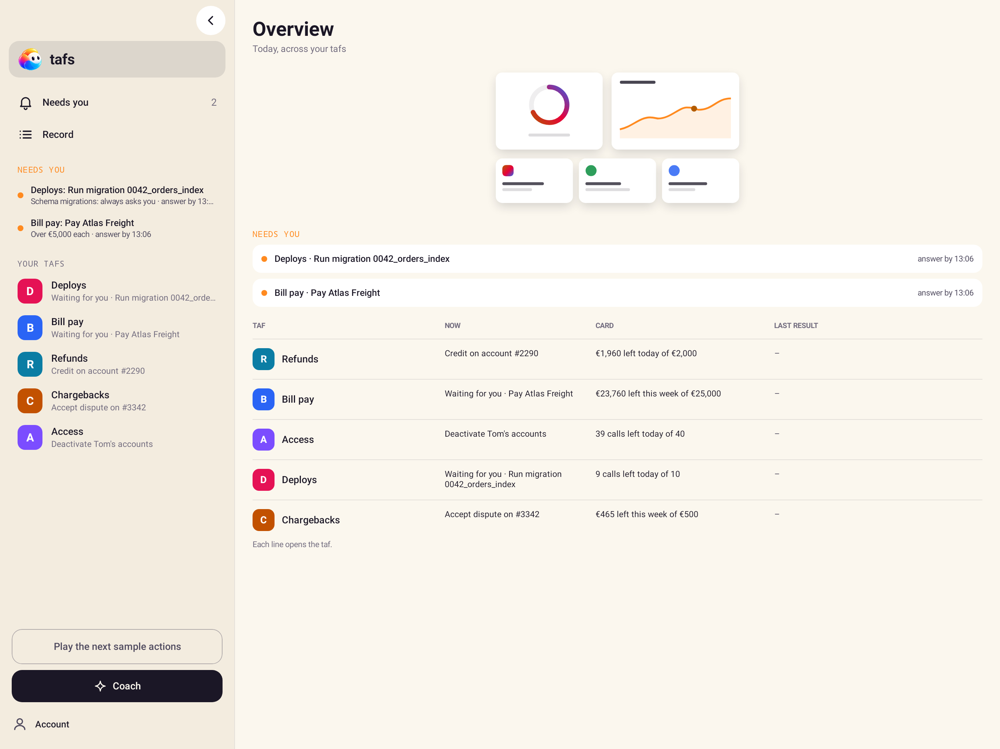
  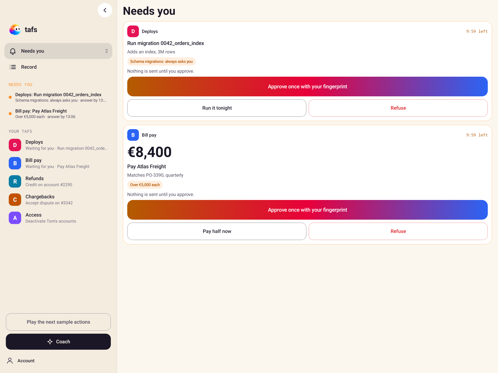
  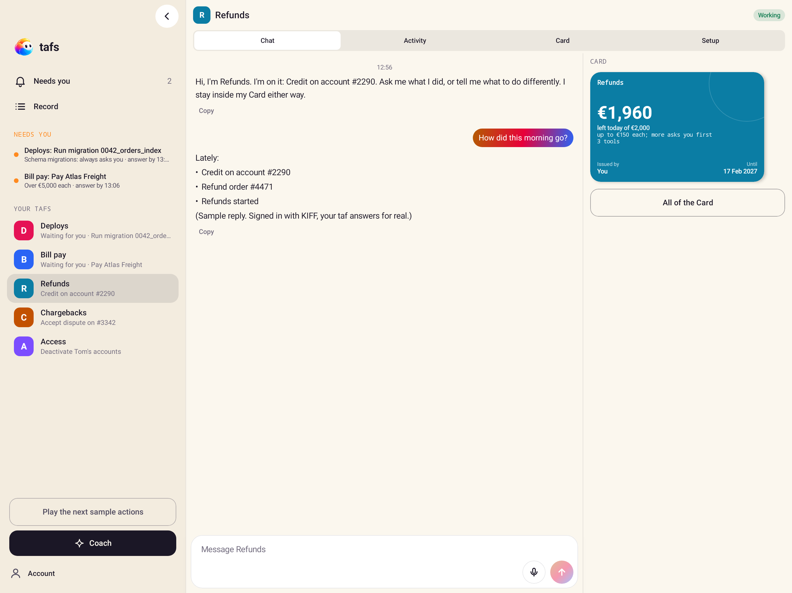
</p>

**TalkBack and the largest text.** Every control says what it is: `tapping` makes a tappable a
button unless its caller says it's a tab or one of a few choices, and the app's two buttons
(`PrimaryButton`, `OutlineButton`) are buttons. A taf's tabs and the calendar's modes (`Segmented`),
Record's filters, Home's label chips and job categories, and Activity's pills are tabs, the one shown selected. The theme and
Setup's two answers are radio buttons; Coach's answers are radio buttons, or boxes where several may be
picked, each saying whether it's picked. Coach's panel needs no drag: its edge is a button whose tap
switches between a third and the whole screen, as ⤢ does. A sent message's menu (Send again, Change it
first, Copy) opens on a long press, and on TalkBack's (double-tap and hold), with no tap offered that
would do nothing. At Android's largest font size (200 %) nothing is cut off: rows that end in "…" read
whole to TalkBack, and a Card's face keeps its shape at the usual size but grows taller, with its stack,
rather than lose its last line, who issued it and until when. `TabletAccessibilityTest` holds this,
walking the tablet's screens at 200 % for any control without a role or a name.

<p>
  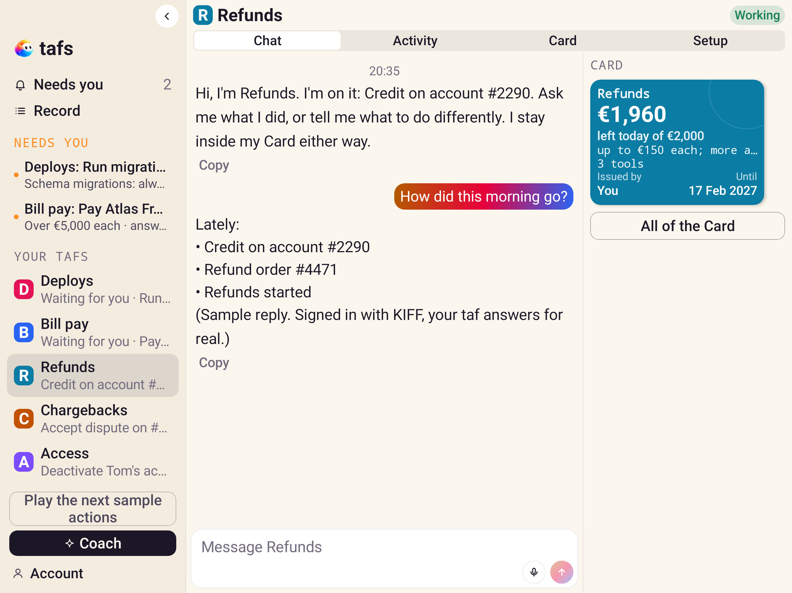
</p>
A new taf starts in Coach, signed in. The sample has no form for one: under its list it says
"Sample data. The Card is checked on this phone. Signed in with KIFF, KIFF decides, and a new taf
starts in Coach." (`HomeWords.SAMPLE_FOOT`). Coach from a taf's page is that taf's conversation: the one
already open about it, else a new one about it; from anywhere else, the conversation open as
it was (`AppModel.openCoachOn`). Leaving a conversation stops following it on this phone (work it
accepted goes on at tafs cloud), and a read of it that lands later doesn't replace the one shown.

**Record** filters by taf too: All tafs, then a chip per taf with its colour, combined with the
kind filter. Each entry starts with its taf's colour and name, and each day says what its money
moved came to, by unit, in the app's words, as the iPad's: "Today · 17 Nov · €640 spent", or "€120 +
$30 spent" across units (`spentOn`, `record.day_spent`), counting its folded reads too.

## The taf's screen

Its head, as the iPad's: its avatar and its name (20, bold) with its state; under them, for whoever
manages it on KIFF, its live version ("Version 2 · live ›", read as the page opens, "Versions" until
then), which opens Versions, then who it's shared with and Share. Both fold away as the page scrolls
down. `TafHeadTest` holds the version line.

Four tabs, each with one job (`TafDetailView`). It opens on Chat, except from a door's knock alert
(tafs cloud's `knock`, `AlertPayload.opensActivity`), which opens it on Activity, where knocks are
answered:
- **Chat:** talking to it.
- **Activity:** what it did and what waits for you. Its holds and its doors' knocks first (Do it,
  Pair them, Ignore), then its runs, where its work stands (each request opens step by step) and
  its last run, then its Record by day: All, Done, Held, Refused (`ActivityRecord`). Signed in, tafs
  cloud's filters are bordered pills as on the iPad, amber for the one chosen and soft for the rest,
  and each group's title is small and quiet (`ActivityFilterPill`).
- **The Card bar** (`CardBar`, on the taf's main tab) is the Cards in one line: a small Card in the taf's colour **with the Card's
  mark on it** (`ic_card`, never an empty coloured block: the owner's phone, 19 Nov), the front Card's balance and its name, each
  on up to two lines, as iOS's (`aCardBarsSmallCardHasItsMark`). A tap opens the Card tab.
  What's left reads as one line in the language's own order (`TafCard.heroLine`): with a calls total, `card.calls_left_line`
  ("180 calls left today of 200"; Korean puts the count last), else the figure then its words. TalkBack reads the Card the same way.
- **Card:** only what's on its Card: the clock its times are in, above it, then the Card, its limits and how they're counted, then, in the
  iPad's order, Halt, Changes to how it runs, Usage and, last, Revoke. A view-only session (`approvalViewOnly`) gets "To revoke this Card, use a device
  that can approve." in Revoke's place ([approvals.md](approvals.md)); the sample keeps its own Revoke.
  A revoked Card's face says **Revoked** and nothing more in its corner, and shows no "left today", since nothing uses it
  (`TafCardFace`, `RevokedCardFaceTest`); a Card in use keeps its end date or "No end date", and what's left.

Who it's shared with (`PeopleWords.sharedWith`) leaves out the person reading: the one KIFF marks
`you` in its people list, or the one whose email is the account read's, as on iOS. Their own share is
never named, and a taf shared with no one else reads "Not shared".
- **Setup** (`SetupTab`): how it runs, in sections.
  - **The job**, with Improve in Coach.
  - **Starts when**, one line per start in tafs cloud's words, opening its sheet
    (`StartsWhenSheet`; beside a tablet's sidebar, its own screen in the page's place, with a round
    Back and its title in the bar, as the iPad pushes it, and so does Results go to: `SetupFrame`,
    `SetupPage`): its schedule (the line, "Next run at 13:00 · Europe/Paris", − and + from
    its `size`, each choice's `setting` sent as it is), and **If it is still working when the next
    start comes: Skip it / Run after** (`busy`, sent in the knob's `setting`); its app events, each
    with its filter in words, **Approve** while it waits for the owner (the signed approval, below)
    and Listening once approved; its doors, each with **Edit** (the door's own screen) then **Add
    a door…**; the follow-ups it set itself, each with **Remove**; and **Pause every start** (off
    when `can_pause` is false; a 502 says "Not every start could be paused. Try again.").
  - **Connected apps**, read from planque: each connection, **Choose actions** for one signed in
    with none chosen yet (Coach), then **Connect an app…**.
  - **Results go to**, the places on, opening its sheet (`ResultsSheet`): tafs' own places (Reply
    to the sender, Alert our phones, Email me), each a switch sent through `PUT …/results`; each
    place in a connected app by its name, a switch from its own on/off choice; **Add a place from
    a connected app…** (Coach). The last place on can't be turned off. A delivery given up on shows
    under **Not sent**, with the place's name for one of the taf's own, and **Send again** by its place.
  - **What it remembers**, **Versions**, Pause (in the sample) and **Remove for good**. Remove for good reads tafs cloud's
    words before its confirmation opens; meanwhile the button takes no second tap and reads as disabled (Android 1.27.11).
    The fingerprint comes first: with the prompt closed, nothing is removed and the screen says so, "Not removed. Nothing
    changed." (`taf.remove.not_confirmed`); before, the button came back with no word. A finger not recognized says "Try
    again, or sign in again if your fingerprints changed." ([Signing](#signing)).

A change to the dial's setting (a size, Skip it / Run after, a place in an app) makes the taf's
next version: "DRAFT · Vn · NOT LIVE" and **Make N changes live** show in the sheet while it waits
(tafs cloud's `pending`), the usual version switch.

**A draft's Cards** (`DraftCardsView`, in Coach's approval card and in Versions): its new Cards show as one
panel, **A new Card**, with each of their lines once (KIFF's draft has one Card per tool, which read as five Cards to
approve). A Card the draft changes keeps its own panel, now then after, and one it removes its own (Android 1.27.6;
iPhone and iPad follow).

**An app's event** (`kind: app_event`) waits for the owner while its `approval` is `needed`:
Approve opens its filters, as tafs cloud gives them, and **Approve with your fingerprint**
approves exactly those (`AppModel.approveKnobEvent`, `EventApprovalSheet`). The live dial is read
again first, and anything changed (version, connection, event or filters, compared in their
canonical form) stops it there. The owner confirms with the approval key over
`tafs.event.v1|tenant|taf|version|trigger|grant|event|sha256(filters)`. planque subscribes the
event with `{account, slug, config}`, signed by this device (`PlanqueClient.subscribeEvent`), and
tafs cloud records planque's id for that version (`POST …/knob/subscriptions {trigger,
subscription, version}`). Whether it's approved is only tafs cloud's answer. A subscription made
but not recorded is kept for this account, so approving again records it, with no second
confirmation or subscription. A refusal is said in planque's or tafs cloud's words.

Every word on Setup's rows is tafs cloud's (each start's `words`, each place's `name`), except
the section titles and tafs' own three places, which are the app's (`SetupWords`).

**A request, step by step** (`RequestSheet`): a request's row in Activity opens it
(`GET /v1/tafs/{id}/requests/{run}`). It shows the request's line, where it came from, and what
happened, each step marked done, failed, not made, waiting or next, every line and time as tafs
cloud wrote it. A run waiting for an app's event (the slow-tools design) says what it waits for in
the connection's words, tafs cloud's `waiting_for`; the step tafs cloud marks `waits_on: "app"` is
drawn as not needing the owner, never in the amber of a hold (`RequestWords.waitsOnApp`). On the
home list, a taf whose work is `waiting_on_app` reads as its work's line, not "Waiting for you" nor
its next run, and a home state the app doesn't know reads as that line too (`KiffMapping`).
**Try the reply now** sends a reply given up on again, for whoever manages the
taf, and **Ask Coach** opens a conversation about the taf.

<p>
  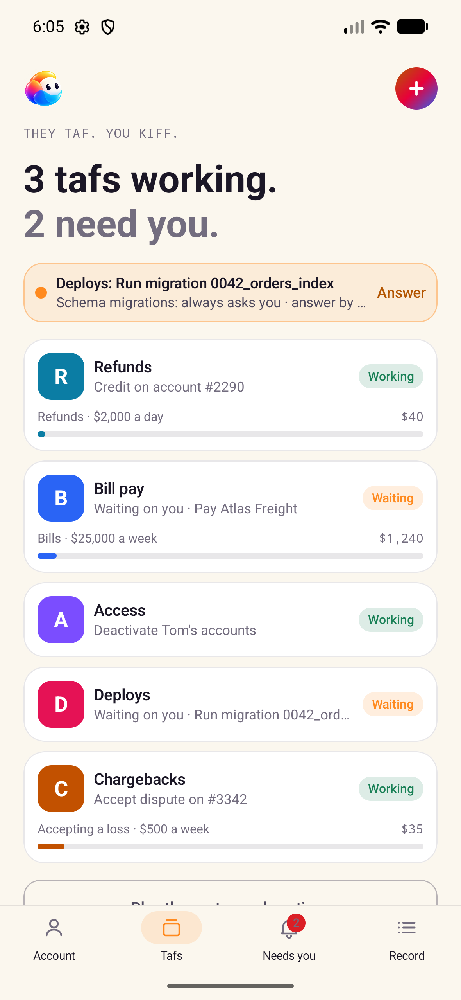
  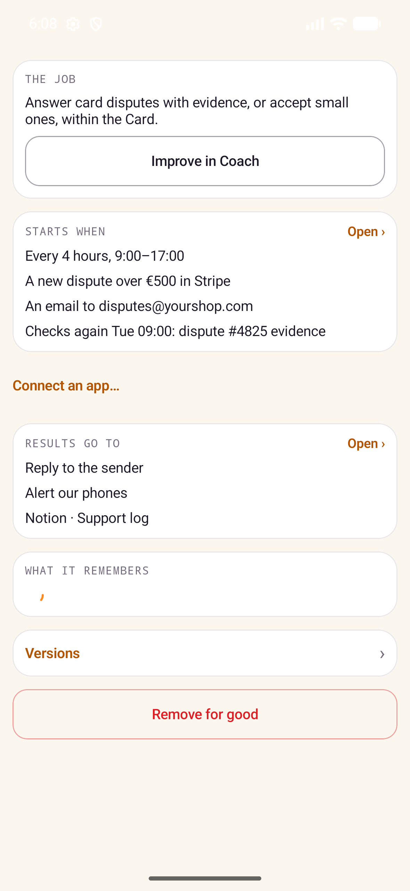
  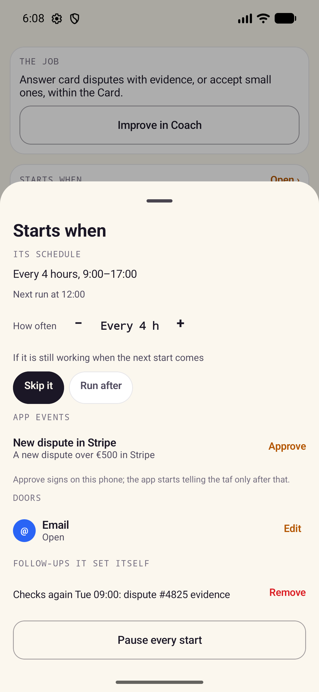
  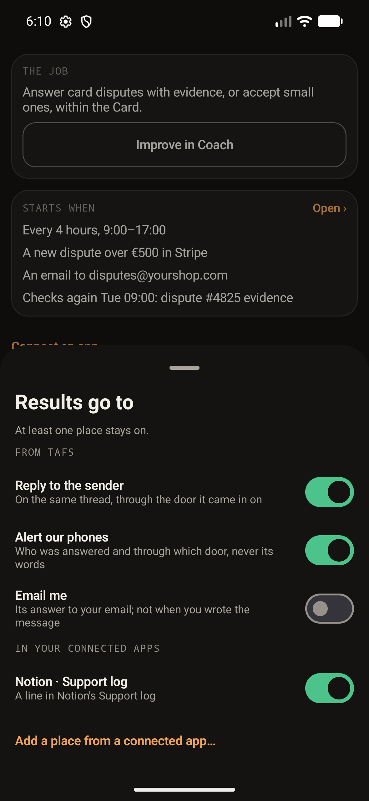
  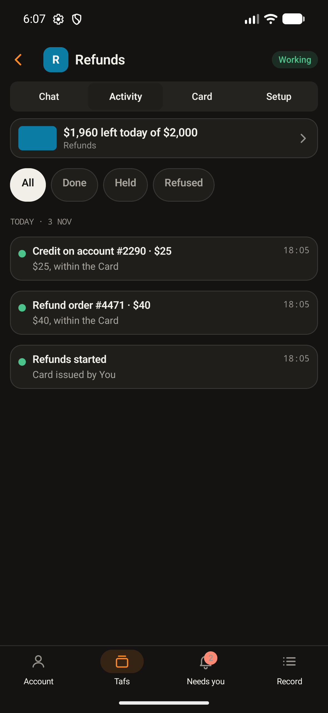
  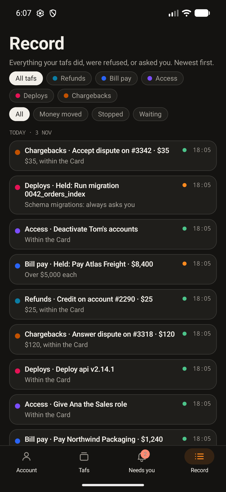
</p>

## Allow this from now on

A held call's third answer ([allow-from-now-on.md](allow-from-now-on.md)): change the Card so calls
like this one go on their own.

- **The button** shows only once KIFF's `GET /v1/me` lists the `holds.allow` capability, which it
  sends once its `allow-draft` answers (`AppState.allowLive`; never assumed when missing). Then
  it follows the app's own rule, from the held call KIFF sent, with no request
  (`AppState.offersAllow`, `HoldAllow.allowable`): someone who manages Cards, on a hold that isn't a
  currency mismatch (`card_unit`) or Coach's install, whose every breach is `per_action_exceeded`,
  `limit_reached` or `resource_not_on_card`.
- **Coach's install** (`KiffMapping.install`, a held `version_install` of Coach's own agent) keeps KIFF's title
  ("Install a version") but isn't drawn as a call: no Details (its `n` and `taf` arguments) and no reason badge,
  since installing is asked every time by design, never something outside the Card. Its Install button says the rest.
- **A tap** opens the sheet (`AllowSheet`) and posts tafs cloud's `…/holds/{exception}/allow`,
  which makes the draft. A `none` shows tafs cloud's words, with nothing to sign.
- **The sheet** shows tafs cloud's change, before and after, and KIFF's own lines for each Card that
  changes, read from KIFF's draft by the phone. Under them: what it would have done, the held
  call's switch (on by default; off, the Card changes and the call still waits), and **Round up to
  {amount}** only when the offer names `round` (the app never rounds).
- **The device signs what the person saw** (`HoldAllow.matches`): the draft is the held call's
  agent's (and, when KIFF names `from_hold`, made from this held call), retires no Card and adds
  none. Each Card it changes is one the offer names and reads exactly as that Card in force with the
  offered limit moved from `before` to `after` in the offer's unit: a per-call cap on the held
  call's action (`per_action`), or a total or count in its own window, the offer's `window` when it
  names one (`total`, `count`). A `resource` change is the held action's scope on the offer's
  `parameter` with exactly its `value` added. Every other term is the same, compared as KIFF compares
  two Cards:
  - each action, its caps, the `entity_states` and `resources` it's limited to, and its `next_steps`;
  - each total, its window (none named is `calendar_day`), its `measure` (none named is `attempts`
    for a count, `effects` for a sum), and its `per`;
  - `on_exceed`, and `valid_from` and `valid_until`, compared as instants;
  - the Card's holders (`subjects`; none named on a revision keeps the Card's, unless `subject`
    names another first holder), its `domain` and `environment` as written (without case), its
    `location` and `hold_expiry` (none, or `keep`, keeps the Card's; a duration it can't read never
    matches). A Card with `revoked_at`, in the draft or in force, never matches.

  KIFF's lines and a grant's title are words, not terms. A Card marked unchanged must read as in
  force too. Anything else, or a kind the contract doesn't name: "This change isn't what was
  offered", and no sign button. A draft that couldn't be read shows the error alone.
- **Round up** asks tafs cloud for the rounded draft and keeps the person's switch. An answer that
  comes back after its sheet closed changes nothing.
- **One signature:** the draft's confirm, behind the approval key, with the held call
  (`hold: {id, accounting_version}`) when the switch is on, so KIFF lets it go under the same
  signature. Then Needs you is read again.

## Connect again on the taf

When a connection's sign-in expired, tafs cloud puts the taf's own **Connect again** at the top of its
Setup page (`connect_again: {grant, app, title, words, done_words}`, [api.md](api.md); read leniently: a
shape this build doesn't know, or one with no connection or no button, is none). A panel
(`ConnectAgainPanel`, `views/TafPresentationViews.kt`) shows tafs cloud's `words`, and, for someone who
manages the taf, its `title` as the button. The tap signs that same connection in again
(`AppModel.connectAgain`, the path of Connect apps' Sign in again: planque's approve, the provider's
sign-in, planque's confirm), so the taf keeps its tools and its Card, with no list and no picking an app.
Once planque says it's connected, tafs cloud's `done_words` ("Gmail is connected again. Mail can use
it.") show on the taf, and its Setup page is read again. A sign-in that didn't go through says so under
the button, and Connect again stays. That line never names the connection's status: "The sign-in at Gmail didn't
finish, so nothing was connected. Try signing in again.", or "Gmail didn't open a sign-in page…", tafs cloud's own
wording for its card (Android 1.27.5; iPhone and iPad the same). The app decides nothing about whether it's needed. iPhone and iPad
do the same.

## Coach waiting

A Coach chat paused on a card its person answers (an approval, a sign-in, questions) is in **Needs
you** ([api.md](api.md#coach-waiting)): Home's `coach_waiting`, after the steps, each a panel
(`CoachWaitingPanel`, `views/YourStepViews.kt`) with tafs cloud's line ("Coach is waiting for your
approval.") and its **Open Coach** button, which opens Coach on that chat (`AppModel.openWaitingCoach`),
where the card is answered; someone who can't use Coach reads the line alone. tafs cloud counts each in `needs_you`, so Home never says "Nothing needs
you." while Coach waits. The app decides nothing about it; a row with no chat or no line isn't drawn.
Home is read when a chat's stream ends, and when it closes with no end line after its last live line said
`waiting_for_you` (`AppModel.stillWaitsOnYou`), so the row and the badge come while Coach's chat is still open
(Android 1.27.6, as iPhone and iPad). Home is read again too when a Coach card is answered and when a row is opened, so
a row whose chat was answered or ended goes once tafs cloud says so. The tab's badge leaves out the chat that's on
screen (`needsYouBadge`): only the app knows what's on screen, so that's the app's; the count is tafs cloud's.

**Set aside** is "not now", never an approval, and only signed in (not the sample). After it, Needs you says where the chat
went, in tafs cloud's words (`words.done`: "Set aside. You'll find it in Previous conversations."), until Coach opens
(Android 1.27.7). A chat set aside is no longer the one
Coach shows: Coach starts a new conversation, so a new job never goes on in the ended session (Android 1.27.1). Opening
Coach with no chat chosen skips a chat tafs cloud marks `set_aside` (set aside on any device, or before a relaunch): the
newest of the rest, or a new conversation when every one was set aside. **Ask Coach** in Connect apps always starts a new
conversation (Android 1.27.3). Set aside, its swipe and Set all aside carry the confirm mark: Coach driving the app never
sets a chat aside (docs/drive.md, Android 1.27.4). One request goes per chat at a
time (Android 1.26.1): a swipe fires once per gesture, and a chat already being set aside isn't asked again until
tafs cloud answers.
- **One chat:** a row whose `words.set_aside` tafs cloud sends can be swiped away either way, and has
  a button with the same words, so a swipe isn't the only way. Either one calls
  `POST /v1/home/coach-waiting/{session}/set-aside` (`AppModel.setAsideCoach`), with the signed read
  of this phone's connections, so tafs cloud can withdraw a connection that chat asked for.
- **Every chat:** with two or more rows and Home's `coach_waiting_clear`, its **Set all aside** sits
  above them. It asks once, in tafs cloud's words (the title names the count), then calls
  `POST /v1/home/coach-waiting/set-aside`.
- **After:** the row goes once tafs cloud answers, and Home is read again for its count. A refusal
  says why (`ErrorWords`) and keeps the rows. A row being set aside isn't drawn while tafs cloud is asked
  (`coachWaitingShown`), so one full swipe takes on the first try; a refusal brings it back (Android 1.27.6).

iPhone and iPad do the same ([ios-app.md](ios-app.md#coach-waiting)).

## Your step

A step a taf may never take itself, such as approving a bank transfer, is handed to its owner
([api.md](api.md#your-step)). Signed in, Home's `your_steps` come first in **Needs you**, oldest
first, each a panel (`YourStepPanel`, `views/YourStepViews.kt`) in tafs cloud's words: its title and
the taf's name, what to do, and why. Needs you counts each once, as tafs cloud does.

- **Open in {vendor}** shows only for an https `link` whose own host is tafs cloud's `link_host`,
  with `words.open` (`YourStep.open`, as iOS's `openLink`). It opens the browser on that link, and
  the host shows under the button, so the line names where it really goes. A link with no host apart,
  another host, or plain http shows the words with no button, as does one tafs cloud left out.
- **Done** and **Skip it** are for those who answer holds (`canAnswerHolds`). Each reads the hand-off
  from KIFF (`GET /v1/me/handoffs/{id}`) for its version, signs KIFF's `kiff.handoff.v1` (tenant,
  hand-off, `done` or `skipped`, version, signed_at) with the **device key** (the signing key KIFF
  binds to the session), after the screen lock, as a refusal is signed. It's never the approval key
  and never needs a fingerprint, since answering grants nothing. It then sends it to KIFF
  (`POST /v1/me/handoffs/{id}/answer`, `AppModel.answerYourStep`). KIFF tells the taf's run. The
  prompt reads tafs cloud's words: "Done · {what}".
- **A step KIFF no longer waits on** (answered elsewhere, or past its week) isn't signed: the app
  says so and drops it. A refusal from KIFF keeps the step and says why.
- **Its alerts** open the taf. A step's alert is tagged by its hand-off, so its reminder replaces its
  first alert and no other, once tafs cloud passes `handoff` on to Android.
- **The vector:** `YourStepTest` pins KIFF's `kiff.handoff.v1` message and its sha256, and checks
  KIFF's vector signature verifies with the key derived from its seed, and for no other answer,
  hand-off, account or version.

## A newer version

When Play's track has a newer tafs, Home says so in one line under the account's name, with one button
(`push/AppUpdates.kt`, Play's flexible in-app update): **Update** opens Play's own confirmation and downloads it in the
background, the line says it's downloading, then **Restart** installs it and opens tafs again. Play is asked each
time the app comes to the front; it decides what's newer and installs it, and the app decides no version. A build Play
didn't install (a debug build, an emulator without Play) is never offered one. Test it on the internal track: install an
older build from the track, publish a newer one, open tafs.

## Alerts

In Account (Settings), **Alerts** shows how each kind looks on the lock screen (a hold, with
sound; an answer, silent), each marked **Example** so no one looks for that taf, then **Alerts on this phone**, **Sound** (for a hold or a halt only)
and the line under them. **What alerts you** is read only, at the levels `push/Alerts.kt` uses: a
taf needs you and every taf halted, with sound, always; a taf answered someone, silent, for the
tafs whose results include our phones (`Taf.results` has `app`; "N tafs ›" lists them); a reply
wasn't sent, silent. Whatever the kind, a locked phone or watch shows only **A taf needs you** until it's unlocked; the examples here are what it shows unlocked.

**Turning alerts on** (`AppModel.turnOnAlerts`) asks for the phone's notification permission, then points the account's KIFF
alert target at tafs cloud: a setup call signed with this phone's device key, never the approval key, so there's no
fingerprint (Android 1.27.2; before, one signed a message nothing sent or checked). As on iPhone and iPad.

## Haptics

The same rule as on iPhone and iPad (`design/Haptics.kt`):

- **A light tap on every button press,** from the shared buttons (`PrimaryButton`, `OutlineButton`), so every new button
  gets it. Also on the bottom bar (Account and each tab) and every row of a tablet's sidebar, Coach's button, a segment changed in a segmented control
  (a taf's Chat, Activity, Card and Setup), a Coach chat swiped aside, and Set all aside (Android 1.27.0). Home's calendar
  icon and everything tapped in the calendar (days, weeks, the chevrons, Choose a date, a taf's slot) tap too, through
  `Modifier.tapping`, the shared tappable for anything that isn't a button (Android 1.27.6). Since Android 1.27.7 every
  tappable does: rows, chips, links and the halt chip, and a unit test fails on a raw `clickable` outside the design
  components (`HapticsTapTest`).
- **A success tick** when a send goes through (`deliverChat`), a held call's answer goes through (`answer`), tafs cloud
  approves Coach's approval card, or a Coach chat is set aside (`setAsideCoach`).
- **A warning tick** when one of those is refused or fails. Only the outcome of something the person did, never a background
  read.
- **A step tick** on a selector's stops: the theme picker and the jobs' category chips.
- **Settings › Haptics** turns all of it off, on this phone (`tafs.display`, `haptics`). It's on until turned off.
- **The phone's own touch setting decides.** On Android 13+, each kind plays as a predefined effect marked as touch
  (`USAGE_TOUCH`, `VIBRATE`, a normal permission): the phone's touch intensity decides, and off there is still off. Some
  phones keep the standard touch feedback switch off and use a slider of their own (ColorOS), and Android 15 reports the
  platform's feedback (`performHapticFeedback`) as played even when that switch drops it, so it's used only before 13 or
  with no vibrator (Android 1.27.4). The first time a launch's feedback plays nothing at all, that's written to the
  diagnostics, so "nothing vibrates" can be told apart from a tap the app never asked for.

## Dark

The app follows the phone's dark setting (`TafsTheme`, `Theme.dark`): every colour in `Theme` has
its dark value, the owner-reviewed warm near-black (background `141311`, panels `1F1E1B` and
`2A2824`, ink `F2EFE9`) with brighter green, amber and red, each 4.5:1 or more on the dark
surfaces. Text on a status fill uses the panel's colour, so it stays readable either way; taf
colours and the Card keep white text.

**Edge to edge, without deprecated calls.** The app draws behind the status and navigation bars
on every Android version, and the bars' icons follow the app's own Light, Dark or System from the
first frame (`MainActivity`, then `TafsTheme`). It doesn't use androidx.activity's
`enableEdgeToEdge`, which calls the window's bar colours (`setStatusBarColor`,
`setNavigationBarColor`) and the short-edges cutout mode, all deprecated from Android 15 and
flagged by Google Play. Below Android 15, the theme makes the bars transparent and uses the cutout
area (`values/themes.xml`, `values-v31`). From Android 15, which draws edge to edge on its own,
the theme sets no bar colours (`values-v35`). `EdgeToEdgeSourceTest` fails if the app's code calls
any of them again; `EdgeToEdgeTest` checks that the app draws behind the bars, with the icons'
shade per theme.

<p>
  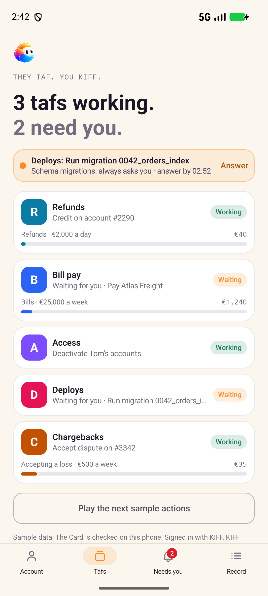
  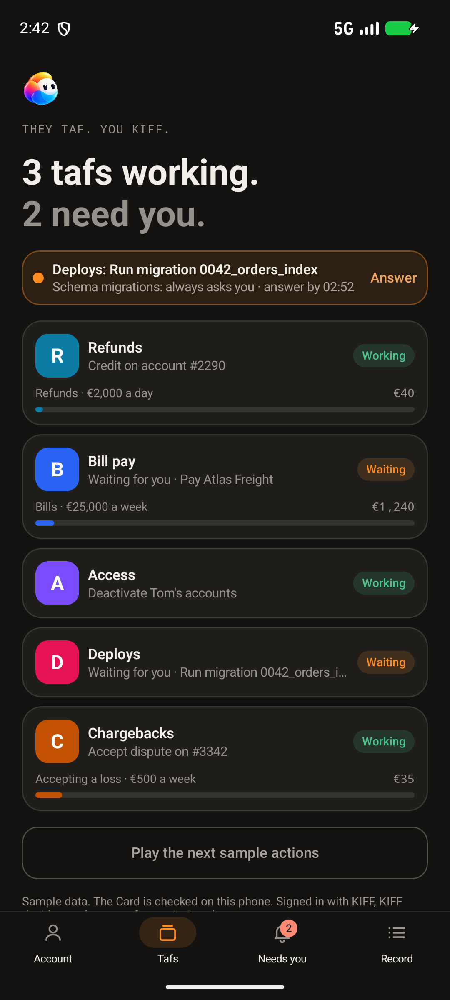
</p>

## Connect apps

Settings › **Connect apps** (`ConnectAppsSheet`), as [coach.md](coach.md#connect-apps) says.

**It opens at full height** from the first frame, saying "Loading…" where the list goes until tafs cloud's list is read,
never as a small sheet that grows once the list comes (Android 1.27.11).

**The list, as on iPhone and iPad** (Android 1.20.3):
- **Yours, then Discover.** The account's own apps (connected, signed in, or to sign in again) come first under **Yours**,
  with **Connected ✓**. The rest of the catalog follows under **Discover**. Within each list, tafs cloud's order is kept.
- **Each row has two lines:** the app's name, then tafs cloud's `line` as sent ("Sign in · Connected · Used by Refunds").
  The name is tafs cloud's `name` ("Qonto"), with its `subtitle` under it when sent ("Invoicing: reads, and invoice drafts from
  quotes"); a tafs cloud from before `name` leaves `title` (`ConnectApps.App.displayName`, Android 1.27.7, as iPhone and iPad).
  - Without `line`, the same shared words are put together here: how it connects (`method`, else `how`: **Sign in** or
    **With a key**), `whose` as sent, where it stands (**Connected**, or **Sign in again**), and, for an app that's
    yours, **Used by** the tafs that use it, as a list in the app's language. iPhone and iPad put it together the same way.
  - "Used by" is tafs cloud's `used_by` when sent, else this phone's own read of its connections, by taf (`usedBy`).
- **The trailing button is compact:** **Connect**, **Sign in again**, or for one signed in, **Signed in · choose its actions**.
  With no taf yet, an app to connect offers **Ask Coach** instead, which opens Coach, where a taf is made; "Make a taf first"
  sits above Discover only, never above Yours (Android 1.27.1).
  A connected app opens its connections, each with Disconnect, from anywhere on its row (Android 1.27.1; before, only its
  "Connected" label). So does an app tafs cloud doesn't mark connected whose connection the phone holds, such as a sign-in
  kept after its card was declined (`listed`): it gives no taf any access and the app stays where tafs cloud puts it, but
  only that sheet can end it (`opensConnections`). The note on what removing access takes shows only when a taf uses one of them. Its tap always answers (Android 1.26.1): with none of its
  connections on this phone, planque's connections are read again first (`refreshConnections`), and if there are still
  none, the sheet says why: the read's failure (`connectionsError`, kept in words and written to the diagnostics), or
  that connecting isn't set up from this phone. A sheet emptied by removing its app's last connection closes instead,
  never "The apps couldn't be read." over a list that's simply empty now; a failed read still says why (Android 1.27.6).

**An app's connections, as planque describes them** (Android 1.25.0, planque's `title`, `used_by`,
`health` and `actions` on each grant; `Grant.health`, `Grant.actions`, read leniently). A connected app
opens its connections, under each taf's name:
- **Each row** is planque's `title` ("Gmail · name@example.com"), then **Used by** its `used_by`, then its
  `health.words` ("Gmail's sign-in expired on 14 Nov"), amber when not `ok`. No id, and no button beside
  it (`DescribedConnectionRow`).
- **A tap opens its detail first:** its health, which of the owner's Chromes it runs in for one there ("In Work Mac",
  `chrome.held_in` with planque's `chrome_name`, `connectionChromeLine`; nothing for planque's hosted browser or any other
  connection, as iOS), the tafs that depend on it, then only the `actions`
  planque sent, in its order: `approve` is Sign in again on itself (`reconnect`), `key` a new key, and
  `delete` the signed removal, and `chrome` ("Use another Chrome", planque's `use_another_chrome`, "Your Chrome" 2): the
  account's other paired Chromes by name (`chromesToMoveTo`). One tapped moves the connection: the sites this phone signed for
  it on its Chrome now, checked with its approval key (`ChromePairing.signedSites`, never planque's list as given), are signed
  for the new Chrome behind one fingerprint naming it (`chrome.switch_prompt`), and `PUT …/grants/{id}/chrome` sends that
  signature (`AppModel.switchChrome`). A list planque widened, a signature for another Chrome or grant, or a connection carried from
  an earlier Chrome (no signature of its own), signs nothing: the line is "{Move this connection to name} didn't go through"
  with the request-mismatch words (`common.didnt_go_through`, `PlanqueError.DigestMismatch`), and nothing is sent. planque offers the action only where it would move it, so the app keeps no status rule. An action whose `how` this build doesn't know isn't drawn, so a leftover
  shows only planque's **Remove unfinished connection**, never Sign in again.
- **A removal asks once more,** with planque's `stops` ("Unanswered customer emails will stop using
  Gmail."), and only then the fingerprint. Remove is never beside a row.
- Every request to planque says the person's time zone (`X-Time-Zone`), so the times in its words are
  theirs.
- A planque from before it sends no `actions`, and the row is the app's own, as below, until it does. A row needs
  both `health.words` and `actions` to be planque's (`Grant.rowFromPlanque`, as iPhone and iPad read it, Android
  1.30.1): a request nobody answered, sent with no health, is the app's own row with its **Cancel**.
- **planque's refusals in its own words:** any refusal that carries planque's `words` (a sign-in again
  to another account than the connection's, say) shows those words as sent (`PlanqueError.Server.words`,
  `ErrorWords.of`), never a line of the app's over them. "It changed in the meantime" is kept for a
  409 with no words. planque's `error` stays the reason, for the code.

tafs cloud's list, searched as the owner types, and **Connect** opens the approval as a sheet
over the list (`ConnectApprovalSheet`). **Which taf is this for?** is asked first, even with one taf
(`connectFor`, Android 1.30.1; before, the only taf was taken without asking), in a dialog over the list wherever
Connect was tapped, as on iPhone and iPad. `AppModel.startConnectApp` starts nothing without a taf named.
It lists only the tafs tafs cloud's `needed_by` names for that app (`tafsFor`, matched by tafs cloud id, Android 1.31.0), still
asked with one; an app no taf needs reads **Ask Coach** in place of Connect. A tafs cloud before `needed_by` lists every taf the
person manages. The start sends a fresh `Planque-Device-Signature`, as the list's read does, so tafs cloud decides `needed_by`
the same way; its `409 not_needed` shows tafs cloud's words (`ErrorWords.CLOUD_WORDED`), never "It changed". A connection tafs
cloud lists as `misplaced` (made under a taf that doesn't use the app) is drawn as the app's own row, saying "Made for ‹taf›,
which doesn't use ‹app›.", with its Cancel or Disconnect.
**An app whose key goes with the owner's own login** at the vendor (tafs cloud's `login: true`, Zendesk's: the key acts as that
person) asks for it once the taf is chosen, before anything starts: "Your ‹app› login", what it's for, one email field
(`connect.login_*`), and Continue, enabled once something is typed. The start sends it as `login`, trimmed, and only for such
an app. Whether it's a well-formed address is tafs cloud's to say: its `400 login_invalid` reads "Enter one email address,
with no spaces." on the list, and nothing starts. The key sheet follows as for any app taking a key (`ConnectAppsSheetTest`,
`ConnectAppsTest`).
While the vendor's page is open, planque is read again on Coach's card schedule, so a sign-in finished there ends the
wait; back on the sheet with no link, **Open … again** opens the same page, and **Not now** ends the wait at once, so
the next Connect isn't refused as another approval in progress (Android 1.30.1). When a sign-in
comes back, what happened is said at once, over the list: "Notion is signed in for Refunds. Next,
Coach chooses its actions and you approve them.", with **Choose its actions**, which opens the
taf's Coach (or "… is connected" when it's done). A row tafs cloud sends as signed in
(`signed_in`, or `listed`) reads **Signed in · choose its actions** in place of Connect, and
opens the same Coach. A row is the app's title alone, never the provider's id
for it. Only the newest search's answer is shown: an earlier read that comes back late (the
first, unfiltered one) is dropped. An app that signs in at the vendor is approved, then
signed in. An app that takes an API key (`needs_key`) takes it on the same sheet, as on iPhone
and iPad: a password field, and **Give the key with your fingerprint**, which signs the same
confirmation as an approval and sends the key to planque once (`AppModel.giveKey`,
`PlanqueClient.giveKey`, the key in `Planque-Vendor-Key`, its SHA-256 in the signed body). The
key lives only in the open sheet's field, and nothing on the phone keeps it.
**Coach's approval card never takes a key** (`openCardKeySheet`): the chat isn't a place for a
secret. While the grant takes a key (planque's `api_key`) and isn't connected, the card has one
button, **Give the key on a secure sheet**, which opens this same key sheet full screen, outside the
chat. The sheet says where the key goes (`connect.key_goes_to`: this phone, then the connection
server, which sends it only to the vendor's host: `Grant.keyHost`, the server without its scheme or
path, never the vendor's name; and never Coach), and that the clipboard is
cleared after a paste: more than one character at once is a paste, and the clipboard is cleared
then. Given there (`AppModel.approveCoachWithKey`), the key goes as above, then the card is answered
as any approval: tafs cloud finds the app connected, and Coach goes on or asks for its Cards. A key
that didn't go answers nothing, and says why on the sheet.

**The secure connection sheet** ([secure-connection.md](secure-connection.md)). When the key
sheet opens, the phone reads tafs cloud's `GET /v1/connect/grants/{grant}/sheet` with its signed
grants read (`Planque-Device-Signature`), once per grant (`AppModel.loadSecureSheet`,
`TafsCloud.connectSheet`), and draws only its words (`SecureKeyContent`):
- the title, with the vendor's logo and a lock;
- the three plain lines. A `reads_only` line is checked against the grant this phone signs: at least
  one tool, and every one `read_only` (`SecureSheetWords.firstLineHolds`). Otherwise the mismatch
  line shows, with nothing to sign;
- **Paste the key**, a button, never a typing field, so no keyboard opens. The pasted key is
  trimmed, the clipboard is cleared at once, and only its last 4 show ("Key …ab12"), then tafs
  cloud's line for what to do next (`paste.next`, "Key pasted. Tap Connect"; none from a tafs
  cloud from before it);
- the legal line, its `{terms}` and `{privacy}` links opening in the browser (https only);
- the button, right under the pasted key and the legal line, which gives the key as above;
- **Details**, collapsed: the technical lines, then the connection server's own words and KIFF's
  words for the profile.

Once the key went, the sheet shows the receipt with the last 4 (from a key of 12 characters or
more, as on iOS) and **Remove access** (`AppState.keyReceipt`), until it closes; nothing keeps the last
4 after that. **Remove access** asks first, naming the taf it ends, in Connect apps' own words. Without
the sheet's words (an older tafs cloud, an error), the sheet stays as above. The sheet sits above
the keyboard and scrolls. An approval card that tafs cloud marks `connection: {done: true, words}`
draws only those words and Its Card, never the connection's text again.

**What a card's fingerprint signs** (`signs`, docs/secure-connection.md): Coach's thread is read with this
phone's planque read proof (the device's key, no prompt) and `?can=tools_and_cards,key_and_cards,signs`, so tafs
cloud marks each waiting approval card with `signs: {card, words?}` (read leniently: any other shape is no mark).
- `card: true`: Its Card, KIFF's own lines, stays on screen until the fingerprint, connected or not, and
  Approve waits until KIFF's draft is read. While it isn't, the draft is read again (as planque's grants are,
  `CARD_GRANT_READ_DELAYS`: 3 s apart for a minute, then 10 s, ten minutes in all), and a read KIFF refused or
  didn't answer says so on the card in KIFF's reason, with **Try again** (`AppModel.loadDraft`,
  `AppState.draftErrors`, `coach.card_draft_not_read`). It used to stay on "Reading KIFF's words…".
- `card: false`: the Card's lines, dimmed, under tafs cloud's `words` ("Its Card: you approve it next"), never
  under its own title as if signed now; with no `words`, not drawn.

**KIFF's words for a connection's profile** (`POST /v1/profiles/words`) are what a card shows above Approve, which waits
for them. Each card reads its own grant's words, by the card's grant id, kept only while their `profile_sha256` is that
grant's profile digest (`AppState.profileWordsFor`). They're read when Coach's thread is (`readApprovals`), every waiting
card's at once, and again when a card is drawn, each time in the model's own scope (`AppModel.readProfileWords`), once
per grant and profile. A card's own read used to be lost when the card was drawn again (two cards arriving in the same
second, Coach's thread read while its run streams), and it said "Reading KIFF's words…" with Approve greyed until the
card left the screen and came back (`ProfileWordsCardsTest`).
- No mark (a tafs cloud from before it): as before, Its Card once the grant is connected.

**A sign-in wider than the job** (`wider: {words}`, docs/chat.md): when planque couldn't narrow an app's sign-in to
what the taf uses, tafs cloud marks the waiting approval or sign-in card, and its words ("Composio connects your Google
Sheets account. Google Sheets may ask for broader access than this job needs, …") are drawn above the card's buttons, in amber (`SetupComponent.wider`,
`WiderLine`). Read leniently: a mark of another shape is no mark.
The approve flow asks with `signs` in `can` too, only from a card that carries the mark: a card read without
it (no read proof, or tafs cloud's read timed out) never says it draws what it signs. Once the ask is back, and before any signature, a step
that disagrees with the mark is never signed (`AppModel.stepMatchesMark`): `card: true` takes only
`cards`, `key_and_cards` or `tools_and_cards`, and `card: false` only another step. On a mismatch the card says
"What you're asked to approve changed since it was shown. Read it again, then approve." and the thread
is read again. No mark: any step.
iPhone and iPad draw it the same way.

**One fingerprint for a key and its Card** (`kiff.requests.v1`, docs/secure-connection.md). From
Coach's card with a Card's draft, on a phone with an approval key, the key sheet's button asks tafs
cloud for the step with `can: ["key_and_cards"]` (`AppModel.approveCoachWithKey`). When tafs cloud
answers `key_and_cards`:
- the phone checks the ask as for each step alone: the card's grant at the digest shown, its draft
  at the version shown, `scheme` `kiff.requests.v1`, and no message of tafs cloud's
  (`expectedApprovalMessage`);
- it builds both requests itself, with one `signed_at`: planque's key request
  (`PlanqueClient.keyMessage`) and KIFF's draft confirm (`KiffClient.confirmMessage`);
- it signs `kiff.requests.v1`, the account, the time and both messages' SHA-256 sorted, once, with
  the approval key, behind the fingerprint (`AppModel.keyAndCards`);
- it sends each request with that signature and the other's hash (`v3=…,with=sha256:…`): the key to
  planque, in its header alone, then, only once planque says `connected`, the confirm to KIFF;
- it reports what came of them, as for any step. A key that went in with a Card that didn't is said
  by tafs cloud, and Coach's next card asks for the Card alone.

Answered with the two steps instead (tafs cloud's step off, or a card it won't join), the phone signs
nothing for that answer and gives the key, then approves the Card, as before.

**One fingerprint for a connection's tools and its Card** (`tools_and_cards`, Android 1.22). The
same, for an app signed in to, not given a key: from Coach's card with a Card's draft, on a phone with
an approval key, Approve asks tafs cloud with `can: ["tools_and_cards"]`. When tafs cloud answers that
step (only while the connection waits for its added tools, behind `TAFS_TOOLS_AND_CARDS`), the phone
checks the ask as for `key_and_cards`, then builds planque's approve, with the body exactly as tafs
cloud built it (`PlanqueClient.approveMessage`), and KIFF's draft confirm with one `signed_at`, signs
both hashes once (`AppModel.toolsAndCards`) and sends the approve, then, only once planque says
`connected`, the confirm. Any other answer is the steps as before. The phone doesn't check the draft's
tools against the connection: a Card can span several of the agent's connections, and KIFF refuses a
draft over tools that aren't declared.

A browser connection's sheet (on a taf's Setup) offers tafs cloud's `site_sign_in` action, to
whoever manages the taf: its `title` ("Sign in to a site") and its line. A tap asks planque, signed
by the device's key with no fingerprint (it grants nothing), for the live sign-in view
(`AppModel.openSiteSignIn`, `PlanqueClient.siteSignIn`, `POST …/grants/{id}/sign-in`). The view
opens only when its URL is on planque's own https origin (scheme, host and port), in a full-screen web view
(`SiteSignInScreen`) under planque's `words`, with **Close** and nothing else. The web view runs the
page's scripts and follows no link off that origin, and closing it clears its cookies (it is the app's only web view). A refusal (a view already open, the connection
not connected) is said on the connection in planque's words. Closing leaves the view to lapse.

An app tafs cloud sends as `needs_setup` (kiff/planque#87) shows tafs cloud's `words` under its
title ("Needs setting up first. Ask tafs to enable it.") and has no Connect: nothing on its row
can be tapped. On a taf's Setup, a connection's sheet shows tafs cloud's `custody_words` under its
status line, the one line on who keeps its sign-in; with none sent, nothing shows. Above it,
`account_words` says which account the connection works in and in which mode ("Demo Shop ·
Live"), as tafs cloud sends it; with none sent, nothing shows.

A connected app opens its connections by taf (`byTaf`), as on iPhone and iPad
([ios-app.md](ios-app.md#connect-apps)): one section per taf, those that need the owner first,
the same rows with **Sign in again**, **Remove access** and **Cancel**, then **From removed tafs**
with **Clear these connections** on tafs cloud's `used_by` (`AppModel.clearRemovedConnections`),
one fingerprint for them all, and **Other connections** last.

**Ending access, in plain words** (`ConnectionWords.endButton`). A connected app's row says
**Remove access**, and asks first, naming the taf it ends. For a key, the confirmation says the key
is deleted from tafs once no taf uses it, since a key another taf's connection shares stays for that
taf; only a sign-in says it's revoked at the vendor. What never connected is
cancelled instead: a request not answered yet (`Grant.pendingRequest`: pending, holding no sign-in, and not connected by
this phone since) says **Cancel the request**,
and a sign-in that never came back says **Cancel**, each with its own question. Once access is
removed, Connect apps is read again at once (`AppModel.disconnect`), so it no longer says
Connected until it's reopened. While the removal is on its way, from the fingerprint until planque
answered and the list was read again (`AppState.disconnecting`), the app's row says **Removing
access…** in place of Connected, and so does that connection's button, as on iPhone and iPad. No
other removal starts meanwhile (Android 1.29.4).


**What the phone signs.** Before it shows or signs a grant, the phone recomputes its digest from
what planque sent and refuses one that doesn't match (`PlanqueClient.digestCovers`,
`Grant.digestMatches`). Without `digest_v`, the digest covers the request alone (v1). With
`digest_v: 2`, it covers `{"lang", "request", "text"}`, so the words the person reads (`text`, in
their language) and that language are what's signed. An unknown version, or a v2 grant without its
words or its language, never matches. Every request to planque carries the person's language
(`Accept-Language`, as tafs cloud gets it), for the words planque writes. Nothing changes on screen
until planque issues v2 grants; iOS checks the same. Each grant is checked against its own entry in
planque's answer, by its place in the list, never by looking its id up (`PlanqueClient.pairedRaws`):
with two entries under one id, the second, shown as its own request, would have been checked against
the first's bytes. An id that repeats, or an entry under another id, matches nothing, so nothing is
signed (Android 1.29.4). A mismatch writes one logcat line (tag `TafsPlanque`)
for each digest: which way it failed (a list of another length, an id repeated, not in the list as
sent, no request, a version or v2 words the app can't cover, or the hash differs; `unpairedCause`
tells the first three apart from Android 1.29.5), the grant's status and `digest_v`, never its id, digest
or words (`PlanqueClient.mismatchCause`, `mismatchLine`, Android 1.29.4).

## Signing

Two keys in the Android Keystore, in StrongBox where the phone has it
([approvals.md](approvals.md#how-an-answer-is-signed)). The **signing key** signs what
reads or takes authority away. The **approval key** signs what grants it, once per
fingerprint, through the prompt; a new fingerprint turns it off, and the phone asks for a
new sign-in. Whether the phone can approve is read each time the app comes back
(`approvalReadiness`), and while it can't, each approval's button gives way to the state and what
to do ([approvals.md](approvals.md#set-up-approvals-on-this-device)). A debug build on a phone with no screen lock signs without asking, as the iOS
Simulator does; a release never does.

**A prompt that didn't sign** says what happened, and nothing is sent. `BiometricAuthenticator` reads how the prompt ended:
Cancel, back, or the system closing it (`ERROR_USER_CANCELED`, `ERROR_NEGATIVE_BUTTON`, `ERROR_CANCELED`) is a closed
prompt (`PromptClosed`); a lockout, a timeout or a sensor error is not. `AppModel.notSigned` then says:
- **A closed prompt, where nothing is waiting on it** (Start Coach, a Card, a door, a version, Halt's Resume, signing a
  device out, removing a passkey, and the rest): "Cancelled. Nothing changed." (`approval.cancelled`), the key every app
  shares.
- **A closed prompt, where the request still waits** (Approve or Refuse on a held call, Your step's Done and Skip, dismissing
  a Card unit request): "Cancelled, so nothing was approved. The request is kept: approve again when you're ready."
  (`approval.cancelled_nothing_approved_request_kept`).
- **Remove for good and Discard** keep their own lines, "Not removed. Nothing changed." and "Not discarded. Nothing changed."
- **A finger not recognized** (the prompt ended without a match, the approval key still good): "Try again, or sign in again if
  your fingerprints changed." (`approval.not_recognized`). Before, a closed prompt said this too, or nothing.

**What the prompt says** is the last thing read before signing. Connecting an app names the app and
the taf as the person knows them (`ConnectionWords.connectPrompt`, `giveKeyPrompt`): tafs cloud's
Connect apps title for that connection, else planque's vendor name, and the taf's name, else the
name planque keeps (`agent_name`). It never shows an agent id or a server's slug. With no name for
the taf, it names the app alone ("Connect Stripe").

**kiff.dev's passkeys.** kiff.dev vouches for the app: `https://kiff.dev/.well-known/assetlinks.json`
names `dev.kiff.tafs` (the applicationId, not the Kotlin namespace) with Play App Signing's
certificate SHA-256, for `delegate_permission/common.get_login_creds` only (Google's Digital Asset
Links API answers `linked: true`, 15 Nov). So a passkey the app makes or uses through Android's
Credential Manager has kiff.dev as its relying party, and KIFF takes its origin
(`android:apk-key-hash:…`). Unlike iOS's `webcredentials:kiff.dev`, Android needs nothing in the
manifest: the Credential Manager reads the file. Only a build Play signed matches; a debug build,
or one signed with the upload key, isn't linked and can't use kiff.dev's passkeys.

## Passkeys on this phone

Account → Devices → **Passkeys** lists the account's passkeys as KIFF lists them (`GET /v1/me/passkeys`), and
**Add a passkey on this phone** makes one (Android 1.30.0). With a passkey on this phone, a computer that approves with
a passkey (Linux, macOS 12) approves through it: the computer shows a QR code, and the phone's passkey provider
answers it. That part is Android's own, with nothing in the app.

- **Making it** (`AppModel.addPasskey`, `makePasskey`): Android's Credential Manager (`androidx.credentials`, with
  `credentials-play-services-auth` for Android 11 to 13) makes it from WebAuthn's creation options
  (`PasskeyRegistration.createOptions`):
  - rp `kiff.dev`;
  - the person's subject as `user.id` (base64url of its UTF-8) and their email as `user.name`, both read from the
    account's members, where KIFF marks the person `you`;
  - ES256 only, user verification required, `residentKey: preferred`, attestation `none`.
  - The challenge is base64url(SHA-256) of `kiff.passkey.register.v1\n<tenant>\n<subject>\n<issued_at>`, with
    `issued_at` to the second in UTC (`PasskeyRegistration.issuedAt`), which KIFF takes within 10 minutes.
  - Android draws its own sheet and asks for the screen lock. Putting it away sends nothing.
  - **Owners and admins only, read first:** KIFF takes a passkey only from an account's owners and admins. The person's
    role, from the same members list, is read before Android is asked for anything, so a member's tap leaves no passkey on
    the phone for KIFF to refuse, and a member isn't offered Add (`PasskeyRegistration.mayAdd`, `AppState.passkeyMayAdd`).
    KIFF still decides.
- **Registering it** (`KiffClient.registerPasskey`): `POST /v1/me/passkeys` with `{name, issued_at, client_data_json,
  attestation_object}`, the creation's response as it came (`PasskeyRegistration.registerBody`). KIFF reads the
  credential from it; the phone parses nothing.
  - **The earlier body's fields** (`credential_id`, `public_key`) are never sent too: KIFF refuses both kinds at once.
  - **The name** is the phone's model, trimmed as KIFF trims (a no-break space and U+0085 too), 1 to 64 code points with
    no control character inside, or "Android phone" for one KIFF would refuse. It's never cut
    (`PasskeyRegistration.validName`).
  - **The signature:** the approval key, behind a fingerprint that says "Add a passkey on this phone to your account",
    never inside an approval window. A session KIFF holds no approval key for adds none, and Android isn't asked: a
    stolen session would add its own.
  - **KIFF's answers:** KIFF decides, and `403 admins_only` says only owners and admins can add one.
    `409 passkey_registered` (the same passkey again, KIFF's code in `error`) reads as added. `400` with reason
    `issued_at` says it took too long, to try again.
  - **Made but not added:** once Android has made the passkey, putting the fingerprint away or any other refusal says
    it's on this phone but not on the account, and where to remove it (`settings.devices.passkey_not_registered`).
  - **A debug build is refused:** Credential Manager names the app by its signing certificate
    (`android:apk-key-hash:…`), and KIFF takes only Play App Signing's (`400 registration_invalid`, reason `origin`).
    So adding one is tested from a build Play installed (the internal track).
- **Removing one** (`KiffClient.removePasskey`): `DELETE /v1/me/passkeys/{id}`, signed by the approval key behind a
  fingerprint that names it, as a device's removal is. A computer's own passkey has no id (it goes with its device,
  `device_id`), so it says "Goes with its computer", with no Remove. **Removing the last passkey that can approve
  warns first:** "This is your only passkey that can approve. Without it, you need another device that can approve."
  (`settings.devices.passkey_remove_last`, `Passkey.removesLast`). Every passkey KIFF lists counts, a computer's own
  included, as on Windows and iOS. A read of the list that started before a removal is dropped when it ends, so the
  removed passkey never comes back.
- **Tests:** `PasskeyRegistrationTest` reads `vectors/passkey-registration.json`, the vector the iPhone and iPad's
  tests read too, so the apps can't drift. `PasskeyAddTest` covers the model: the fingerprint, the body, the 409, the
  sheet put away, no approval key, KIFF's refusals, and a computer's own passkey.

## Pairing a computer

Account → Devices → **Add a device** gives a computer, or a new phone or tablet, approval authority on the account, as
KIFF's pairing contract sets out. Only a phone KIFF holds an approval key for can
pair one; without it, Devices says approving needs a new sign-in and sends nothing.

1. **The scan.** Google's code scanner (`play-services-code-scanner`) reads the QR in its own
   screen, so the app asks for no camera permission; the manifest has Play services fetch it as
   the app installs (`app/PairScan.kt`). Closing the scanner does nothing.
2. **The QR** is read by `kiff/Pairing.kt` (`PairQr.read`): `kiff.pair.v1`, a device key, a
   name, a nonce, an expiry, a `kind` of `hello`, `enclave` or `passkey`, and keys that decode as base64url. Anything else, a web address
   say, says "That QR code isn't a computer asking to be paired." Whether the fields are within
   KIFF's bounds, the keys P-256, or the expiry still ahead, is KIFF's to say.
3. **The check code** is the first 6 characters of base32(sha256(device key ‖ approval key)),
   RFC 4648 with no padding. A computer's own platform passkey (Windows Hello, §2.6), which a
   `kind: "passkey"` QR carries as `credential {id, public_key}`, takes the approval key's place,
   so the code covers the passkey the pairing registers; with neither, or for a computer whose device
   key is in software (`key_store: "software"`), the device key alone. The alert's title is
   "Add a device", naming no device (`pairTitle`), and its first line is the code to compare, "Does your computer show {code}?": the name
   is only what the other device says it is, so the code is what binds the yes to the device in front of
   the person (`pairLines`). Then, as on iOS, "Add this device to your account. Only this device; nothing else changes."
   and "It calls itself {name}.", the name as the device's own claim. Then it says what yes gives ("{name} will be able to approve your tafs' actions
   with Windows Hello" for `hello` or a Windows computer's own passkey, Touch ID for `enclave`, a
   passkey for any other `passkey`), for a computer whose QR
   says `key_store: "software"`, which never approves, "{name} will show your tafs and send approvals
   to this phone." in place of what it would approve with,
   and "Only pair a computer you're using right now.", with **Yes, pair it** or
   Cancel. A page showing its own QR shows another code; the code protects only if the person
   knows what yes gives.
4. **The approval.** On yes, `POST /v1/me/pairings` carries the QR's fields as they came
   (`credential` included),
   signed by the approval key behind a fingerprint that reads "Pair {name}: it can approve actions".
   The route grants authority (`KiffClient.grantsAuthority`), so it is never signed inside an
   approval window, which never covers a pairing.
5. **KIFF's answer.** `201 {pairing: {id, code, expires}}`: Devices shows "{name} is paired. It
   showed {code}.", and reads the list again. The computer finishes its own half after the yes, so
   until KIFF lists a device it didn't before, the list is read again every 3 seconds, ten times at
   most (`AppModel.followPairedDevice`). Devices is also read again whenever it comes back on screen
   (Google's scanner, another app, the phone locked), so a device added meanwhile shows without
   closing it. When KIFF's code isn't the one the person checked,
   it says so instead, and to sign the computer out if it isn't theirs. In the list the computer has Sign out
   like any other device. A refusal says what didn't go through, in KIFF's `words` when it sends
   them; until then, the app words its codes: `pairing_expired`, `pairing_used`,
   `key_registered` and `invalid_pairing` each say to show a new code or that the computer is
   paired already, and `approval_key_required` that approving needs a new sign-in.

**Signing a device out** (Devices → Sign out on another device) is signed too. Removing a
device that holds an approval key or a passkey takes an approval at KIFF (KIFF's pairing
contract), and the phone can't tell which devices do, so `DELETE /v1/me/devices/{id}` is always
signed by the approval key, behind one fingerprint that names the device ("Sign {device} out of
your account"), never inside an approval window. A session KIFF holds no approval key for confirms
on the phone and signs with the device key; KIFF decides, and its `approval_key_required` says
approving needs a new sign-in. A view-only session (`view_only`) is told "To sign another device out, use a device
that can approve.", the line every app shares (`settings.devices.signout_needs_approver`). This phone signs itself out with Sign out, unchanged.

**Where it's held.** The QR being asked about, the line that says what came of it, and whether a
scan or a pairing is under way are the model's (`AppState.pairAsking`, `pairLine`, `pairBusy`), and
the scan, the alert's Yes and the pairing run in the model's scope (`AppModel.addDevice`,
`confirmPairing`, `cancelPairing`). The sheet only draws them: torn down and rebuilt as Google's
scanner or the fingerprint closes, it still shows the line and the alert. On Android 100 they were
the sheet's own, and a phone showed "That QR code isn't a computer asking to be paired." for a
moment, then nothing. The line stays until Devices closes.

**The sheet** opens at full height from the first frame, as Connect apps does, and Done goes back to
Account, where Devices was opened.

Both controls carry the confirm mark: Coach never pairs a computer ([drive.md](drive.md)).
Tests: `PairingTest` (a fixed check-code vector worked out outside the app, which every
implementation of §5.2 must give literally: the P-256 keys of private keys 1 and 2 give `H6SJNU`,
the first alone `LTJFF6`; RFC 4648's base32 vectors; what is read, the signed
request, the window, each refusal) and `PairComputerTest` (the sheet).

## Pairing a Chrome

Account › **Chrome** (`ChromesSheet`, `ChromesView.kt`) lists the Chromes paired to the account, with Unpair, and **Pair a
Chrome**, as iOS's `ChromesView`. The extension's side, and the contract all three sides build to, is [chrome.md](chrome.md).
The row shows only once planque offers Chromes: its `GET …/chromes` answering 404 leaves `AppState.chromes` null, so planque's
switch decides, never the app. Account reads it when it opens (`AppModel.refreshChromes`). Account reads them when it opens; one opened before planque is ready (the first seconds after launch) reads nothing, so the first grants read that makes planque ready reads them too (`refreshConnections`, `ChromesTest.theRowShowsOnceReadyEvenWhenAccountOpenedBeforePlanqueWas`).

- **The phone shows the code.** `POST …/chromes/pairings` gives the lookup. The phone makes the 17-character secret itself (about 83 bits, so the proof planque keeps under it can't be tried offline), shown in groups of four (`K7QF-29XM-DPQR-STVW-XYZ2-3`)
  (`ChromePairing.newSecret`, `SecureRandom`) and never sends it. It shows `lookup-secret` with "Pair only a Chrome on a computer
  you're at", and while it does both the sheet's own window (`DriveSheet(secure = true)`) and the activity's are secure, so no screenshot, recents thumbnail or shared screen shows it (`ChromeSecureSheetTest`).
  `ChromePairingInProgress` leaves the secret out of its `toString`.
- **The code can be selected, and Copy copies it** (`CHROME_CODE_COPY`): the code is typed on another device, so it's carried there
  on the clipboard (the owner's ask, 22 Nov). It's copied as a key is (`copyKeyForAMinute`, label `tafs.chrome.code`): marked
  sensitive (Android 13 and later, so the system's preview never shows it) and taken off the clipboard after a minute if the
  clipboard still holds it, never the person's next copy (`ApiDoorScreensTest.aCopiedChromePairingCodeIsSensitiveAndGoneAfterItsMinute`).
- **It shows a Chrome only once that Chrome's proof holds** under the secret (`ChromePairing.extensionProofHolds`, compared in
  constant time), over its key and its KIFF device's offer (`kiff_offer`, empty when it sent none), so planque can swap
  neither. That offer must be KIFF's `kiff.pair.v1` for a `chrome` `extension` in `software`, with no approval key
  (`PairQr.readChromeExtension`, as iOS's `PairingRequest.read`); any other is refused. The sheet reads the pairing every 2 seconds. An offer that doesn't hold means another extension used the
  lookup: nothing is paired, and the sheet says so (`chrome.refused`). So does a pairing planque marks `contested` (more than
  one Chrome tried the code, so it's spent). An expired pairing says `chrome.expired`.
- **One fingerprint, naming the Chrome, signs the confirmation** with the **approval key** only (`signCritical`):
  `tafs-chrome/pair/v1` over the pairing, the Chrome key's SHA-256, the name, this phone's approval key and its proof under the
  secret. The Keystore's DER signature goes as raw `r‖s` (`ChromePairing.rawSignature`), and the extension checks it itself.
  - **A phone without an approval key can't pair.** Unlike iOS, Android's other key signs with no prompt the Keystore enforces,
    so it could never stand for the owner's presence when a sealed value is released. Pairing says so instead of starting.
- **Its view-only KIFF device is paired before planque hears the confirmation** (`POST /v1/me/pairings` with the offer's
  fields, signed by the approval key, as Add a device pairs a computer), so a Chrome is never confirmed without its device.
  Where the extension checks one-touch (`one_touch`, its `one_touch_proof` holding under the secret), **one fingerprint signs
  both** under one `kiff.requests.v1` signature (`AppModel.confirmChromeOneTouch`), as iOS does behind one Face ID. An older
  extension gets a second fingerprint for the device. KIFF's refusal, in its own words, confirms nothing.
- **Re-pairing replaces, never adds** (docs/chrome.md "Your Chrome" 1). When Chromes are already paired, the offer shows
  **Replaces** (`chrome.replace_title`): each paired Chrome, and "A new Chrome (replaces none)". The pick starts on the Chrome
  with the offer's `profile_id`; else (a reinstalled extension has a new id) the one paired Chrome on the same browser and system; else
  none, never a guess between two (`ChromePairing.replacedBy`, as iOS's `ChromeReplace.preselect`). With a Chrome picked:
  - "Moves to this Chrome: {sites}" lists what moves. That is only each connection planque lists live on the old Chrome whose
    `chrome_sites_sig` (this phone's own signature at approval) verifies with this phone's approval key for that Chrome
    (`ChromePairing.carriedFrom`, `AppModel.chromeMoves`), at most 50. Never planque's sites as given. Another key's, another
    Chrome's, wider sites, one not listed live, one carried before (no signature of its own): none move.
  - "{name} is unpaired once this one is paired." The connections that don't move end with it, as Unpair does.
  - The confirm sends `replaces` to planque, and `carried: [{grant, sites}]` goes inside the signed pairing body the extension
    checks, so planque can't change it. With "A new Chrome" picked, it's a first pairing, as before.
- **Each Chrome says what it's used for** ("Your Chrome" 4): "Used for {sites}" (`chrome.used_for`), the sites of the
  `connections` planque lists on it (`Chrome.connections`, `chromeSites`). planque decides which are live (asked for or
  approved, not ended or failed), so the app keeps no status rule of its own. A planque that doesn't list them shows nothing.
- **Unpair** is signed by this phone, with no prompt, since it takes power away. Its question says what it ends, from the same
  list: "Unpairing ends the connections that use it: {sites}…" (`chrome.unpair_ends`). The extension wipes itself at its next
  connect.
- **Approving a grant for the owner's own Chrome** (`browser.driver` = `extension` in the grant's request, read in
  `GrantRequest.browser`) sends `chrome_sites_sig` with the approve body: the approval key's signature over
  `tafs-chrome/sites/v1` of `{chrome_id, grant, sites}` (`ChromePairing.sitesSignature`), raw `r‖s`, signed behind that
  approval's one fingerprint (`signCritical`, so a debug phone with no lock gets no demo signature). planque approves such a
  grant only with it, and the extension runs nothing outside those sites. Such an approval never rides an approval window:
  it opens none and taps none, in Coach's step and in Connect again alike, and the app never offers `tools_and_cards` for
  it, since Android's approval key signs once per fingerprint. A grant that names no Chrome or no sites is refused before
  anything is signed; in Coach's step the sites are signed only when the grant held, the one shown and the ask's body share
  one digest. The signature is added by the phone, never by tafs cloud.
- **The bytes:** `ChromePairing.sitesBytes` and `sensitiveBytes`
  build `tafs-chrome/sites/v1` over `{chrome_id, grant, sites}` and `tafs-chrome/sensitive/v1` over `{chrome_id, grant, site}`,
  as iOS's. `ChromePairing.isSensitive` marks the sites the extension blocks unless the owner allows them by name: the
  extension's list and label pattern, with the host read as its `hostOf` reads it (lower case, an ideographic full stop as a
  dot, no trailing dot). `ChromePairingTest` checks all three against vectors/chrome-grant.json and chrome-sensitive.json.
- Its lines are `chrome.*`, shared with iOS.
- **Tests:** `ChromePairingTest` (the shared vector with and without `kiff_offer`, a refused proof, the KIFF offer read only
  as a Chrome extension in software, raw `r‖s` verified as P1363, the sites signature over vectors/chrome-grant.json's bytes,
  and its refused cases), `ConnectWindowTest` (a grant for the owner's Chrome: one fingerprint, no window, `chrome_sites_sig`
  verified with the approval key; with no sites, nothing signed or approved) and `ChromesTest`:
  - the row only once planque offers Chromes;
  - an offer shown only on its proof, and the secret never in a request;
  - one fingerprint naming the Chrome, and the approval key's `r‖s` verifying where the device key's doesn't;
  - a closed prompt sends nothing;
  - an offer whose KIFF device could approve, or whose proof leaves it out, is refused;
  - the KIFF device paired by the approval key before planque's confirm, and KIFF's refusal confirming nothing;
  - Unpair with no prompt.

  `ChromePairingTest` also checks the re-pair: what's carried (only this phone's verified signature for the old Chrome),
  the pick's start (same profile id, else the one alike, never two), and the carried connections inside the signed bytes
  (the vector's `signed_bytes_with_carried`).

### A held step in Chrome

A step a taf takes in the owner's Chrome that KIFF holds is a hold like any other, drawn in Needs you with KIFF's amount, action
and reason. KIFF keeps planque's words for the page on the hold (`browser` on the held call: docs/chrome.md, "The phone
approval card"), and the card draws them under KIFF's own lines, never in their place (`BrowserStepBlock`, as iOS's):

- the site large, the full origin small, as sent (an internationalised domain stays in its xn-- form), and which
  Chrome ("In Work Mac", `chrome.held_in`);
- under "On the page" (`chrome.held_page`): the element's own label as planque read it ("Click “Place order”") first,
  then the page's title and an excerpt of at most 600 characters, masked by planque. **The label is the page's words, so
  it never becomes the card's summary**: that stays KIFF's, the tool's, as for any hold (`aHostileLabelNeverBecomesTheSummary`);
- under "In the basket" (`chrome.held_basket`), a checkout's lines, one each and at most 20 ("2 × Blue pen · 3.00"); the total is KIFF's
  amount, at the top.

Each piece is plain text, one paragraph, with no character that reorders or hides words (`KiffMapping.browserStep`, as the
taf's own line). A block with no site or no action draws nothing. With no block (until KIFF carries it, or any other hold),
the card is as it was. KIFF adds the block's digest to what the phone signs for the hold, so the words approved are the words
shown. Tests: `BrowserStepCardTest`.

**The picture before a step** (`ChromeShotSheet`, as iOS's `ChromeShotView`; docs/chrome.md, "Screenshots of a run's acts").
The page as the Chrome showed it just before a taf's step acted, read from planque's owner route (`GET
/v1/accounts/{tenant}/chromes/screenshots/{step}`, signed by this device as the Chromes list is; `AppModel.chromeScreenshot`).
The bytes are shown only when they're WebP, at most 120 KB, and hash to the `sha256` planque sent
(`ChromeScreenshot.read`), and only when it is the step asked for. Under the picture: when it was taken, and "Kept for 30 days, then deleted." A 404 reads "No
picture is kept for this step" (none taken, past its 30 days, or planque's switch off). Anything else, including a picture
that doesn't check out or planque not ready to be asked, reads "The picture couldn't be loaded", never as a picture.

A Record line's receipt (`ReceiptSheet`) opens it: the receipt asks planque for the pictures kept for the line's operation,
KIFF's `proposal_id` (`GET /v1/accounts/{tenant}/chromes/screenshots?op=…`, device-signed with the query covered;
`AppModel.chromeShots`), which answers step ids and times, oldest first, at most 20, without bytes. One **See the page before
this step** per picture, each opening the sheet for its step. None listed, a planque without the route (404), a read that
fails, or signed out and the sample: no link, and the receipt is as it was. planque lists none while its switch is off, so
no receipt shows a link today. Tests: `ChromeScreenshotTest`.

## Signing in with your other phone

A new tablet can be added from a phone that's already signed in, with no browser:
the sign-in sheet's **Sign in with your other phone** (KIFF's pairing contract for phones; the
approving side is [Pairing a computer](#pairing-a-computer)). A phone isn't offered it: it always
signs in with KIFF itself, so being added from another phone is only for a tablet, as on the iPad
(`offersPairSignIn`, from `ThisDevice.tablet`). On a tablet the sheet is the owner's mockup (16 Nov), two halves side by
side: **Sign in with KIFF** and Continue on the left, **Sign in with your phone** on the right with its QR from the start
and "Scan with tafs". KIFF's code is made only once Continue is tapped, which stops the QR; "Sign in with your phone"
brings the QR back and forgets that code, so one sign-in runs at a time. A token that lands just as the
person switches ways, or leaves, is ended at KIFF with its own bearer and never kept (`AppModel.takeSession`), on both ways. Signed in either way, the sheet shows
**You're connected.**, "Let's build great things together." and **Let's go**, under the mascot (no words in the
image), before it closes onto the app (`SignedInCelebration`). Let's go is then the one way on: the sheet's Cancel is gone.

1. **The offer** (`kiff/Pairing.kt`, `PairOffer.make`): the same `kiff.pair.v1` QR as a computer, with
   `platform: "android"`, `kind: "keystore"`, `device_kind` (`android_phone` or `android_tablet`),
   both of this phone's keys, a fresh 32-byte nonce and an expiry 4 minutes 30 seconds ahead, under
   the contract's 5. The approval key is required, so a phone with no strong biometric can't be
   paired: it says "This phone can't hold a key, so it can't be paired. Sign in with KIFF instead."
2. **The screen** (`views/PairSignInView.kt`) draws the QR itself (zxing's encoder, error correction
   M, dark on white), says how to scan it from the other phone ("Account → Devices → Add a device"),
   and shows the 6-character code the other phone asks about, then "Waiting for your other phone…".
   Sign in with KIFF goes back to the browser sign-in; while the QR shows, the browser code isn't
   asked about.
3. **The claim** (`AppModel.finishPairSignIn`): `POST /v1/pair/claim` with no session, every 3
   seconds or more, with the nonce, the device key and a proof: the device key's signature over
   `kiff.pair.claim.v1`, the nonce and sha256 of the key in hex, made once with no prompt. KIFF
   answers pending, slow down or expired as the device sign-in does. Once the other phone
   approves, its answer is used like any sign-in's (`useSession`), and the approval key's check
   after a sign-in confirms KIFF holds this phone's key.
4. **An offer that runs out** is replaced by a new one, which says "That code expired, so here's a
   new one."; anything else KIFF refuses (`invalid_proof`, say) stops with Try again.

Tests: `PairSignInTest` (the shared check-code vector, the claim message, the QR read by the
approving side's own reader, the drawn QR decoded back, the claim's proof verified, the 3-second
pace, expiry, a refused proof, a phone with no approval key) and `PairSignInViewTest` (the screen).

## The calendar

As iOS's (`docs/ios-app.md`, "The calendar"): the tafs' scheduled work still to
come (kiff/tafs#534), opened from the sidebar's Calendar on a tablet (the Overview then
draws no calendar button of its own, as the iPad's) and from the home's header on a phone.
`views/CalendarView.kt` draws Day, Week and Month, Week first; `model/Calendar.kt`
(`CalendarMath`, `CalendarLayout`, `CalendarState`) counts dates, groups and picks
the layout exactly as iOS's does, and the titles are the same words. Every
occurrence, with its `day`, `time` and `minute` in the account's zone, is tafs
cloud's (`TafsCloud.calendar`, `GET /v1/calendar`); the app converts no zone. What
it shows is kept in `AppState`, so a rotation keeps it, and a new account starts
afresh. A tap opens the taf. Read-only; no new dependency. Tests:
`CalendarTest.kt`.

## Files

What the account's tafs make in their runs (a report, a sheet, a document), kept 30 days from the run for everyone on the
account, as mockup v2.1 draws it (kiff/work `files-v2/`). It reads tafs cloud's Files routes. **On since Android 125
(1.41.0)**, on the owner's yes of 19 Nov; its switch (`FilesFeature`) was removed on 21 Nov, so `MainActivity` always makes the
model. Where `LocalFiles` is null (a preview, a test), Account, a taf's page and its chat draw nothing of it
(`withNoModelNothingOfFilesIsDrawn`).

- **The store** (`FilesStore`) is tafs cloud's four routes and nothing else (docs/api.md, contracts/files-*.json): `list`
  (`GET /v1/files?taf=&run=&chat=`, paged by the last id read, `?after=`, with `next`, newest first), `file`
  (`GET /v1/files/{id}`, with its preview: a text file's first 4 KB as plain text),
  `download` (`GET /v1/files/{id}/download`, a 60 s link this phone fetches with `fetch`, never gives out) and `delete`
  (`DELETE /v1/files/{id}`, for anyone on the account, gone for everyone). A file (`KeptFile`) carries its name, media type,
  size, when it was made and when it goes, its taf (by id, and `taf_name` as named at delivery), its run and its chat.
  **`TafsCloudFilesStore`** is the real one (`AppModel.filesStore`, in `MainActivity`): `TafsCloud.files`, `file`,
  `fileDownload` and `deleteFile`. A file already gone answers Delete as gone. The short link's bytes are read by
  `TafsCloud.signedBytes`, over HTTPS only and with no token of the person's, since the link is signed for its one object. A file
  whose times can't be read is left out of the list, never drawn with guessed ones. `StubFilesStore` holds four sample files of
  the sample tafs (Late parcels, Support replies, Lead follow-up: CSV, Markdown and plain text) in memory, for the screens' tests.
- **The model** (`FilesModel`) reads every page, keeps the list, the view (All, By taf, By run), the taf chip, the file open,
  and Delete's question. A failed read keeps what was shown, with `ErrorWords`' line.
- **Shown cleaned** (`FileNames`): a name without its path (what follows the last `/` or `\`) and without control or
  direction characters (U+202A–U+202E, U+2066–U+2069, U+200E, U+200F, U+061C), its id where nothing's left; a preview the same,
  keeping its lines and tabs. The preview is drawn as plain text only, never Markdown or HTML. A file's type is its name's
  extension, else its media type ("CSV").
- **The entries:** Account's "Files" row under People & apps (a KIFF account), "4 files · kept 30 days" or "None yet · kept 30 days"
  (`files.account_row`, `files.none_yet`); **a taf's one way into its files, first on its header's line, "Files · Version 5 ·
  live"** (`TafFilesEntry`: the owner's test of 125, 19 Nov, and the mockup's option A, as iOS's): "Files" in the page's ink with
  its count when it has files kept now, at least 48 dp like the version beside it (now 48 dp too), said to TalkBack as "Files, 2
  files from its runs", and there with none yet too, opening its files By run (the Card tab's Files row is gone); and in a taf's chat, under the last answer of each chat
  session, a chip per file of that chat (its name, type and size) and the date they're kept until. A chip opens the file on its
  own: closing it goes back to the chat.
- **The list:** All (newest first, by day, in the account's zone), By taf (each taf and its count) and By run (each run, its taf
  and time); "All tafs" and a chip per taf narrow it. Each row: the file, its taf, its size as the phone writes one, and when it
  goes, counted to the account's midnight: "goes today" (or past), "goes tomorrow", "goes in N days" (`Goes`). Then
  `files.kept_line`; with no file, `files.empty`.
- **A file:** its preview (cut at 4 KB, tafs cloud's `preview_truncated`, it says `files.preview_start` under it, so a start never
  passes for the whole file), **Download** and **Share**, then Made by (`taf_name`), In the run, Type, Size, Who sees it
  (Everyone on this account) and Goes away ("{date} (30 days after its run)"), See it in the chat (its taf's page) and **Delete
  now** apart at the end. Download writes the bytes into the phone's Downloads through MediaStore (no permission from Android
  10), then "Saved to this device". Share writes the bytes as a file into the app's cache (`kept-files/`) and offers it through
  the share sheet by the app's FileProvider: the file itself, never a link. That copy is cleared on sign-out, with opened files
  and exports (`KeptFilesTest`). Delete now is asked first ("Delete "{name}" now?"
  and what it means), then sent, and the file is off the list with "Deleted for everyone".
- **A tablet** (600 dp or more for Files, beside the sidebar from `WIDE_DP`): the list and the file side by side, "Pick a file
  to see it here." until one is. On a phone it's a sheet, and the file takes the list's place, with Back.
- **Left out:** the mockup's counts over the list (files, total size, going this week) and the run's result line on By run,
  which have no words or data yet; "Also sent to", which v1 drops; drawing a PDF or an image preview (the 60 s link isn't
  fetched yet).
- Tests: `TafsCloudFilesStoreTest` (tafs cloud's contract answers read as the app reads them, the query and paging, the short
  link read with no bearer and over HTTPS only, Delete, a file gone), `FilesModelTest` (the stub's filters and pages, the groups, the days left at the account's midnight, names and
  previews cleaned, Delete asked first and gone for everyone), `FilesScreensTest` (the switch off, the entries, the list's
  views, a file, Delete's question, the tablet's two panes).

## From your watch (W11)

The watch's Coach conversations on the phone, one a day, read only, as the iPhone's are (docs/watch-app.md, W11). **On since
Android 124 (1.40.0)**, on the owner's rule of 19 Nov that a finished, reviewed feature goes on at once; tafs cloud's routes are
live (tafs#1463). Its switch (`WatchDaysFeature`) was removed on 21 Nov, so `MainActivity` always provides the store; tafs cloud's
own switch still decides (a 404 draws nothing). Where `LocalWatchDays` is null (a preview, a test), Coach's Previous conversations
draws nothing of it and asks nothing (`withNoStoreNothingOfTheWatchIsDrawn`).

- **The store** (`WatchDaysStore`) is tafs cloud's two routes and nothing else, with the session, under the same switch as
  `GET /v1/watch/asks`: `days` (`GET /v1/watch/days`: the days, newest first, each `date` and `count`, and `today`, the
  account's day) and `day` (`GET /v1/watch/days/{yyyy-mm-dd}`: its `turns`, oldest first). A 404 (`watch_off`) is the switch
  off: null, nothing drawn. **`TafsCloudWatchDaysStore`** is the real one (`AppModel.watchDaysStore`): `TafsCloud.watchDays`
  and `watchDay`. Each day and turn is read on its own (`WatchDaysWire`): one that can't be read is left out, never the list,
  and a date or a time that can't be read is never guessed. `StubWatchDaysStore` holds sample days of the sample tafs (Late
  parcels, Support replies, Lead follow-up) as tafs cloud's JSON, read the same way, for the tests.
- **The section:** in Previous conversations, under the chats and above Archived, "From your watch"
  (`coach.chats.from_your_watch`) and a row per day in tafs cloud's order: its title and how many requests, as a number. A
  day's title is "Today" (`calendar.today`) when it is the account's today as tafs cloud gives it, else the phone's own today
  where tafs cloud gives none, so a person in another zone than the account's sees it on the right day; any other day is the
  platform's weekday, day and month in the app's language (`getBestDateTimePattern`, "EEEEdMMMM"). No section, and never an
  error, when tafs cloud's switch is off, it has no day, or the read fails.
- **A day** opens in the sheet's place, with Back (`coach.chats.back`) and Done: its turns in tafs cloud's order. Each is
  "⌚ Sent from your watch" (`coach.chats.sent_from_your_watch`) and when (the platform's short time, in the account's zone),
  the person's words (`said`), then the taf that took it, by name, and its `line`, else tafs cloud's `words` for the state,
  whatever the state: the app never words a state of its own. A turn with `reply_to` is drawn indented under the one before
  it. A read that fails says "The conversation couldn't be loaded: {why}" (`coach.conversation_not_loaded`, with `ErrorWords`'
  line) and Try again.
- **Read only, kept nowhere:** no box and no send on a day (a reply goes on in a Coach chat); the days and turns are read
  when shown and held only while on screen. Leaving a day cancels its read, so a late answer is never drawn.
- Tests: `WatchDaysTest` (the switch off, tafs cloud's switch off, no days and a failed read, the days and their counts, the
  account's Today a day behind the phone, a day's turns, line else words, an unknown state, a reply indented, no reply control,
  a failed day and Try again, both answers read with and without their optional parts, 404 as off).

## Illustrations

The owner's approved boards 1–10, drawn as shapes in `design/Illustrations.kt`, never image files, and with **no letter,
number or word** in any drawing (rule 14). Every word on those screens stays the screen's own. Each drawing is hidden from
TalkBack, keeps its board's proportions, and is scaled to the room it gets (`Illustrated`, about 180 dp tall at most on a
phone), so a short screen gets a smaller drawing rather than a scroll. Cards are `Theme.panel` and the marks are the theme's
amber and the brand's sweep, so light and dark both read. The boards are placed as iOS places them (docs/ios-app.md,
Illustrations):

| Board | Drawing | Where | Shown when |
|---|---|---|---|
| 1 First run | `FirstRunArt` | `OnboardingView` | always on the welcome, in place of the mascot |
| 2 No tafs yet | `NoTafsArt` | `HomeView` | no taf, and no job listed |
| 3 Brief, nothing to decide | `BriefClearArt` | `BriefView`'s decisions | the brief has no decisions |
| 4 All halted | `AllHaltedArt` | `HaltSheet` | Halt all, once every taf reads halted |
| 5 An app connected | `AppConnectedArt` | `SecureKeySheet`'s receipt | after a key is given |
| 6 Needs you, nothing waiting | `NeedsYouClearArt` | `NeedsYouView` | nothing waiting, above its line |
| 7 Coach, nothing or one taf | `CoachStartArt` | `CoachIntro`; Coach's start; an empty conversation | not improving a taf, with at most one taf |
| 8 New taf, small | `NewTafArt` | `HomeRecipes`, beside Say it in your own words | in the gallery's create mode |
| 9 Coach starting (tablet) | `CoachLoadingArt` | Coach's start, before it has started | a wide screen only |
| 10 Overview (tablet) | `OverviewArt` | `OverviewView`, under its title | the tablet's Overview |

`IllustrationsTest` draws each in light and dark (written with `-PphoneScreenshots` for a look beside its board), and
`IllustrationPlacementTest` checks that each screen draws its board and that the drawings hold no text, string or image.

## Right to left

The app is laid out right to left in a right-to-left language (`supportsRtl`), for Arabic and Hebrew as the global launch adds
them. Compose mirrors the layout itself: the tablet's sidebar is on the right, rows read from the right, and a switch's on is
on the left.
- **Every drawable that points a way mirrors itself** (`android:autoMirrored="true"`: the chevrons Back, the calendar's previous
  and next, and a Card row use). A `›` written as text needs nothing: Unicode mirrors it in a right-to-left line.
  `RtlTest` keeps both rules: no directional drawable without the mirror, and no Material arrow that isn't `Icons.AutoMirrored`.
- **No direction character from a server reaches an approval** (`KiffMapping.visible`): U+202A–U+202E, U+2066–U+2069,
  U+200E/U+200F and U+061C are taken out of what KIFF, a vendor, a taf or tafs cloud sends, wherever it's drawn beside an
  amount or an answer: a held call's summary, reason and Details (payee, IBAN…), the record's entries, a Card's title and
  rule labels, a notification's title and body, and the watch's Needs you; and every line `KiffMapping` builds from a server
  value: a vendor's quoted message, a tool's or vendor's name in words, and a taf's name, job and status lines. So a payee name can't make an amount or an IBAN
  beside it look reordered. Any other control character is a space; right-to-left letters stay (as iOS's #1547).
- **A value inside a right-to-left line is set apart** (`Res.isolated`): in Arabic, Hebrew and the other right-to-left
  languages, each text value `Res.s` and `Res.p` fill in is wrapped in U+2068 … U+2069 with its own direction characters
  taken out, so a Latin name or an amount keeps its direction without turning the sentence (as iOS's #1557). Left to
  right, values are as passed. The rule is `watchlink`'s `Bidi`, so the watch fills its lines the same way
  (docs/watch-wear.md). A count (`%d`) is written in the line's language's digits, as `String.format` does: Arabic-Indic
  in Arabic (٣ for 3). An amount or a code, sent as text, stays as sent. **What the app copies** (`Res.clip`: a key, an address, a receipt, a sign-in link, a
  message, an answer) carries no direction character.
- **Each line reads in its own words' direction** (`TextDirection.Content` in `scaled` and the type scale), as Android's own
  text does: an English name, a ticket number or a chat in English stays in order on a right-to-left screen, and lines in
  the screen's language follow it. Such an English line sits at its own start (the left), as on the web with `dir="auto"`.
- **What's drawn, slid or dragged by hand mirrors too** (`design/Directions`): Compose mirrors a layout, but not a
  `drawBehind`'s coordinates, a slide's pixels or a drag's delta, which are always from the left. So a job's colour edge is
  on the start side, the Card's ring at the top end corner, and Coach comes in from the end edge (the left, in right to
  left), on a phone as a screen and on a tablet as the panel, whose handle widens it when dragged towards the start.
  `RtlTest` checks each rule and refuses a slide or a drag fixed to the right.
- **The pictures:** `RtlScreenshots` draws sign-in, the tafs, a taf's chat, Account, Files and Devices right to left, on a
  tablet's 1280 × 800 dp window, into `docs/screenshots/android/rtl/` (`-PrtlScreenshots`). With the app's English, so what
  moves is the layout. Each test checks it was laid out right to left.

## Any screen

tafs runs in any orientation, on phones held upright and on devices that are only ever landscape (a Chromebook's or a
desktop's window, a tablet docked sideways), **since Android 129 (1.41.4)**. No activity is locked to an orientation, libraries'
included, and the manifest names both screen orientations as features not required (`android.hardware.screen.portrait`,
`android.hardware.screen.landscape`, `required="false"`), so Play never reads tafs as needing a portrait screen.
- **ML Kit's code scanner** (Pairing a computer) brings an invisible delegate activity,
  `GmsBarcodeScanningDelegateActivity`, that ML Kit locks to portrait so a rotation can't recreate it mid-scan. Android 128's
  pre-launch check flagged it (a required portrait screen, implied). The app's manifest replaces that lock with
  `screenOrientation="unspecified"` and handles the rotation itself (`configChanges` orientation and sizes), so the delegate
  is never recreated and nothing is locked. The scanner's own screen is Google's, full screen in either orientation.
- **Tested** by `AnyOrientationTest`, which reads the merged manifest through the package manager: no activity locked to
  one orientation (ML Kit's delegate included, and named, so it can't fall out of the read), and neither screen feature
  required. Taking the override out fails it.
- **Shown** by `LandscapeOnlyScreenshots`, 1280 × 800 dp landscape, into `docs/screenshots/android/landscape/` when asked
  (`-PlandscapeScreenshots`): sign-in, the tafs, a taf's chat, Account, Files in two panes and Devices (where the scanner
  opens). A screen that stops drawing there fails the test either way. Portrait phones are as `PhoneStoreScreenshots`
  draws them, unchanged.

## Store screenshots

The phone's Play screenshots (`PhoneStoreScreenshots`, a unit test) are the app's real screens over the sample, drawn on the
JVM with Robolectric and Roborazzi in each of the 8 languages, as the watch's are (docs/watch-wear.md). Each screen is reached
by tapping, as the person would, and nothing is drawn over it. They're 1080 × 1918 px, an S23's width (384 × 682 dp at 450 dpi), about 9:16,
since Play refuses a phone screenshot whose long side is more than twice its short one. Six per language, written as opaque RGB PNGs since Play takes no alpha (`opaqueForPlay`), into
`android/play/phone-screenshots/<locale>/`:

1. **Your brief** (`showBriefForScreenshots`), in Needs you's place.
2. **The tafs list**, with the held call that needs you on top.
3. **Needs you**, each held call with its Card's reason.
4. **Coach at work** (`CoachScreen`): its plan, a connection approved and the rules to agree to, in the sample's stand-ins
   for tafs cloud's words (`sample.coach.*`).
5. **Sign in with KIFF**, the phone's one way: KIFF's code and Open KIFF to approve, while KIFF waits.
6. **You're connected.**

The sample runs on the phone's own clock, so its held calls are waiting rather than expired, and the phone's fingerprint is set
up for approvals and named in its language (`LocalBiometry`, as `MainActivity` provides it). The sample's templates (`TafTemplates`) read their words each time, so each language draws its own. Its five jobs are
Support replies, Late parcels, Lead follow-up, Access and Deploys (app/strings' `sample.support.*`, `sample.parcels.*`,
`sample.leads.*`, since 18 Nov in place of Refunds, Bill pay and Chargebacks): their Cards count calls, ask the owner first
(a promised replacement, a reship, a discount) or never let a call through (a customer's details, an address change), with no
money limit, and `CardCheckTest` plays each script. After its two opening rounds Needs you holds Late parcels' reship and
Deploys' migration (`AppModelTest`). Support replies opens with 12 of its 40 replies used today, 28 left: ten counted
before the sample opens (`TafTemplate.countedEarlier`) and its two opening replies, so its Card, its Activity bar and the
Overview show one number, the one the Store's frames show. Support replies' promise plays third on purpose: the sample's morning chat is that taf's,
and a held call's card counts down every second, which a chat on a tablet's tests can't wait out. iOS plays the promise second,
so its sample loads with three waiting. Account's Alerts examples speak of the same samples (`alert.*_example`). The
images are written only when asked:

```bash
cd android && ./gradlew :app:testDebugUnitTest --tests bot.tafs.app.PhoneStoreScreenshots -PphoneScreenshots
```

Otherwise the test still draws every screen, so one that no longer draws fails CI. Uploading them to Play's listing is a
store change, made by hand on the owner's yes.

## Tests

`app/src/test` holds the unit tests: each feature against `FakeTransport`, which answers
each route in turn with what the test queued and keeps every request, and
`FakeAuthenticator`, the person at the prompt. `app/src/androidTest` holds the UI tests.
Each one orders `AwakeDevice` before its compose rule: it wakes the device and dismisses the
keyguard, then waits until it is awake and unlocked, since a just-booted emulator may not be,
and an activity launched then never gets a window ("No compose hierarchies found"). It
also closes a system dialog left over from boot, and each test sets its screen with `setShown`,
which waits until there's a Compose hierarchy to read before reading it.

Robolectric's Android jar (`android-all-instrumented`, SDK 35, the one every test runs on) comes through Gradle, never
Robolectric's own download at test time, which hit Maven Central's rate limit on CI and failed every Robolectric test at
once. Gradle fetches it once into its cache (CI's `setup-gradle` keeps that between runs), the root `build.gradle.kts`
copies it into each app's `build/robolectric-jars`, and the tests run Robolectric offline from there. Its version is
`robolectric-android-all` in `libs.versions.toml`, next to Robolectric's: a new Robolectric or SDK changes both, and a jar
that doesn't match fails every Robolectric test at once.

## The app map

`AppMapWalkTest` (a UI test, run with the others by `connectedDebugAndroidTest` in the
workflow's `ui` job) walks every screen in app/routes.json. It launches `MainActivity`, starts
the sample on the app's one `AppModel` (`TafsApplication.model`), and for each `AppRoute` calls `open(path)` with
`{taf}` filled by the sample's first taf. Between routes it goes back to Home: back closes any
sheet or dialog, then the `tafs` route clears the rest. For each route it records `opened`
(what `open` returned), `title_shown` (whether the route's English title, from the app's
`app/strings/en` resources, is on screen, ignoring case; a refused route opened nothing, so
it's false and not looked for), and, for a refused route, `refused_because`: what it `needs`
when the sample lacks that, else `signed_in_only`.

The walk writes `{generated_by, mode: "sample", routes: [...]}`, sorted by route, as
`app-map-android.json` in the connected run's additional test output (CI keeps it as the
`android-app-map` artifact) and to logcat (tag `AppMap`, between `APP MAP BEGIN` and
`APP MAP END`). It fails when a route that opens doesn't show its title, or when the walk
differs from the committed `app/map/android.json`, packed as the UI tests' asset. A change
to what a screen opens in the sample updates that file with it: the failure prints the
walk's map to copy in. The model outlives the test, so a walk that started signed out clears
the sample from it at the end, and the tests after it start as they did.

## The first run

A simpler first run (Android 1.20), drawn from tafs cloud's words ([coach.md](coach.md#starting-coach-once-per-account),
[api.md](api.md)):

- **No time-zone question for a new account.** `GET /v1/setup` carries this phone's zone as `X-Time-Zone`. When tafs cloud
  set a new account's zone from it, it answers `time_zone`; times show in it, and nothing is asked. For an account KIFF still
  has on UTC, on a phone that isn't, that read happens before the account first shows (Android 1.20.2, as on iPhone and
  iPad), so the question never comes up for it. A later mismatch is still asked, as before.
  It's never asked over the celebration of a sign-in inside the app (`InAppSignedIn`), and nor is "Your data and the AI": both wait until
  "You're connected" is gone, then open in order. Two names for one fixed offset (GMT, UTC, Etc/UTC) are the same time, so
  a phone on GMT is never asked to move an account on UTC (`AppModel.sameTime`); a zone with a summer time still differs.
- **A phone with no fingerprint enrolled** holds no approval key, so KIFF makes its session view-only
  (`AppState.noApprovalKeyHere`). The lines that say why approving isn't possible here (Needs you's `ApprovalKeyLine`,
  Account) then say "Add a fingerprint to this phone to approve from it. Refusing still works."
  (`approval.no_fingerprint`), not only "Sign in again", which changes nothing until a fingerprint is added. Sign in
  again stays offered, since KIFF learns the new key at the next sign-in (`viewOnlyLine`).
- **A taf made with no plan** says so on Coach's card, with **Choose a plan**, which opens Plan & usage.
- **When KIFF doesn't take this phone's approval key at Start,** Start says "KIFF didn't accept this device's approval key.
  Try again." (`approval.key_not_accepted`), and from the second time in a row the support line under it
  (`approval.key_not_accepted_support`). A phone with no fingerprint keeps "Setting up a taf needs approvals".
- **A sign-in card names its app**: the card's `service`, else the connection's app as Connect apps and planque name it
  ("Sign in at Gmail"); "Sign in at the vendor" only when neither is known (`signInWords`, Android 1.27.8).
- **"If the vendor's sign-in page opened, finish it there"** shows under an approval or sign-in in progress only while the
  vendor's page is actually open (`AppState.vendorPageOpen`): an approval that reuses a sign-in opens none, and says nothing
  of it (Android 1.27.8). It names the app ("If Gmail's sign-in page opened…", `waitingWords`), and Sign in says where it
  goes ("Opens Gmail's sign-in", `opensWords`; a service the card names is shown as it is). "The vendor" only when no app is
  known (Android 1.27.10).
- **An approval card whose grant planque doesn't list yet** ("Reading what it asks for…") reads the grants again, three
  seconds apart for the first minute and ten seconds apart after (`CARD_GRANT_READ_DELAYS`, Android 1.29.5; before, three
  seconds throughout), until planque lists it or the card is answered: tafs cloud can write the card as the grant is made
  (`readApprovals`, `AppModel.grantsCardsWaitOn`). Before Android 1.27.8, it waited for another tab to read them. Until
  Android 1.29.4 it read them three times only, so a grant planque listed after nine seconds, with Coach's run done, left
  the card on that line until the chat was opened again. It reads for ten minutes at most, 74 reads, counted on the
  phone.
  - **Since 18 Nov it reads Coach's whole thread again, not only the grants** (`AppModel.cardsWaiting`, `followCards`): a
    card can be written before it names its grant, or have its grant named or changed after it first showed, and the
    owner's card stayed on "Reading…" for minutes until the screen was left and opened again. One follower reads at a time,
    whatever grant ids were followed before: a set of followed ids (`grantsFollowed`) once kept a later card naming one of
    them from being read at all.
  - **A stream never cancels itself**: on a phone a stream's lines come through `flowOn(Dispatchers.IO)`, so its own reads
    run in a child of its job, and a guard that compared jobs never matched. A read it made once the run looked quiet (nothing
    at work, the live answer over 15 s old) cancelled the stream and that read with it, so the chat stopped updating and a card
    stayed on "Reading…": the owner's case on 18 Nov. Its own reads now say so (`readThread(ownStream = true)`), and only
    another read closes a quiet stream (its 30 s check, a refresh, a push), last, once the card is read
    (`ChatStreamTest`, `CoachStartTest`).
  - **A minute in, a card still not drawable says so**: "Couldn't read what to approve", with planque's last reason or
    "we're on it", and **Try again**, which reads the thread at once (`AppState.cardsNotRead`, `AppModel.retryCards`). The
    reads go on behind it, and the line goes once the card can be drawn (`CoachStartTest`). Try again starts a new minute (the
    follower that said it ends), a sign-in card that names no grant says the same under its button, and an account change ends
    the follower at once.
  - **The approval sheet over Connect apps** reads planque again the same way while its connection isn't listed
    (`AppModel.followListApproval`), from Connect, a sign-in again or a card's key sheet: it read planque once and could stay on
    "Reading…". A minute in it says it couldn't be read, with Try again (`AppState.listApprovalNotRead`,
    `retryListApproval`); closing the sheet ends the reads (`ConnectAppsTest`).
- **The approval window's words** ("No fingerprint for the next 4 minutes") and Approve without the fingerprint named
  go only on a card tafs cloud marks a tap (`signs.takes: "tap"`, `windowWordsFor`): a card that takes the fingerprint, or
  says nothing of it, keeps "Approve with fingerprint" and no window line (Android 1.27.9). **What the button says is what
  happens:** signing reads the same rule (`CoachWords.approvesAsTap`), so a card that says "Approve with your fingerprint"
  asks for it even while this phone holds a window, and its call doesn't ride on that window. Before, a card tafs cloud didn't
  mark could still go as a tap inside a held window, under the fingerprint's words (`PlanqueTest`,
  `aCardThatSaysFingerprintAsksForItEvenInsideAWindow`).
- **One approval runs at a time** (`AppState.connecting`), and a card another approval holds says so, "Another approval
  is going through. Approve this one once it's done.", never a greyed button with no word (`approvalHeld`). A sign-in the
  owner came back from with no link (its vendor's page left) holds nothing: approving another card gives it up, as
  **Open … again** does (`AppModel.giveWayToNewApproval`). Its wait ends quietly, Coach hears nothing from it, its card shows
  Approve again, and the new approval goes on. Before, it held every card in every chat until tafs was opened again
  (`CoachStartTest`, `aSignInLeftOnItsVendorsPageGivesWayToANewApproval`).
- **An app's first sign-in card** has no draft yet (a Card is drafted over the tools that sign-in brings), and still draws
  tafs cloud's `signs.words` ("Its Card: you approve it next"), so the owner knows a second approval follows (Android 1.27.2).
- **Coach's Start is one screen** (`StartScreen`): tafs cloud's line, Coach's Cards in KIFF's words, the tools folded under
  their details, what Start does (tafs cloud's `words.does`, drawn only when sent: the app has no line of its own about the
  fingerprint, since 1.26.1), and its button. Start, or the first Send, signs it all under one fingerprint.
- **Home leads with "Say it in your own words"** (`GET /v1/recipes`'s `home.own_words`, `OwnWordsRow`): under tafs cloud's
  line and above the jobs, or under Home's empty line when no job is listed, so there's always a way to Coach. It opens Coach,
  empty, for someone who may use it. As on iPhone and iPad.
- **Fewer words** (1.20.x): the welcome is its title and one line, with no points under it. Home doesn't repeat the
  tagline (it's in Settings, About), and Coach's intro doesn't say that each approval waits, since the first approval card
  does. The shared lines are cut in `app/strings` for both apps.
- **A taf made with no plan says so** on Coach's "taf made" card, in tafs cloud's words (the result's
  `plan_needed.words`).
- **Alerts are offered once,** on Coach's "taf made" card, where alerts can be on and aren't: "Get an alert when a taf needs
  you", Turn on alerts (as in Settings, with Android's permission prompt) or Not now. Either answer is kept on this phone for
  the account (`AppModel.ALERTS_OFFERED_PREFIX`), so it isn't asked again. Settings keeps the switch.
- **A taf whose setup stopped partway** (Android 1.20.1; listed among the tafs from 1.20.2): tafs cloud lists it in
  `setting_up` ([tafs.md](tafs.md#the-home-list)), by the name Coach gave it, with no state. Home draws it among the tafs with
  no state pill. The person whose Coach chat it was gets `finish: {taf, session, words}`: the row shows `finish.words`
  ("Finish setting up") in amber, and a tap opens Coach on that chat (`AppModel.finishSetup`), only for Coach's own chat and
  someone who may use Coach, as on iPhone and iPad. Reading the chat makes the taf at tafs cloud. Anyone else sees the name
  alone. When `setting_up` is sent, `others` only repeats it for apps from before, so it isn't drawn; a tafs cloud from before
  `setting_up` still has its `others` drawn under "Other agents with Cards".
  - **Discard** (Android 1.21): for the person who started it, tafs cloud also sends `discard: {cards, words}`. Under the row,
    `words.button` asks `words.title` and `words.text`, with `words.yes` and `words.no`; with any word missing there's no button.
    On yes (`AppModel.discardSetup`): the fingerprint, under `words.title`, signs `POST /v1/home/setting-up/{kiff_agent}/discard`
    and its empty body; each of `cards` is revoked in KIFF, as before a removal; then the signed POST goes to tafs cloud, and
    Home is read again. A Card KIFF didn't revoke is said, with tafs cloud's refusal (`cards_in_force`) when it gives one, and
    Home is read again then too. The Cards that refusal names are kept and revoked on the next tap, with its own fingerprint
    (a signature is taken once, so there's no second ask). Once tafs cloud drops it, no Card is said left. The
    phone decides nothing: whether it's theirs to drop is tafs cloud's to prove. iPhone and iPad do the same. With the
    prompt closed nothing is revoked or sent, and the screen says "Not discarded. Nothing changed."
    (`setup.discard_not_confirmed`); a finger not recognized says try again ([Signing](#signing)).
- **When it shows:** after sign-in and at launch while it isn't given, and whenever tafs cloud refuses a model turn with
  `ai_consent_required`. `TafsCloud` reads that refusal once, for every route, plain or streamed, and the sheet shows the
  `consent` it carries.
- **Allow** sends the version on the screen. A 409 (the words changed) shows the newer words to read again.
- **Not now** sends nothing and closes the sheet for the session: reading it again for Account doesn't bring it back, only
  the next refused turn does. Reading Home, a taf and the Record goes on as before.
- **A refused message goes back in the box,** with its files. There's no Not sent row, since Retry would change nothing
  until it's allowed, and no error line: the screen says why. A refused card answer stays on the card, with no line either.
- **Account** shows the section under tafs cloud's title: "AI use: allowed" with Withdraw, or the lines with Allow.
- With no answer from tafs cloud (a build before the route), or words missing a title, a line, Allow or Not now, nothing
  shows: never a blank sheet.

## Account and paged taf presentation

Account names the KIFF account, its id and who's signed in. A personal account is named after its
owner's email (`Account.personal`), so it shows the email once, as the account's name, with no
"Signed in as" and no raw id; a named account shows all three. People & groups starts with the
count alone for a personal account, else "Acme · 3 people".

`ThemePreference` and `TafsTheme` apply the saved Light/Dark/System choice.
**Sheets stay put after a fast fling.** Every sheet opens through `DriveSheet`, which keeps what a list inside it doesn't use
going up past its end (`KeepUpwardLeftovers`). Material's sheet would otherwise settle on that leftover speed with a spring that
overshoots, and on a tall sheet the overshoot moved it under the status bar, changed its insets and its height, and set it
bouncing on its own: Account did after a fast swipe to Sign out, never after a slow one (Android 111). A pull downwards at a
list's top still reaches the sheet and closes it.

`SettingsSheet` exposes source-defined phone alerts and time zones. Alert
choices are saved for this device and account and sent on registration; Off
unregisters this phone. Account › Time zone shows the account's zone, Choose a time zone, and "Use this phone's: ‹zone›"
only when the account's zone isn't already the phone's (`offersDeviceZone`, UTC when KIFF names none), with the iPad's footer
under it: "Holds' deadlines, Activity, the Record and what your tafs write use this time zone." The alert that offers this
phone's zone after a sign-in ("Use ‹zone› for times in tafs?") hands its yes to the model, which finishes it, confirmation
and KIFF's call, under `NonCancellable`: the alert closes as the offer clears, and its own scope would otherwise cancel the
prompt as it opens (`TimeZoneTest.useIsFinishedWhenTheAlertThatAskedCloses`). Time zone changes keep the existing signed KIFF flow; once KIFF
has the new zone, `AppModel.applyAccountTimeZone` asks tafs cloud to move the schedules
(`POST /v1/account/time-zone`), then drops the pages and Setups read in the old zone and reads
home and each dial again; a page, Setup, dial or work read begun in the old zone is dropped when
it lands. A 503 shows tafs cloud's words, and choosing again retries it. The Card tab names, above the Card as on the iPad, the
clock its times are in, in tafs cloud's words (`time_zone_words`), and, while a schedule still
runs in another zone, what to do about it (`schedule_time_zone_words`).
Its sheets open at full height, so the back key closes them. Signing in from the
sample, or switching account, closes what the last account had open (`accountShown`).

`TafPresentation.kt` decodes cloud presentation DTOs. `SourcePages` and
`AppModel` cache pages and first-page ETags per taf, filter and app selection.
The cloud defines outcomes, display names, limits, step mappings and counts.
`TafPresentationViews` draws the ring, app sheets, Workflow, memory summary,
Activity and recent runs. An app's sheet shows tafs cloud's words for its connection
(`statusWords`, "Connected"), and planque's state is read on its own. So the taf's Setup is read
again each time an app's sheet opens, and whenever planque's state for one of the taf's
connections changes (`ConnectionWords.setupKey`): a sign-out at the vendor, then a new sign-in,
each show without reopening anything. The Setup on screen stays while it's read. A list asks for its next page whenever it is at its end with a cursor
and no load running, including when it got there while its first page was refreshing. Under the
last page it shows tafs cloud's `end_words` ("Nothing older in this view").
`AvatarDoorRim` animates source metadata and respects
disabled system animations. Coach overlays the mounted taf so its tab survives.
The API contracts and recent-run history bound are in [api.md](api.md).

### A vendor sign-in left in its tab

The vendor's sign-in opens in a Custom Tab, from tafs's own screen and in tafs's task (`BrowserVendorSignIn.attach`), and the app waits for planque to send the owner back (`tafs://planque/signed-in`), which also closes the tab. An owner who leaves for another app mid-way (an authenticator, for a code) and comes back to tafs from Recents comes back to the vendor's page. Coming back from the launcher's icon, or after closing the tab, the app is in front with no link: Android closes a tab above tafs's screen there, since that screen is `singleTask`. After a short grace (`VendorWait.RETURN_GRACE_MS`, for a link that arrives just after the resume), the sign-in is marked left (`VendorSignIn.left`, `AppState.vendorPageLeft`), never dropped: the card offers **Open Gmail's sign-in again** and **Cancel**. Open again never opens the same link: a vendor's link is single-use once its sign-in reached planque, so the page would only say it was used. It ends the wait on that page quietly, with nothing answered to Coach or reported to tafs cloud (`VendorSignInReplaced`, `Came.Replaced`), and runs the card's approval again, one fingerprint (`AppModel.reopenSignIn`). Planque decides from there: a grant it holds signed in answers `signed_in` with its confirm code, and the phone confirms it with no page, as any held sign-in; any other gets a fresh link, opened as the first was (Android 1.29.4). Only with no approval to run again does it open the same page. While it's left, other approvals wait behind it, as they do while any sign-in is open, until the owner reopens the page, taps Cancel, or 60 minutes end the wait as a closed sign-in (`SIGN_IN_WINDOW_MS`, as long as planque's sign-in link works); the card then offers the sign-in again. Only a resume after the tab took the screen counts: the fingerprint dialog before the tab opens doesn't (Android 1.27.10; before it, a resume with no link closed the sign-in, with Google's page still waiting). **The tab gone** (closed with back or its ✕, or closed above tafs's screen by the launcher) marks the sign-in left even when no resume was seen: the tab opens for a result (`MainActivity.vendorTab`), which comes back once the tab is gone, never while it's still there behind another app, and with no link within the grace the card or Connect apps' sheet offers Open again and Cancel (`VendorWait.closed`). It's never left on "Approving…" with no way back (Android 1.30.1; before, a closed tab could leave it there).
Coming back to tafs before finishing also ends that sign-in, and a link the tab sends later is dropped, with nothing connected: start it again from the card. With tafs and the tab side by side, tafs may never pause, and the wait keeps its 15 minutes.

## Account › Sign-in: the email-code setting

Account › Sign-in shows `GET /v1/me/sign-in` (`KiffClient.codeSignIn`, `AppState.codeSignIn`): whether the person signs in with
a code sent by email, and whether KIFF can send codes (`available`). It is off for everyone until they turn it on, and there is
no code screen in the app: the code is typed on KIFF's page. A KIFF without the route (404) shows no section. **Turn off** goes
straight from the app (`PUT /v1/me/sign-in {"email_code": false}`, `AppModel.turnCodeSignInOff`); KIFF emails the person about
the change. **Turn on** opens KIFF's own `/dashboard/sign-in` (`KiffClient.codeSignInPage`), because turning it on needs a
recent sign-in, which a device session never passes; the setting is read again whenever the app comes back to Account
(`ON_RESUME`). When KIFF can't send codes (`available` false) the section says so and offers nothing. A read KIFF refuses (any answer but 404) shows the section with "Couldn't load this setting" and why, never nothing. As iOS's
([ios-app.md](ios-app.md)). Tests: `CodeSignInTest` (the answer read, a 404 shows nothing, off sent with the session alone and
never on, a refusal said in the person's words with the setting kept).
