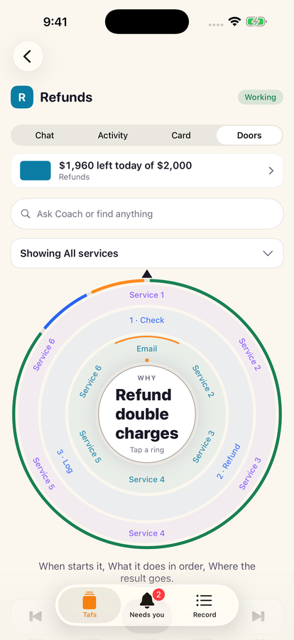
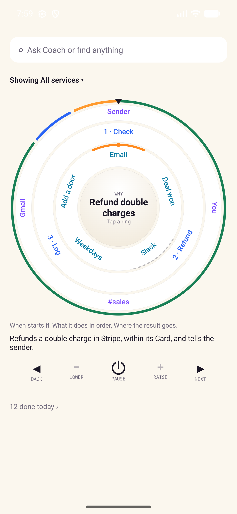
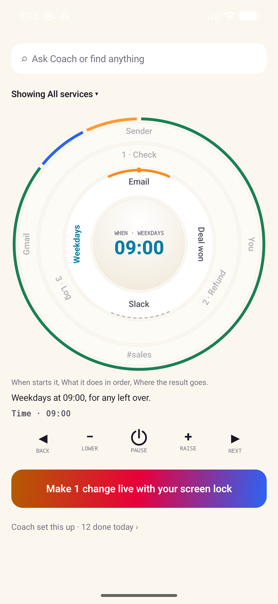
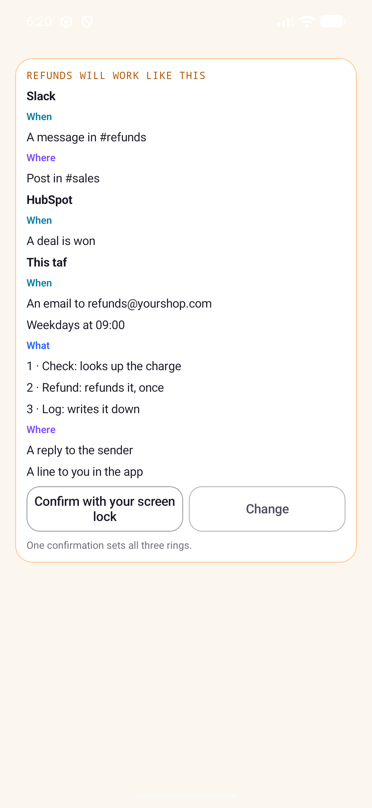

# The dial

**On Android the dial is replaced by the taf screen's Setup tab** (Starts when, Results go to,
its connected apps), as [android-app.md](android-app.md#the-tafs-screen) says; iPhone and iPad
follow. The routes and rules below stay the same.

Each taf has a dial, in its Doors tab, on iPhone and iPad. It shows how the taf
works on one screen, and changing it makes the taf's next version, which runs nothing
until the owner makes it live. This page says what the dial does for the person using
it. The routes are in [api.md](api.md) (`GET` and `PUT /v1/tafs/{id}/knob`,
`…/follow-ups/{fid}`, `…/requests/{run}`, `…/pause` and `…/resume`); the code is in
[ios-app.md](ios-app.md#the-dial-and-kiffs-words) and
[android-app.md](android-app.md#the-tafs-screen).

  
  
  
  

## Three rings around the Why

The same three rings are on every taf, inner to outer:

- **When** it starts: its doors (email, Slack, WhatsApp), its schedules, Run now, the
  follow-ups the taf set itself, and the connected apps' events it wakes on. The last stop
  is **Add a door**, for whoever manages the taf, which opens Coach: with the dial, a new
  door is made through Coach.
- **What** it does: its recipe, step by step, as Coach wrote it. A taf with no recipe shows
  one step that asks Coach.
- **Where** results go: back through the door, to the app, to the owner's email, or to an
  action in one of the taf's connected apps, such as a line in a page or a sheet. The taf
  makes that last kind itself, a call through KIFF inside its Card.

The face shows the taf's **Why**, its purpose in a few words. The rim counts today's
requests: done, working, retrying and needing you. Tapping the count opens a request
step by step: where it came from, each call by KIFF's title for the tool, a held call,
where the reply went, and how it ended or when it tries next.

**Showing** narrows the rings to one connected app, or to **This taf** (its own doors,
schedules, recipe and places). There's no limit on connections, triggers or places; a ring
with more than six stops shows them a page at a time. A word longer than its share of the
ring ends in "…"; the chosen stop shows it whole on the face, and VoiceOver and TalkBack read
it whole.

## Choosing and changing a stop

Choose a stop and its ring turns to the pointer; the face shows its value. What pressing
the face does depends on the stop: it opens or closes a door, runs the taf once, or
removes a follow-up. A held call that can be approved once can take the face too.

**An app's event needs your approval.** A stop for a connected app's event (a new deal, a
new ticket) shows what it will listen to, with its filters. Until you approve those filters
with Face ID, Touch ID or the fingerprint, the stop says it needs you and nothing wakes the
taf; once you have, the taf wakes only on events that match. See
[connect-apps.md](connect-apps.md#app-events-a-taf-that-wakes-on-something-in-an-app).

A stop with a size, such as a schedule's time or how often it runs, or a result place on
or off, has **−** and **+**. Each press moves to the next choice and sends it as the taf's
next version. The changes add up, marked **not live**, until **Make changes live**, which
switches to that version as any version is switched, with Face ID, Touch ID or the
fingerprint where the Card changes. A tweak alone never goes live. Adding something new
(an app, a step, a place) goes through Coach.

Only someone who manages the taf can change its dial.

## Coach's dial card

Coach can draft a dial change with its `taf_dial` tool. It shows in Coach's chat as a card
with the draft's lines, grouped by connection and This taf. **Confirm** makes it live;
**Change** goes back to Coach. A card whose draft has been replaced says so.

## Pause and follow-ups

**Pause** stops every schedule the dial keeps, and the follow-ups still to come, and the
taf stays paused until it's resumed, even when a new version goes live. If a schedule
couldn't be switched, pause says the taf may still wake, and asking again finishes it. A
taf that works from its chat has no schedule to pause, so ⏻ is off for it; a pause tafs
cloud refuses is said in its own words.

A follow-up is a one-off run the taf set itself ("check this refund again tomorrow at 9"):
once, within seven days, at most three waiting. It shows on When until it fires, and
whoever manages the taf can remove it from the face.
